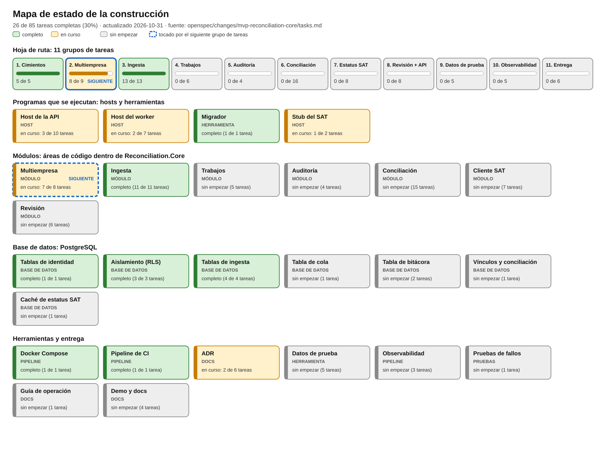

# Bitácora de construcción

Registro continuo de lo que se ha agregado al proyecto, para qué sirve cada pieza y qué idea de C# o de
herramientas enseña. Léela una vez de principio a fin y después actualízala con cada pull request.

English version: [BUILD-LOG.md](BUILD-LOG.md).

Fuente de verdad de los elementos de trabajo: `openspec/changes/mvp-reconciliation-core/tasks.md` (85 tareas en
11 grupos). Esta bitácora las explica; el mapa de estado de abajo se genera a partir de ellas.

## 1. Estado de un vistazo

**26 de 85 tareas completas. Grupo 3 completo; del grupo 2 solo queda 2.4 para decisiones reales del grupo 8.**
Regenera la imagen después de marcar tareas: `python3 tools/progress_diagram.py --lang es`
(sin `--lang es` genera la versión en inglés).

### Qué significa cada tipo

| Tipo | Qué es | Ejemplo aquí |
|---|---|---|
| **Host** | Un programa que sigue ejecutándose y atiende solicitudes o hace trabajo en segundo plano | API, worker, stub del SAT |
| **Módulo** | Un área de código dentro de la biblioteca compartida, con una responsabilidad de negocio | Conciliación, Auditoría |
| **Base de datos** | Tablas, reglas y seguridad que viven dentro de PostgreSQL | `company`, seguridad a nivel de fila |
| **Herramienta** | Un programa que se ejecuta una vez para hacer un trabajo y termina | Migrador, generadores de datos de prueba |
| **Pipeline** | Automatización que compila, prueba o arranca cosas | Docker Compose, CI |
| **Docs / Pruebas** | Decisiones escritas, o código que verifica al resto del código | ADR, pruebas xUnit |

## 2. Qué existe hoy

| Pieza | Tipo | Para qué sirve | Dónde |
|---|---|---|---|
| Archivo de solución | Compilación | Agrupa los seis proyectos para que un solo `dotnet build` compile todo | `Reconciliation.slnx` |
| Reglas de compilación compartidas | Compilación | Todos los proyectos usan la misma configuración: .NET 10, verificación de nulos, las advertencias son errores | `Directory.Build.props`, `.editorconfig`, `global.json` |
| **Biblioteca Core** | Área de módulos | El código que comparten ambos hosts. Contiene los límites de los siete módulos y el código común de base de datos y salud | `src/Reconciliation.Core` |
| **Host de la API** | Host | La API web que llamarán los usuarios. Ahora atiende autenticación, empresas, miembros, configuración, archivo, salud y OpenAPI | `src/Reconciliation.Api` |
| **Host del worker** | Host | Ejecuta trabajos en segundo plano (importaciones, conciliación, consultas al SAT). Hoy arranca, reporta su salud y espera | `src/Reconciliation.Worker` |
| **Migrador** | Herramienta | Aplica o revierte cambios de la base de datos (`up`, `down`) | `src/Reconciliation.Migrator` |
| **Stub del SAT** | Host | Una simulación del servicio de estatus del SAT para desarrollar sin cuenta real. Hoy es solo un marcador | `src/Reconciliation.SatStub` |
| **PostgreSQL 17** | Base de datos | Guarda todos los datos. Identidad, multiempresa y una `audit_entry` mínima con RLS forzado | `docker-compose.yml`, migraciones `M0001` a `M0004` |
| Docker Compose | Pipeline | Arranca base de datos, migrador, API, worker y stub con un solo comando y espera a que todos estén sanos | `docker-compose.yml`, `Dockerfile` |
| Pipeline de CI | Pipeline | En cada push: revisión de formato, compilación, pruebas, migraciones subir/bajar/subir y arranque completo del sistema | `.github/workflows/ci.yml` |
| ADR | Docs | Registros breves de las decisiones grandes y de las alternativas descartadas | `docs/adr/` |
| Requisitos y plan | Docs | BRS, SRS (inglés y español), diagramas y el cambio de OpenSpec que define el trabajo | `docs/`, `openspec/` |
| Pruebas | Pruebas | 103 casos xUnit: 100 aprobados, 3 pendientes explícitos; PostgreSQL real para multiempresa e ingesta | `tests/Reconciliation.Tests` |
| Mapa de progreso | Herramienta | Dibuja la imagen de estado a partir de `tasks.md` | `tools/progress_diagram.py` |

## 3. Registro de pull requests

Primero el más reciente. Cada entrada dice qué cambió, por qué y qué puedes aprender de ello.

### PR-3: Modelo de dominio e ingesta (3.1–3.8, incluidas 3.4b–3.4f)

**Para qué:** convertir CFDI sintéticos y CSV bancario de referencia en registros aislados, exactos y conservados.
**Cómo:** cada implementación sigue a su commit de pruebas rojas. La persistencia usa PostgreSQL real mediante
Testcontainers y el migrador real; los parsers también se prueban directamente con entradas inválidas y hostiles.
**Verificado:** compilación sin advertencias/errores, `dotnet test --solution Reconciliation.slnx` con 100 aprobados
 y 3 omitidos, revisión de formato, Compose compilado y sano, migraciones subir/bajar/subir en una base desechable
 y ambos mapas regenerados. No se hizo push.

#### Modelo, dinero exacto y RLS (3.2, 3.8)
- **Para qué:** aislar filas, conservar importes exactos y evitar duplicados.
- **Cómo:** M0004 agrega import_file, cfdi, cfdi_relation, cfdi_payment, cfdi_payment_doc, bank_account y bank_movement.
  Todas llevan company_id, RLS forzado y política. Claves foráneas compuestas impiden referencias a otra empresa.
  UUID es único por empresa; la identidad del movimiento incluye cuenta, fecha, descripción, abono/cargo y saldo.
  Dinero usa decimal / numeric(18,2), y tipos de cambio numeric(20,10).
- **Qué aprendí:** restricciones SQL protegen también contra errores del código. Tanto C# como PostgreSQL suman
  0.10 + 0.20 exactamente a 0.30.

#### XML seguro y valores fiscales declarados (3.3, 3.4, 3.4b–3.4e)
- **Para qué:** aceptar ingresos, egresos y complemento de pago 2.0 sin leer recursos externos ni alterar valores.
- **Cómo:** DTD y resolución externa están prohibidos; un recorrido acotado limita tamaño, nodos y profundidad.
  La aritmética de cabecera incluye descuentos, traslados y retenciones federales/locales, sin recalcular tasas.
  La muestra sintética importa con 1,939.27. Importes de conceptos con seis decimales se aceptan sin recalcularlos
  ni guardarlos por separado. Cabecera, pagos y saldos con más de dos decimales declarados se rechazan, incluidos
  ceros adicionales; el MVP trata otras monedas con dos decimales. Versiones antiguas del complemento se rechazan.
  Cada línea comprueba saldo anterior - pagado = restante y la continuidad entre parcialidades consecutivas presentes
  en la carga. Una inconsistencia se guarda marcada para revisión, sin rechazar el complemento. No se infieren
  parcialidades ausentes ni se exige haber importado la factura. Archivos rechazados o ajenos no afectan líneas válidas.
  Se guardan códigos de relación incluso desconocidos, indicador global/RFC genérico y fechas de emisión/timbrado.
  Ingesta conserva relaciones; no las aplica a importes pendientes.
- **Qué aprendí:** verificar valores declarados es distinto de recalcular reglas fiscales. Las fechas locales no
  llevan zona y admiten hasta seis dígitos fraccionarios; se rechaza más precisión para no cambiarla en PostgreSQL.

#### Reportes, originales y límites (3.4f, 3.5)
- **Para qué:** explicar el resultado de cada archivo y devolver originales byte por byte.
- **Cómo:** cada archivo tiene una fila import_file, agrupada por upload_id, sin tabla de lote. Se guarda estado,
  motivo y SHA-256; un rechazado conserva hash, no bytes. Un UUID repetido apunta al original y no lo reemplaza.
  Un bloqueo transaccional por empresa/UUID serializa duplicados concurrentes, respaldado por la restricción única.
  Un trigger impide cambiar originales/hashes o acortar conservación; no hay privilegio ni ruta DELETE.
  RetentionYears vale 10 por defecto, se valida al arrancar (mínimo 5, máximo conservador 100) y fija retained_until.
- **Decisiones con Claude:** MaxFileBytes=10 MiB, MaxUploadBytes=20 MiB, MaxFiles=20, MaxXmlNodes=100000 y MaxXmlDepth=64,
  configurables en Ingestion. Tamaño agregado o cantidad excesiva rechazan toda la carga antes de persistir (413/400).
  Un archivo demasiado grande o XML inválido/hostil solo rechaza ese archivo. Se cuentan bytes durante la lectura
  multipart, incluso sin Content-Length. Los bytes de un archivo grande se descartan mientras se calcula su hash;
  el buffer aceptado queda dentro del máximo agregado, que incluye cabeceras multipart. Lecturas y SQL reciben cancelación.
- **Qué aprendí:** cada archivo necesita su transacción para que uno inválido no revierta los demás. Se puede conservar
  el hash completo sin guardar contenido rechazado. El encadenamiento completo de auditoría sigue en el grupo 5.

#### Estados de cuenta de referencia (3.1, 3.6, 3.7)
- **Para qué:** tener un formato documentado y un punto de extensión para bancos reales.
- **Cómo:** docs/bank-csv-reference-format.md define cabecera, UTF-8, fechas ISO, centavos, comillas y ejemplos sintéticos
  que se ejecutan con IBankStatementParser. Se usa el lector CSV de la plataforma. Una línea inválida rechaza todo el
  archivo con número de línea y no crea cuenta ni movimientos parciales. Un banco desconocido informa reference.
  bank=reference y accountReference crean/reutilizan la cuenta por empresa/banco/etiqueta; no hay CRUD de cuentas.
  accountReference admite 1–40 letras/dígitos ASCII, espacios, guiones y guiones bajos; es etiqueta, nunca un número
  real completo (sugerencia: últimos cuatro dígitos). RASTREO tiene prioridad sobre REF; sin token la referencia es nula.
  Cargas traslapadas cuentan filas nuevas y repetidas; filas iguales con saldo distinto se conservan. También se guarda
  el original del estado de cuenta con hash.
- **Qué aprendí:** reutilizar el parser CSV evita errores con comillas y comas. Como decisión conservadora, se rechaza
  un archivo sin movimientos y cada línea debe tener exactamente un abono o cargo positivo.

#### API y cierre de escenarios de multiempresa
- **Para qué:** permitir importaciones a contador/administrador y lecturas al rol consulta.
- **Cómo:** todas las rutas validan membresía y X-Company-Id: POST /companies/{id}/imports/cfdi y /imports/bank-statement;
  GET /companies/{id}/imports/{uploadId}, /cfdi/{invoiceId}, /cfdi/{invoiceId}/xml, /imports/files/{fileId}/original y /banks.
  Los archivos usan el campo multipart files. El reporte conserva estados, motivos, ids y conteos de movimientos.
  El guardián descubre rutas, prepara casos exitosos, intenta ids de B bajo contexto válido A y compara todas las tablas
  de B antes/después. “Cross-company attempt in the test suite” ahora comprueba 404 con factura real de B; “Delete attempt”
  comprueba 405 y factura/original intactos. Se completan 2.6 y 2.9.
- **Qué aprendí:** un 404 solo demuestra aislamiento después de comprobar que el propietario sí puede leer el recurso.

**Aún omitidos:** “Viewer cannot decide” y “Different roles” esperan vínculos reales del grupo 8; “Tolerance changed”
espera corrida del grupo 6. La tarea 2.4 sigue sin marcar. Las importaciones son síncronas hasta los trabajos del grupo 4.

### PR-2: Multiempresa y acceso (grupo 2; seis tareas completas y tres pendientes)

**Para qué:** aislar cada empresa desde PostgreSQL, autenticar al usuario y permitir que administradores gestionen
acceso y configuración. Los identificadores y las credenciales de prueba son sintéticos.
**Cómo:** cada corte tuvo primero su commit de pruebas rojas y después el de implementación. Testcontainers ejecuta
el migrador real contra PostgreSQL 17; la aplicación entra como `cfdi_app`, sin superusuario ni BYPASSRLS.
**Verificado:** `dotnet build` sin advertencias ni errores, `dotnet test --solution Reconciliation.slnx` con 40 casos
aprobados y 5 omitidos explícitamente, `dotnet format --verify-no-changes`, Compose sano tras compilar y migraciones
subir/bajar/subir en una base desechable separada. También funcionó revertir hasta cero y volver a aplicar todo.

#### Transacciones y RLS forzado (2.1, 2.2)
- **Para qué:** olvidar un WHERE no debe revelar ni modificar filas de otra empresa.
- **Cómo:** `TenantContext.ExecuteAsync` fija la empresa con un parámetro local a la transacción. `company`,
  `membership` y la `audit_entry` mínima tienen RLS habilitado y forzado. Sin contexto no hay filas visibles y se
  registra el intento. API y worker usan el rol restringido; el migrador usa el propietario.
- **Qué aprendí:** `SET LOCAL` termina con la transacción y evita arrastrar contexto al reutilizar conexiones del
  pool. RLS y la verificación de membresía autenticada resuelven partes distintas; hacen falta ambas.

#### Credenciales y roles por empresa (2.3; 2.4 pendiente)
- **Para qué:** identificar al usuario y comprobar su rol actual en la empresa elegida.
- **Cómo:** PasswordHasher de Identity genera hashes PBKDF2 con sal aleatoria. Login emite JWT firmado con caducidad.
  La política de respaldo exige autenticación; solo salud, OpenAPI y login son anónimos. `X-Company-Id` debe coincidir
  con la ruta y una membresía. Las políticas consultan PostgreSQL en cada solicitud. Un endpoint exclusivo del host
  de pruebas verifica la política de contador; la gestión real de miembros verifica permisos de administrador.
- **Qué aprendí:** no guardar roles por empresa en el token evita permisos desactualizados después de un cambio.
  WebApplicationFactory permite probar la política sin publicar endpoints ficticios del dominio.

#### Alta, configuración y archivo (2.7, 2.8; 2.9 pendiente)
- **Para qué:** crear empresas, conservar su identidad y sus registros, y explicar los cambios.
- **Cómo:** el migrador crea opcionalmente un operador desde `OPERATOR_EMAIL` / `OPERATOR_PASSWORD`. Solo ese operador
  puede dar de alta empresa y primer administrador. El RFC se valida y un trigger impide cambiarlo. Una cuenta nueva
  requiere contraseña de 12 caracteres; una existente conserva su contraseña y recibe la misma forma de respuesta.
  Cambios de configuración guardan valores anteriores/nuevos y actor en la misma transacción. Archivar conserva las
  filas; no hay rutas DELETE. Denegar INSERT en auditoría demuestra que la configuración se revierte. El primer
  arranque Compose detectó que el migrador necesitaba la imagen de runtime ASP.NET para PasswordHasher; se corrigió.
- **Qué aprendí:** acción y auditoría deben compartir transacción. La auditoría mínima depende del grupo 5 para
  encadenamiento por hash, triggers de rechazo y el resto de su contrato.
- **Atajo de demo:** enviar la contraseña en el alta simplifica esta demo; producción usaría enlaces de invitación o
  restablecimiento y gestión de secretos. `.env.example` solo contiene marcadores, no credenciales de operadores.

#### Pruebas de aislamiento y ADR (2.5; 2.6 pendiente)
- **Para qué:** detectar tablas y rutas nuevas cuyo aislamiento todavía no se ha probado.
- **Cómo:** `information_schema` descubre tablas de empresa; se exige RLS habilitado/forzado y política. EndpointDataSource
  descubre rutas; cada ruta protegida debe tener caso exitoso, rechazo anónimo y rechazo entre empresas o de no operador.
  Se comparan las filas de B antes/después. Quitar deliberadamente `membership_isolation` produjo cuatro fallos, incluido
  el guardián de políticas; restaurarla devolvió la suite a verde. ADR-003 compara RLS, schema-per-company y
  database-per-company.
- **Qué aprendí:** quitar una política causa denegación por defecto; un 403 por sí solo no demuestra que exista la
  política. Por eso también se verifica la estructura de PostgreSQL.

**Pendientes explícitos:** 2.4, 2.6 y 2.9 siguen sin marcar. Cinco pruebas omitidas conservan los nombres exactos:
“Viewer cannot decide” y “Different roles” esperan vínculos reales del grupo 8; “Cross-company attempt in the test suite”
y “Delete attempt” esperan CFDI importados del grupo 3; “Tolerance changed” espera una corrida del grupo 6. Persistencia
y auditoría de configuración sí se prueban ahora; no se afirma el comportamiento de la corrida futura. Ninguna tarea
se marca completa por una prueba omitida.

### PR-1: Cimientos (tareas 1.1 a 1.5), commit `a10c3ab`

**Objetivo:** un proyecto que compila, arranca y se verifica automáticamente, antes de que exista cualquier
lógica de negocio.
**Verificado:** compilación limpia, 4 de 4 pruebas, revisión de formato limpia, los cuatro servicios sanos en
Docker, migración subir/bajar/subir en una base de datos real y la ejecución `41122200072` de GitHub Actions
terminó con éxito.

#### 3.1 Solución y configuración de compilación compartida (tarea 1.1)
- **Para qué:** un solo lugar define cómo se compila cada proyecto, así nadie repite configuración ni puede
  olvidarla.
- **Cómo:** `Directory.Build.props` se aplica automáticamente a todos los `.csproj` que están debajo.
  `TreatWarningsAsErrors` junto con `AnalysisLevel` hacen que los analizadores de código del compilador bloqueen
  el código descuidado.
- **Aprende:** una *solución* (`.slnx`) agrupa *proyectos*; un *proyecto* (`.csproj`) compila un ensamblado (un
  `.dll` o un programa). Dos analizadores ya nos enseñaron algo: renombrar el namespace `Shared` a `Common`
  (palabra reservada en VB) y usar `[LoggerMessage]` en lugar de logging con cadenas (más rápido y verificado en
  compilación).

#### 3.2 Biblioteca Core: módulos y código común (tarea 1.1)
- **Para qué:** aquí vivirán las reglas de negocio, en siete carpetas que coinciden con el diseño (Ingestion,
  Matching, Review, Audit, Tenancy, Sat, Jobs). La API y el worker la referencian, así que la lógica se escribe
  una sola vez.
- **Cómo:** cada módulo tiene una clase marcadora pequeña que implementa `IModule`
  (`src/Reconciliation.Core/Common/IModule.cs`). La regla del diseño es que los módulos se comunican por
  interfaces y nunca por las tablas de otro.
- **Aprende:** una `interface` es un contrato sin código; una *biblioteca de clases* es código sin `Main`,
  reutilizado por los programas.

#### 3.3 Verificación de salud y acceso a la base de datos (tarea 1.2)
- **Para qué:** una forma estándar de preguntar "¿el programa está vivo y llega a la base de datos?". Docker, CI y
  más adelante un balanceador de carga la usan.
- **Cómo:** `IDatabaseHealth` (interfaz) con `NpgsqlDatabaseHealth` (implementación) ejecuta `SELECT 1`.
  `MapHealth()` publica `GET /health` y responde 200 con `{"status":"ok","database":"up"}` o 503.
- **Aprende:**
  - *Inyección de dependencias:* `AddReconciliationDatabase` registra servicios una vez; ASP.NET se los entrega a
    quien los pida en un constructor. Las pruebas cambian la verificación real por una falsa.
  - Los *métodos de extensión* (`this IServiceCollection services`) agregan métodos a un tipo que no te pertenece.
  - Los *constructores primarios* (`class NpgsqlDatabaseHealth(NpgsqlDataSource dataSource)`) y los *records*
    (`record HealthResponse(...)`) eliminan código repetitivo.
  - `await using`, `async`/`await` y `CancellationToken` para llamadas a la base de datos sin bloquear.
  - Una ruta de *minimal API* es simplemente `app.MapGet("/health", ...)` (`HealthEndpoint.cs`).

#### 3.4 Host de la API (tarea 1.2)
- **Para qué:** el punto de entrada de los usuarios. Todo lo que haga la API REST se agrega a este programa.
- **Cómo:** `src/Reconciliation.Api/Program.cs` son cinco líneas con *top-level statements*: construir, registrar,
  mapear endpoints, ejecutar. `public partial class Program;` permite que las pruebas arranquen toda la app en
  memoria.
- **Aprende:** `WebApplication.CreateBuilder` / `Build` / `Run` es el ciclo de vida estándar de ASP.NET Core.

#### 3.5 Host del worker (tarea 1.2)
- **Para qué:** trabajo en segundo plano de larga duración que no debe bloquear las solicitudes web. También puede
  arrancarse varias veces para procesar trabajos en paralelo.
- **Cómo:** `JobLoop` es un `BackgroundService`: el host llama a `ExecuteAsync` al arrancar y cancela el token al
  detenerse. Hoy el ciclo solo escribe en el log y espera; el grupo 4 lo reemplaza por la cola de trabajos real.
- **Aprende:** servicios hospedados; métodos `partial` con el *generador de código* `[LoggerMessage]` (el
  compilador escribe el código de logging por ti).

#### 3.6 Migraciones de la base de datos (tarea 1.5)
- **Para qué:** los cambios de la base de datos son código versionado, así que todos los entornos reciben el mismo
  esquema y cualquier cambio se puede deshacer.
- **Cómo:** `M0001CompanyUserMembership` tiene `Up()` (crear) y `Down()` (borrar). La herramienta Migrator ejecuta
  `up` o `down` mediante FluentMigrator, que registra las versiones aplicadas en una tabla `VersionInfo`.
- **Notas del esquema:** el RFC se valida con un `CHECK` de la base de datos; las configuraciones tipo dinero usan
  `numeric(18,2)`, nunca punto flotante; `membership` une a un usuario con una empresa con un rol.
- **Aprende:** los *literales de cadena crudos* (`"""..."""`) contienen SQL de varias líneas; un programa devuelve
  un *código de salida* (0 correcto, distinto de 0 falla) para que los scripts y el CI reaccionen; una migración
  nunca debe editarse una vez compartida.

#### 3.7 Stub del SAT (tarea 1.2, marcador)
- **Para qué:** un sustituto del servicio real del SAT para poder construir y probar la consulta de estatus sin
  conexión.
- **Cómo:** una app ASP.NET vacía con `/health` y un 501 para todo lo demás. La tarea 7.2 la convierte en una
  simulación real.

#### 3.8 Imagen de Docker y Compose (tarea 1.2)
- **Para qué:** un solo comando le da a cualquiera el sistema completo, idéntico en cada máquina.
- **Cómo:** un `Dockerfile` con varios *targets* (`api`, `worker`, `migrator`, `sat-stub`). Compose arranca
  PostgreSQL, espera a que esté sano, ejecuta el migrador una vez y luego arranca el resto. Los contenedores corren
  con un usuario sin privilegios de root.
- **Aprende:** las *compilaciones en varias etapas* (imagen grande de SDK para compilar, imagen pequeña de runtime
  para ejecutar); `depends_on` con `service_healthy` y `service_completed_successfully` describen el orden de
  arranque.

#### 3.9 Pruebas (tareas 1.1 / 1.2)
- **Para qué:** demostrar que el endpoint de salud y los errores de configuración se comportan, ahora y después de
  cada cambio.
- **Cómo:** métodos xUnit `[Fact]`; `WebApplicationFactory<Program>` ejecuta la API real en memoria con una
  verificación de base de datos falsa (`HealthEndpointTests.cs`).
- **Aprende:** un *fixture* (`IClassFixture`) comparte entre pruebas una preparación costosa; los falsos mantienen
  las pruebas rápidas.

#### 3.10 CI y ADR (tareas 1.3, 1.4)
- **Para qué:** el CI ejecuta las mismas verificaciones en cada push para encontrar errores en minutos. Los ADR
  explican *por qué* se eligieron la estructura y el stack (monolito modular con worker; C# y PostgreSQL).
- **Aprende:** un pipeline son simplemente los comandos que ejecutarías a mano, escritos. Leer el ADR-002 muestra
  los compromisos entre TypeScript, Java, Go, PHP, Ruby y Elixir que llevaron a C#.

**Hallazgos para recordar de este PR**
- Una dependencia de FluentMigrator tenía una vulnerabilidad conocida. Como las advertencias son errores, la
  compilación se detuvo, y la solución fue fijar una versión corregida (`System.Security.Cryptography.Pkcs`
  10.0.14) en lugar de silenciar la advertencia.
- El primer andamiaje fue en TypeScript. Se descartó cuando el stack cambió a C#; nada dependía de él.

## 4. Siguiente trabajo: grupo 4, Trabajos

Mover los servicios síncronos de ingesta a la cola PostgreSQL conservando transacciones por empresa, resultados
por archivo e idempotencia. 2.4 espera decisiones reales del grupo 8; la prueba configuración/corrida espera el
grupo 6. El mapa conserva el grupo 2 en progreso de forma intencional.

## 5. El resto del camino

| Grupo | Agrega | Tipos principales |
|---|---|---|
| 3. Ingesta | Lectura segura de XML de CFDI y CSV bancario, con importación idempotente y verificaciones de documentos y saldos | Módulo, Base de datos |
| 4. Trabajos | Cola de trabajos en PostgreSQL: los workers toman trabajos sin chocar, reintentos, recuperación tras caídas | Módulo, Host, Base de datos |
| 5. Auditoría | Bitácora de solo agregar y encadenada por hash de cada acción, con una función de verificación | Módulo, Base de datos |
| 6. Conciliación | El pipeline de reglas que vincula movimientos con facturas, con motivos, notas de crédito, cancelaciones y fechas límite | Módulo |
| 7. Estatus SAT | El cliente del SAT con stub, caché, reintentos y reproducción, y luego el servicio real | Módulo, Host |
| 8. Revisión + API | Cola de revisión, decisiones, resúmenes, documento OpenAPI y una interfaz mínima | Módulo, API |
| 9. Datos de prueba | Anonimizador, generador de estados de cuenta, casos límite, semilla de demo y escaneo de fugas | Herramienta |
| 10. Observabilidad | Logs estructurados, trazas y métricas, pruebas de inyección de fallos, guía de operación | Pipeline, Docs |
| 11. Entrega | ADR del diseño en la nube, vistas de arquitectura, recorrido del README, recorrido grabado | Docs |

## 6. Cómo mantener esta bitácora al día

1. Termina un pull request y marca sus tareas en `tasks.md` (`- [x]`).
2. Ejecuta `python3 tools/progress_diagram.py` y `python3 tools/progress_diagram.py --lang es`, y haz commit de los
   nuevos `docs/progress/status-map*`.
3. Agrega una entrada "PR-n" en la sección 3 con la misma forma: objetivo y un bloque por pieza con Para qué,
   Cómo y Aprende.
4. Mueve la tabla de "Siguiente pull request" de la sección 4 al grupo siguiente.
5. La plantilla de pull request (`.github/pull_request_template.md`) pide exactamente esta información, así que la
   descripción se puede pegar en la bitácora.

## 7. Glosario breve

- **Host:** un programa que sigue ejecutándose (servidor web, worker en segundo plano).
- **Inyección de dependencias (DI):** el framework crea los objetos que tu clase necesita y se los pasa; son fáciles
  de reemplazar por falsos en las pruebas.
- **Migración:** un cambio versionado de la base de datos con `Up` y `Down`.
- **Seguridad a nivel de fila (RLS):** una función de PostgreSQL que filtra filas por política, aplicada por la
  propia base de datos.
- **Idempotente:** hacer lo mismo dos veces da el mismo resultado que hacerlo una vez (cargar el mismo archivo dos
  veces crea un solo registro).
- **ADR:** registro de decisión de arquitectura; una nota breve sobre una decisión y las alternativas descartadas.
- **Sano (healthy):** la verificación de salud del contenedor pasó, así que los servicios que dependen de él pueden
  arrancar.
