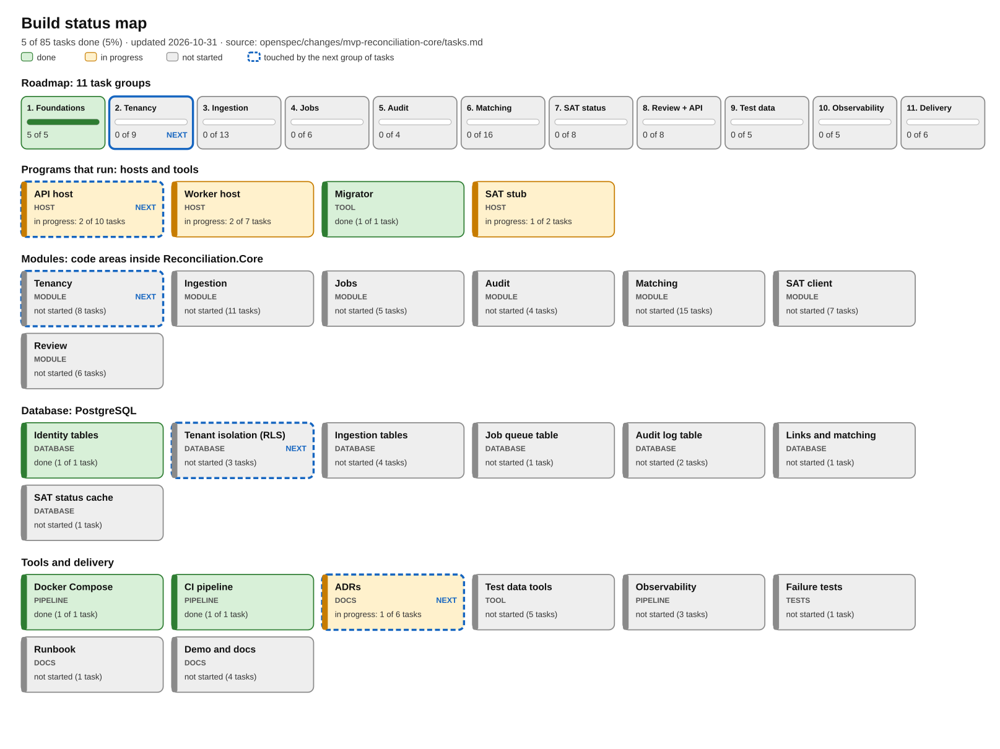

# Build log

A running record of what has been added to the project, what each piece is for, and what C# or tooling idea
it teaches. Read it top to bottom once, then update it with every pull request.

Versión en español: [BUILD-LOG-ES.md](BUILD-LOG-ES.md).

Source of truth for the work items: `openspec/changes/mvp-reconciliation-core/tasks.md` (85 tasks in 11 groups).
This log explains them; the status map below is generated from them.

## 1. Status at a glance

**5 of 85 tasks done (group 1, Foundations). Next: group 2, Tenancy and access.**
Regenerate the picture after ticking tasks: `python3 tools/progress_diagram.py` (add `--lang es` for the Spanish map).

### What the types mean

| Type | What it is | Example here |
|---|---|---|
| **Host** | A program that keeps running and answers requests or does background work | API, worker, SAT stub |
| **Module** | A code area inside the shared library, owning one business responsibility | Matching, Audit |
| **Database** | Tables, rules and security that live inside PostgreSQL | `company`, row-level security |
| **Tool** | A program you run once to do a job, then it exits | Migrator, test-data generators |
| **Pipeline** | Automation that builds, tests or starts things | Docker Compose, CI |
| **Docs / Tests** | Written decisions, or code that checks the other code | ADRs, xUnit tests |

## 2. What exists today

| Piece | Type | What it is used for | Where |
|---|---|---|---|
| Solution file | Build | Groups the six projects so one `dotnet build` builds everything | `Reconciliation.slnx` |
| Shared build rules | Build | Every project gets the same settings: .NET 10, nullable checks on, warnings are errors | `Directory.Build.props`, `.editorconfig`, `global.json` |
| **Core library** | Module area | The code both hosts share. Holds the seven module boundaries and the common database and health code | `src/Reconciliation.Core` |
| **API host** | Host | The web API users will call. Today it only answers `GET /health` | `src/Reconciliation.Api` |
| **Worker host** | Host | Runs background jobs (imports, matching, SAT checks). Today it starts, reports health and idles | `src/Reconciliation.Worker` |
| **Migrator** | Tool | Applies or reverts database changes (`up`, `down`) | `src/Reconciliation.Migrator` |
| **SAT stub** | Host | A fake of the SAT status service so development needs no real account. Today only a placeholder | `src/Reconciliation.SatStub` |
| **PostgreSQL 17** | Database | Stores all data. First tables: `company`, `app_user`, `membership` | `docker-compose.yml`, migration `M0001` |
| Docker Compose | Pipeline | Starts database, migrator, API, worker and stub with one command and waits until all are healthy | `docker-compose.yml`, `Dockerfile` |
| CI pipeline | Pipeline | On every push: format check, build, tests, migrations up/down/up, and a full stack start | `.github/workflows/ci.yml` |
| ADRs | Docs | Short records of big decisions and the alternatives rejected | `docs/adr/` |
| Requirements and plan | Docs | BRS, SRS (English and Spanish), diagrams, and the OpenSpec change that defines the work | `docs/`, `openspec/` |
| Tests | Tests | 4 xUnit tests: health answers 200/503, configuration errors are clear | `tests/Reconciliation.Tests` |
| Progress map | Tool | Draws the status picture from `tasks.md` | `tools/progress_diagram.py` |

## 3. Pull request log

Newest first. Each entry says what changed, why, and what you can learn from it.

### PR-1: Foundations (tasks 1.1 to 1.5), commit `a10c3ab`

**Goal:** a project that builds, starts and is checked automatically, before any business logic exists.
**Verified:** build clean, 4 of 4 tests, format check clean, all four services healthy in Docker, migration
up/down/up on a real database, and the GitHub Actions run `41122200072` succeeded.

#### 3.1 Solution and shared build settings (task 1.1)
- **Purpose:** one place defines how every project is built, so nobody has to repeat settings or can forget them.
- **How:** `Directory.Build.props` is picked up automatically by every `.csproj` underneath it.
  `TreatWarningsAsErrors` plus `AnalysisLevel` make the compiler's code analysers block sloppy code.
- **Learn:** a *solution* (`.slnx`) groups *projects*; a *project* (`.csproj`) builds one assembly (a `.dll` or program).
  Two analysers already taught us something: renaming the `Shared` namespace to `Common` (reserved word in
  VB), and using `[LoggerMessage]` instead of string logging (faster, checked at compile time).

#### 3.2 Core library: modules and common code (task 1.1)
- **Purpose:** the business rules will live here, in seven folders that match the design (Ingestion, Matching,
  Review, Audit, Tenancy, Sat, Jobs). The API and the worker both reference it, so logic is written once.
- **How:** each module has a small marker class implementing `IModule` (`src/Reconciliation.Core/Common/IModule.cs`).
  The rule from the design is that modules talk through interfaces and never through each other's tables.
- **Learn:** an `interface` is a contract without code; a *class library* is code with no `Main`, reused by programs.

#### 3.3 Health check and database access (task 1.2)
- **Purpose:** a standard way to ask "is the program alive and can it reach the database?". Docker, CI and later
  a load balancer all use it.
- **How:** `IDatabaseHealth` (interface) with `NpgsqlDatabaseHealth` (implementation) runs `SELECT 1`.
  `MapHealth()` publishes `GET /health` and answers 200 with `{"status":"ok","database":"up"}` or 503.
- **Learn:**
  - *Dependency injection:* `AddReconciliationDatabase` registers services once; ASP.NET hands them to whoever
    asks in a constructor. Tests swap the real check for a fake.
  - *Extension methods* (`this IServiceCollection services`) add methods to a type you do not own.
  - *Primary constructors* (`class NpgsqlDatabaseHealth(NpgsqlDataSource dataSource)`) and *records*
    (`record HealthResponse(...)`) remove boilerplate.
  - `await using`, `async`/`await` and `CancellationToken` for non-blocking database calls.
  - A *minimal API* route is just `app.MapGet("/health", ...)` (`HealthEndpoint.cs`).

#### 3.4 API host (task 1.2)
- **Purpose:** the entry point for users. Everything the REST API will do is added to this program.
- **How:** `src/Reconciliation.Api/Program.cs` is five lines using *top-level statements*: build, register,
  map endpoints, run. `public partial class Program;` lets tests start the whole app in memory.
- **Learn:** `WebApplication.CreateBuilder` / `Build` / `Run` is the standard ASP.NET Core life cycle.

#### 3.5 Worker host (task 1.2)
- **Purpose:** long-running background work that must not block web requests. It can also be started several
  times to process jobs in parallel.
- **How:** `JobLoop` is a `BackgroundService`: the host calls `ExecuteAsync` when it starts and cancels the token
  when it stops. Today the loop only logs and waits; group 4 replaces it with the real job queue.
- **Learn:** hosted services; `partial` methods with the `[LoggerMessage]` *source generator* (the compiler writes
  the logging code for you).

#### 3.6 Database migrations (task 1.5)
- **Purpose:** database changes are versioned code, so every environment gets the same schema and any change
  can be undone.
- **How:** `M0001CompanyUserMembership` has `Up()` (create) and `Down()` (drop). The Migrator tool runs
  `up` or `down` through FluentMigrator, which records applied versions in a `VersionInfo` table.
- **Schema notes:** the RFC is validated by a database `CHECK`; money-like settings use `numeric(18,2)`,
  never floating point; `membership` links a user to a company with a role.
- **Learn:** *raw string literals* (`"""..."""`) hold multi-line SQL; a program returns an *exit code*
  (0 ok, non-zero failure) so scripts and CI can react; migrations must never be edited once shared.

#### 3.7 SAT stub (task 1.2, placeholder)
- **Purpose:** a stand-in for the real SAT service so the status check can be built and tested offline.
- **How:** an empty ASP.NET app with `/health` and a 501 for everything else. Task 7.2 turns it into a real fake.

#### 3.8 Docker image and Compose (task 1.2)
- **Purpose:** one command gives anyone the whole system, identical on every machine.
- **How:** one `Dockerfile` with several *targets* (`api`, `worker`, `migrator`, `sat-stub`). Compose starts
  PostgreSQL, waits until it is healthy, runs the migrator once, then starts the rest. Containers run as a
  non-root user.
- **Learn:** *multi-stage builds* (big SDK image to build, small runtime image to run); `depends_on` with
  `service_healthy` and `service_completed_successfully` describe start-up order.

#### 3.9 Tests (task 1.1 / 1.2)
- **Purpose:** prove the health endpoint and the configuration errors behave, now and after every change.
- **How:** xUnit `[Fact]` methods; `WebApplicationFactory<Program>` runs the real API in memory with a fake
  database check (`HealthEndpointTests.cs`).
- **Learn:** a *fixture* (`IClassFixture`) shares expensive setup between tests; fakes keep tests fast.

#### 3.10 CI and ADRs (tasks 1.3, 1.4)
- **Purpose:** CI runs the same checks on every push so mistakes are found within minutes. The ADRs explain *why*
  the structure and the stack were chosen (modular monolith with a worker; C# and PostgreSQL).
- **Learn:** a pipeline is just the commands you would run by hand, written down. Reading ADR-002 shows the
  trade-offs between TypeScript, Java, Go, PHP, Ruby and Elixir that led to C#.

**Findings worth remembering from this PR**
- A dependency of FluentMigrator had a known vulnerability. Because warnings are errors the build stopped, and the
  fix was to pin a patched version (`System.Security.Cryptography.Pkcs` 10.0.14) instead of silencing the warning.
- The first scaffold was TypeScript. It was discarded when the stack changed to C#; nothing depended on it.

## 4. Next pull request: PR-2, Tenancy and access (group 2, 9 tasks)

**Goal:** make the system multi-company and safe: a company's data can never leak to another company, even if a
developer forgets a filter. This is the foundation every later group builds on.

| Task | New piece | Type | Why it is needed | You will learn (planned approach) |
|---|---|---|---|---|
| 2.1 | Transaction wrapper that sets the company context | Module (Tenancy) | Every request and job runs in one transaction that tells the database which company it acts for | Scoped services, `NpgsqlTransaction`, ASP.NET middleware, PostgreSQL `set_config` |
| 2.2 | Row-level security policies and a restricted database role | Database | The database itself hides other companies' rows; the app's role must not be able to bypass it (the current Compose user is a superuser, which would bypass it) | Migration `M0002` in SQL: `ENABLE`/`FORCE ROW LEVEL SECURITY`, `CREATE POLICY`, roles |
| 2.3 | Authentication: password hashing and tokens | Module + API | Know who is calling; refuse anonymous requests | `PasswordHasher`, JWT bearer tokens, `RequireAuthorization()` |
| 2.4 | Roles per company (administrator, accountant, viewer) | Module | Different people may do different things in each company | Authorization policies and claims |
| 2.5 | ADR-003: tenant isolation | Docs | Records why row-level security beat schema-per-company or database-per-company | Writing a decision record |
| 2.6 | Cross-company isolation tests | Tests | Fail the build if any endpoint leaks data; also fail if a policy is removed | Testcontainers: a real PostgreSQL started by the test |
| 2.7 | Company creation by a platform operator, immutable RFC | API + Database | Companies need an RFC; only an operator may create them | Validation, `Results.Created`, 403 responses |
| 2.8 | Company settings (tolerances, due-date rule) with audit of changes | API + Module | Administrators tune matching without code changes | `PATCH` endpoints, optimistic checks |
| 2.9 | No deletion of imported data; archive companies | Module + Database | Accounting records must be kept | Soft delete with `archived_at` |

**What the map will show afterwards:** Tenancy and Tenant isolation turn green, API host and Migrator gain
progress, and ADRs move one step closer to done.

## 5. The rest of the road

| Group | Adds | Main types |
|---|---|---|
| 3. Ingestion | Reading CFDI XML and bank CSV safely, with idempotent import and the document and balance checks | Module, Database |
| 4. Jobs | PostgreSQL job queue: workers claim jobs without clashes, retries, recovery from crashes | Module, Host, Database |
| 5. Audit | Append-only, hash-chained log of every action, with a verification function | Module, Database |
| 6. Matching | The rule pipeline that links movements to invoices, with reasons, credit notes, cancellations and due dates | Module |
| 7. SAT status | The SAT client with stub, cache, retries and replay, then the real service | Module, Host |
| 8. Review + API | Review queue, decisions, summaries, OpenAPI document and a minimal UI | Module, API |
| 9. Test data | Anonymiser, statement generator, edge cases, demo seed and leak scan | Tool |
| 10. Observability | Structured logs, traces and metrics, failure-injection tests, runbook | Pipeline, Docs |
| 11. Delivery | Cloud-design ADR, architecture views, README tour, recorded walkthrough | Docs |

## 6. How to keep this log current

1. Finish a pull request and tick its tasks in `tasks.md` (`- [x]`).
2. Run `python3 tools/progress_diagram.py` and `python3 tools/progress_diagram.py --lang es`, and commit the new `docs/progress/status-map*` files.
3. Add a "PR-n" entry in section 3 using the same shape: goal, one block per piece with Purpose, How, Learn.
4. Move the "Next pull request" table in section 4 to the following group.
5. The pull request template (`.github/pull_request_template.md`) asks for exactly this information, so the
   description can be pasted into the log.

## 7. Small glossary

- **Host:** a program that keeps running (web server, background worker).
- **Dependency injection (DI):** the framework creates the objects your class needs and passes them in; easy to
  replace with fakes in tests.
- **Migration:** a versioned database change with `Up` and `Down`.
- **Row-level security (RLS):** a PostgreSQL feature that filters rows by policy, enforced by the database.
- **Idempotent:** doing the same thing twice has the same result as doing it once (uploading the same file twice
  creates one record).
- **ADR:** architecture decision record; a short note on a decision and the alternatives rejected.
- **Healthy:** the container's health check passed, so dependent services may start.
