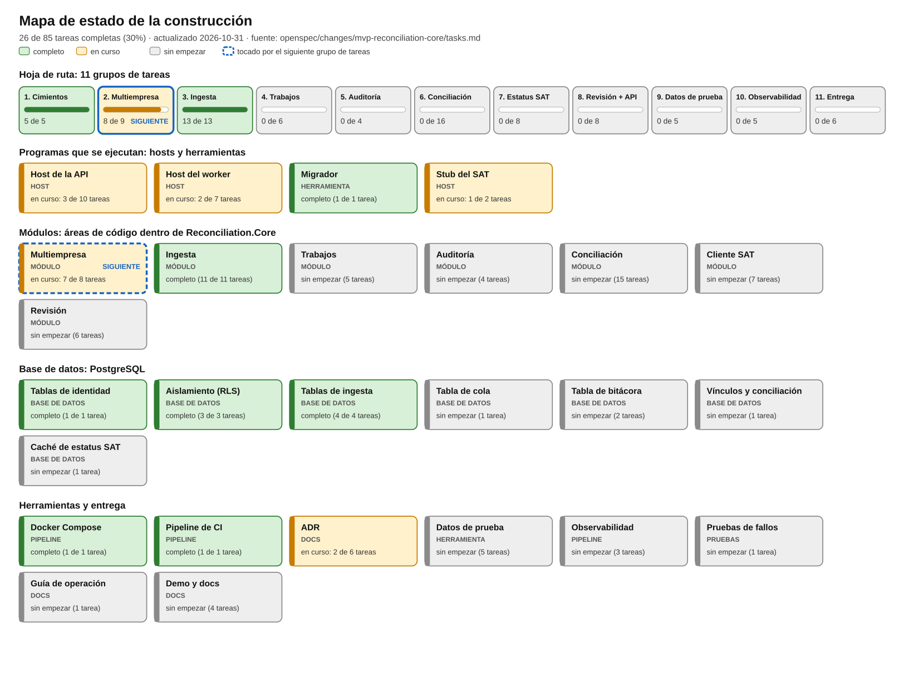
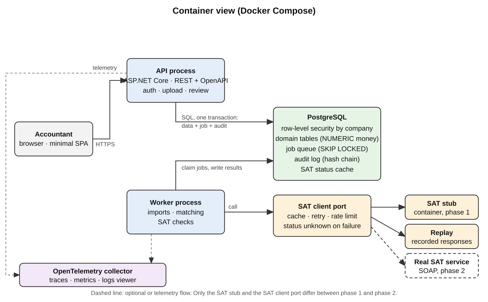
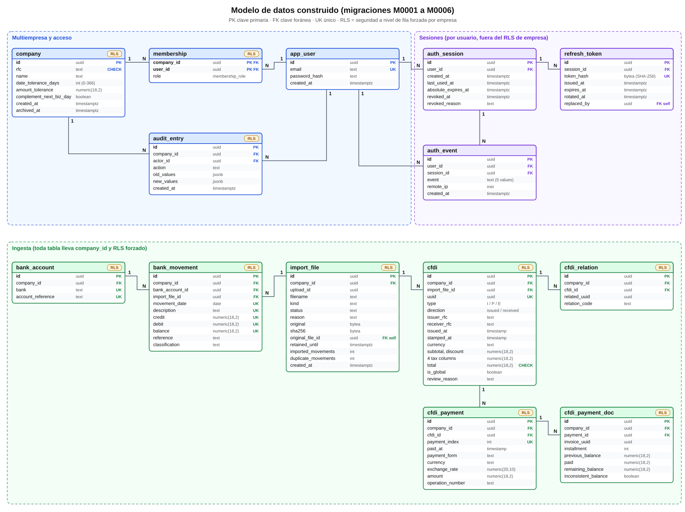
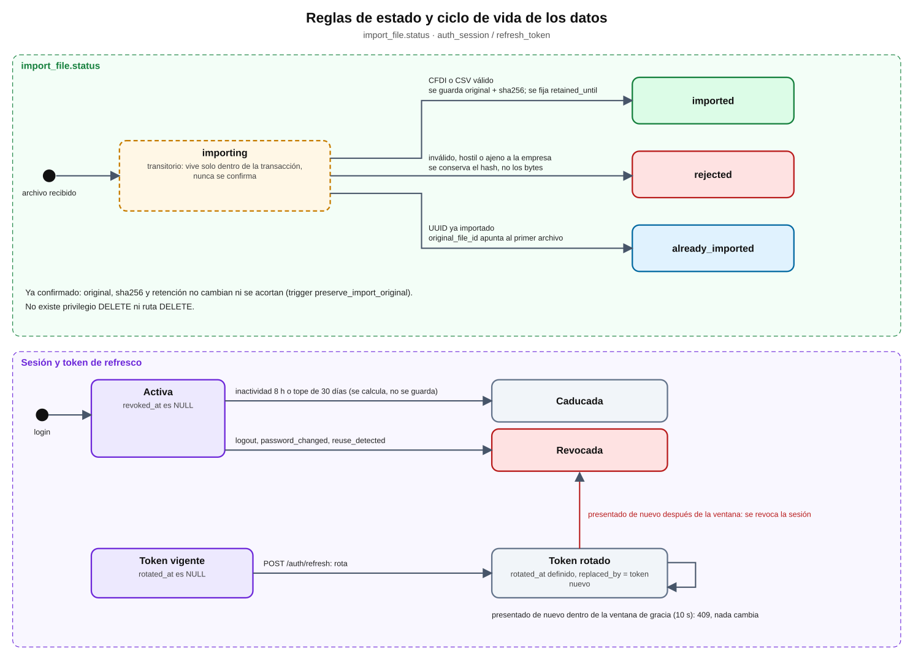
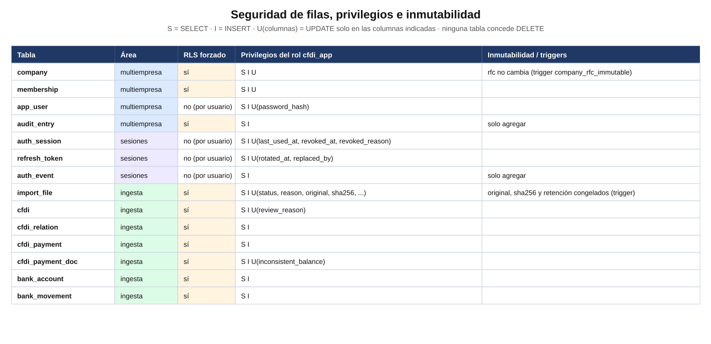

# Bitácora de construcción

Registro continuo de lo que se ha agregado al proyecto: qué es cada pieza, cómo funciona por dentro, qué significan
los nombres y variables que aparecen en el código, por qué se eligió así y qué idea de C#, PostgreSQL o de
herramientas enseña. Léela una vez de principio a fin y después actualízala con cada pull request.

English version: [BUILD-LOG.md](BUILD-LOG.md). Los PDF/Word exportados están en [`exports/`](exports/).

Fuente de verdad de los elementos de trabajo: `openspec/changes/mvp-reconciliation-core/tasks.md` (85 tareas en
11 grupos). Esta bitácora las explica; el mapa de estado de abajo se genera a partir de ellas.

## Cómo está organizada la documentación

| Carpeta | Qué contiene | Por qué está separada |
|---|---|---|
| `docs/adr/` | Registros de decisiones de arquitectura (ADR-001 a ADR-004) | Una decisión = un archivo; nunca se editan, se reemplazan por otro ADR |
| `docs/build-log/` | Esta bitácora en español e inglés, y `exports/` con los PDF/Word generados | Lo que se actualiza en cada PR; los exportados no se mezclan con el texto fuente |
| `docs/requirements/` | BRS y SRS (inglés y español) | Documentos de requisitos que casi no cambian |
| `docs/reference/` | Formato CSV bancario de referencia y la ficha del proyecto con enlaces de consulta | Material de consulta que las pruebas leen o que se cita |
| `docs/diagrams/` | Diagramas de base de datos, de roles y el mapa de progreso (`progress/`) | Imágenes generadas o dibujadas, con su `.svg` fuente |
| `openspec/` | La especificación y las tareas del cambio `mvp-reconciliation-core` | Fuente de verdad del alcance |

Regla práctica: antes de borrar o mover un archivo de `docs/`, busca su nombre con `grep -rn` (varias pruebas xUnit
leen `docs/adr/`, `docs/reference/` y `docs/build-log/`), y usa `git mv` para conservar el historial.

## 1. Estado de un vistazo



**26 de 85 tareas completas. Grupo 3 completo; del grupo 2 solo queda 2.4 para decisiones reales del grupo 8.**
Regenera la imagen después de marcar tareas: `python3 tools/progress_diagram.py --lang es`
(sin `--lang es` genera la versión en inglés).

### Qué significa cada tipo

| Tipo | Qué es | Ejemplo aquí |
|---|---|---|
| **Host** | Un programa que sigue ejecutándose y atiende solicitudes o hace trabajo en segundo plano | API, worker, stub del SAT |
| **Módulo** | Un área de código dentro de la biblioteca compartida, con una responsabilidad de negocio | Conciliación, Auditoría |
| **Base de datos** | Tablas, reglas y seguridad que viven dentro de PostgreSQL | `company`, seguridad a nivel de fila |
| **Herramienta** | Un programa que se ejecuta una vez para hacer un trabajo y termina | Migrador, generadores de datos de prueba |
| **Pipeline** | Automatización que compila, prueba o arranca cosas | Docker Compose, CI |
| **Docs / Pruebas** | Decisiones escritas, o código que verifica al resto del código | ADR, pruebas xUnit |

## 2. Arquitectura

### 2.1 Vista general: qué está construido hoy

```
 Cliente HTTP (curl, navegador, pruebas)
        |  HTTPS + cabecera "Authorization: Bearer <JWT>" + "X-Company-Id: <uuid>"
        v
 +--------------------------+        +-----------------------------+
 | Host API (ASP.NET Core)  |        | Host Worker (BackgroundSvc) |
 | puerto 3000 (8080 fuera) |        | puerto 3001 (solo interno)  |
 +------------+-------------+        +--------------+--------------+
              |   ambos referencian la misma biblioteca           |
              +---------------+---------------+-------------------+
                              v
              +-------------------------------+
              | Reconciliation.Core           |   Tenancy | Ingestion | Audit
              | (siete módulos, sin Main)     |   Matching | Review | Sat | Jobs
              +---------------+---------------+   (los últimos cuatro son marcadores)
                              | SQL con Npgsql + Dapper, CompanyScope para empresa; auth global
                              v
              +-------------------------------+        +----------------------+
              | PostgreSQL 17                 |        | Migrador (una vez)   |
              | RLS forzado por empresa       |<-------| crea tablas, rol y   |
              | rol de la app: cfdi_app       |        | operador inicial     |
              +-------------------------------+        +----------------------+

 Stub del SAT (puerto 8081): contenedor aparte, hoy solo /health.
```

Cada flecha es una frontera con una razón de ser:

- **Dos hosts, una biblioteca.** La API atiende personas y debe responder rápido; el worker hará tareas largas
  (conciliar, consultar al SAT). Comparten `Reconciliation.Core`, así la regla de negocio se escribe una sola vez
  (ADR-001: monolito modular con worker separado, en lugar de microservicios).
- **Módulos con fronteras.** `Tenancy` (empresas, usuarios, roles, sesiones), `Ingestion` (lectura de CFDI y CSV), `Audit`
  (bitácora), y los marcadores `Matching`, `Review`, `Sat`, `Jobs` que se llenarán en los grupos 4 a 8. Un módulo
  habla con otro por interfaces, nunca leyendo las tablas ajenas.
- **PostgreSQL como árbitro final.** Aunque el código olvide filtrar por empresa, la base de datos no entrega filas
  de otra empresa (sección 2.3).
- **El migrador es un programa aparte** con otro rol de base de datos: el dueño del esquema (`cfdi`) crea y cambia
  tablas; la aplicación (`cfdi_app`) solo puede lo que se le concede.

El diseño completo, incluido lo que aún no existe (cola de trabajos, cliente SAT, telemetría), es este:



Lo construido hasta ahora es la caja *API process*, el *Worker* (solo arranca y reporta salud), *PostgreSQL* con el
aislamiento por empresa y las tablas de ingesta, y el *SAT stub* como marcador. Faltan la cola de trabajos
(`SKIP LOCKED`), la cadena de hash de auditoría, el puerto del cliente SAT y OpenTelemetry.

### 2.2 Ciclo de una solicitud autenticada

Ejemplo: un contador sube una factura con `POST /companies/{companyId}/imports/cfdi`.

1. **Login.** El cliente llama `POST /auth/tokens` con `{"email","password"}`. Antes de tocar la base,
   `LoginProtection` lee el cuerpo (máximo 8 KiB), normaliza el correo (recortar y pasar a mayúsculas) y aplica dos
   límites de ventana fija: 10 intentos por minuto por correo y 30 por minuto por IP; al excederlos responde 429 con
   `Retry-After`. Luego busca al usuario sin distinguir mayúsculas y hace **exactamente una** verificación PBKDF2: contra
   su hash real o, si el correo no existe, contra un hash ficticio (`DummyPasswordHash`) creado una vez al arrancar, así
   el tiempo de respuesta no revela qué correos existen. Si coincide, devuelve un JWT firmado (HMAC-SHA256) válido 15 minutos con los claims `sub`, `sid` y `jti`.
2. **Solicitud.** El cliente envía el archivo con `Authorization: Bearer <token>` y `X-Company-Id: <uuid>`.
3. **Autenticación.** ASP.NET valida firma, emisor, audiencia y caducidad. Si falla, responde 401.
4. **Autorización por empresa.** `CompanyRoleHandler` exige que el `X-Company-Id` coincida con el `{companyId}` de la
   ruta, abre una transacción con ese contexto y lee de `membership` el rol del usuario. La política `accountant`
   acepta administrador y contador; consulta (`viewer`) recibe 403.
5. **Contexto de empresa.** `CompanyScope.ExecuteAsync` abre una conexión, inicia una transacción y ejecuta
   `set_config('app.company_id', <uuid>, true)`; el `true` hace que valga solo dentro de esa transacción. En
   operaciones de escritura, en el mismo lote de comandos (`NpgsqlBatch`) toma un bloqueo de la fila de la empresa
   (`SELECT archived_at IS NOT NULL FROM company FOR UPDATE`): si la empresa está archivada lanza
   `CompanyReadOnlyException` y la API responde 409; el bloqueo también serializa cambios simultáneos (por ejemplo, dos
   degradaciones de administradores a la vez).
6. **Trabajo.** El importador lee y valida el archivo, e inserta filas; cada consulta pasa por las políticas RLS.
7. **Cierre.** Si todo salió bien, `COMMIT`; si algo falla, `ROLLBACK` y no queda nada a medias. La respuesta es un
   `ImportReport` con un resultado por archivo. Un error inesperado pasa por `UseExceptionHandler` y se devuelve como
   `ProblemDetails` con un mensaje seguro, sin detalles internos; si ya se habían confirmado algunos archivos, el error
   incluye el `uploadId` para consultar el reporte parcial.

### 2.2a Renovación de sesión

`add-session-renewal` se sigue aparte de las 85 tareas del MVP. No agrega rutas de datos por empresa ni cambia su
contrato Bearer. La API entrega un JWT de 15 minutos y una credencial base64url de 256 bits; solo se guarda su
SHA-256 `token_hash`. `sub` identifica al usuario, `sid` a la familia y `jti` al token de acceso. `SessionService`
usa `TimeProvider` inyectado para emisión, validación, plazos y eventos. `SessionOptions` se valida al arrancar.
`CompanyRoleHandler` sigue consultando membership en cada petición; los roles quedan fuera de tokens y sesiones.

1. Login verifica el hash lento con sal e inserta familia, digest de renovación y evento `login` en una transacción.
2. La renovación busca el digest, bloquea `auth_session` con `SELECT ... FOR UPDATE`, vuelve a leer el token y lo rota
   junto con `refresh`. Actualiza `last_used_at`; el vencimiento nuevo es el menor entre inactividad y el tope original.
3. Reutilizar hasta el límite inclusivo de gracia devuelve 409 sin cambios. Después revoca la familia y registra
   `reuse_detected`; otros dispositivos siguen activos. El cliente coordina una renovación single-flight.
4. Logout revoca la familia propia. Cambiar contraseña verifica la actual, genera el hash nuevo y revoca todas las
   sesiones de ese usuario junto con `password_changed`, atómicamente. Los eventos son append-only para `cfdi_app`.
5. El acceso sigue sin estado hasta caducar; no se añade consulta de sesión a peticiones por empresa. La cookie
   opcional HttpOnly/Secure/SameSite=Strict usa Path=/auth y exige un Origin permitido al renovar; JSON sigue por
   defecto. Login conserva límites por correo/IP; refresh y logout comparten un límite IP con nombre. Ver ADR-004.

### 2.3 Capas de seguridad (defensa en profundidad)

| Capa | Qué impide | Dónde vive | Cómo se prueba |
|---|---|---|---|
| Límite de intentos de login | Fuerza bruta y relleno de credenciales | `LoginProtection.cs` | `ReviewHardeningTests` |
| Autenticación JWT | Solicitudes anónimas | `Authentication.cs`, política de respaldo | `AuthenticationTests` |
| Membresía y rol por empresa | Usar una empresa donde no se tiene rol, o una acción no permitida al rol | `CompanyRoleHandler.cs` | `MembershipTests`, `IsolationTests` |
| Transacción con contexto | Consultas sin empresa asignada | `CompanyScope.cs` | `CompanyScopeTests` |
| Empresa archivada de solo lectura | Escribir en una empresa archivada o dejar sin administradores por carreras | `CompanyScope.cs` (bloqueo de fila) | `ReviewHardeningTests` |
| RLS forzado en PostgreSQL | Ver o escribir filas de otra empresa aunque falte un `WHERE` | Migraciones `M0002` y `M0004` | Guardián de aislamiento sobre todas las tablas y rutas |
| Claves foráneas compuestas | Que una fila apunte a un registro de otra empresa | `FOREIGN KEY (company_id, x_id)` | `IngestionDatabaseTests` |
| Rol sin privilegios | Saltarse RLS, borrar datos | `cfdi_app`: sin superusuario, sin `BYPASSRLS`, sin `DELETE` | Pruebas que usan el rol real |
| Lectura segura de XML | Ataques XXE y archivos "bomba" | `SafeCfdiXmlReader.cs` | `SafeXmlTests` |
| Límites de entrada | Archivos o CSV desmesurados; nombres de archivo hostiles | `IngestionOptions`, `MultipartUpload.cs` | `ReviewHardeningTests`, `IngestionHttpTests` |
| Descargas y errores seguros | Que el navegador interprete un original; filtrar detalles internos | `Content-Disposition: attachment`, `nosniff`, `ProblemDetails` | `ReviewHardeningTests` |

Por qué varias capas: cada una cubre un fallo distinto. Un 403 no demuestra que exista la política RLS, y una política
RLS no identifica al usuario; por eso hacen falta ambas y pruebas para cada una.

### 2.4 Ciclo de una importación

```
 multipart (files, bank, accountReference)
   -> MultipartUpload: cuenta bytes al leer, limpia nombres de archivo (413/400)
   -> por archivo: SafeCfdiXmlReader (una sola lectura acotada) -> CfdiParser -> ¿es de la empresa?
   -> por archivo, UNA transacción propia:
        import_file en estado 'importing' (solo metadatos, privada a la transacción)
        -> filas en lotes (CFDI, pagos, relaciones; movimientos en bloques de 5000)
        -> se finaliza una vez: original + hash validado -> 'imported' -> audit
   -> ImportReport { upload_id, archivos[ estado, motivo, ids ] }
```

El punto clave es "una transacción por archivo": si el tercer archivo de diez es inválido, los otros nueve se
importan y el tercero queda como `rejected` con su motivo. Todos los archivos de una subida comparten `upload_id`
(un UUID nuevo por subida) para poder pedir luego el reporte completo. La fila transitoria `importing` nunca se
confirma: como vive solo dentro de la transacción, los bytes del original (hasta 10 MiB) se escriben y se verifican una
sola vez, en lugar de recalcular el hash cada vez que se actualiza un contador.

### 2.5 Modelo de datos

| Tabla | Para qué existe | Columnas clave |
|---|---|---|
| `company` | Cada cliente (empresa) del sistema | `rfc` (inmutable, validado), `date_tolerance_days` (0–366), `amount_tolerance`, `archived_at` |
| `app_user` | Personas que inician sesión | `email` (único sin distinguir mayúsculas), `password_hash` |
| `membership` | Une usuario, empresa y rol | PK `(company_id, user_id)`, `role` (`administrator`, `accountant`, `viewer`) |
| `audit_entry` | Qué hizo quién y cuándo | `actor_id`, `action`, `old_values`, `new_values` (jsonb) |
| `import_file` | Un archivo subido y su resultado | `upload_id`, `status`, `reason`, `original` (bytes), `sha256`, `retained_until`, `original_file_id` |
| `cfdi` | Una factura importada | `uuid`, `type` (I/P/E), `direction`, importes `numeric(18,2)`, `is_global`, `review_reason` |
| `cfdi_relation` | Relaciones entre CFDI (por ejemplo, nota de crédito) | `related_uuid`, `relation_code` |
| `cfdi_payment`, `cfdi_payment_doc` | Complemento de pago y las facturas que liquida | `payment_index`, `installment`, `previous_balance`, `paid`, `remaining_balance` |
| `bank_account` | Cuenta bancaria identificada por etiqueta | `bank`, `account_reference` |
| `bank_movement` | Un renglón del estado de cuenta | `movement_date`, `credit`, `debit`, `balance`, `reference` |

Convenciones que se repiten en todas las tablas de empresa: `id uuid` generado por la base; `company_id` obligatorio;
RLS habilitado **y** forzado; claves foráneas compuestas; dinero en `numeric(18,2)`, nunca `double` ni `float`; índices
que empiezan por `company_id` (`M0005`) para que cada consulta de una empresa recorra solo sus filas.

El esquema construido (migraciones M0001 a M0006), dibujado a partir de las propias migraciones:



Azul es multiempresa, morado son sesiones (por usuario, fuera del RLS de empresa) y verde es ingesta; la etiqueta naranja
`RLS` marca las tablas con seguridad a nivel de fila forzada. Los dos diagramas siguientes muestran las reglas de estado
de los datos y quién puede hacer qué:





El modelo original de diseño (tablas planeadas para todo el MVP) sigue en `docs/diagrams/database/database-erd.png`.
Regenera los tres diagramas construidos con `python3 tools/db_diagrams.py` (agrega `--lang es` para español).

### 2.6 Persistencia de autenticación por usuario

Los diagramas de empresa/ingesta describen su modelo multiempresa. M0006 añade estas tablas globales por usuario,
fuera del RLS por empresa: no tienen `company_id` ni usan `CompanyScope`. Se conservan políticas y nombres SQL existentes.

| Tabla | Campos y propósito |
|---|---|
| `auth_session` | `id`, `user_id`, `created_at`, `last_used_at`, `absolute_expires_at`, `revoked_at`, `revoked_reason`: un dispositivo/familia |
| `refresh_token` | `id`, `session_id`, `token_hash`, `issued_at`, `expires_at`, `rotated_at`, `replaced_by`: digest/plazo inmutables y enlace de rotación |
| `auth_event` | `id`, `user_id`, `session_id`, `event`, `remote_ip`, `created_at`: eventos de login/refresh/reutilización/logout/contraseña, sin credenciales |

Los índices cubren digest único, familia y usuario. `cfdi_app` tiene SELECT/INSERT y UPDATE solo en columnas mutables
concretas, sin DELETE ni UPDATE de eventos. `app_user` recibe únicamente UPDATE(password_hash). Down elimina las tablas
nuevas y ese permiso. Los tiempos de sesión son UTC explícitos de TimeProvider. El grupo 5 integrará los eventos en la
auditoría encadenada; la purga espera a trabajos. El acceso emitido puede sobrevivir a la revocación hasta su caducidad.

## 3. Diccionario de nombres y variables

### 3.1 Variables de entorno y configuración

| Nombre | Valor de ejemplo | Quién lo lee | Qué significa |
|---|---|---|---|
| `ConnectionStrings__Default` | `Host=postgres;Port=5432;Username=cfdi_app;...` | API, worker, migrador | Cadena de conexión a PostgreSQL. El doble guion bajo es cómo .NET escribe `ConnectionStrings:Default` en una variable de entorno. API y worker usan el rol `cfdi_app`; el migrador usa el dueño `cfdi` |
| `APP_DB_PASSWORD` | marcador sintético | Migrador y Compose | Contraseña con la que el migrador activa el login del rol `cfdi_app` (`ALTER ROLE ... LOGIN PASSWORD`) |
| `Jwt__SigningKey` / `JWT_SIGNING_KEY` | al menos 32 bytes aleatorios | API | Clave secreta con la que se firman y verifican los tokens. Si falta, es corta o es el antiguo valor público de ejemplo, la API no arranca. Compose **exige** `JWT_SIGNING_KEY` (ya no hay valor por defecto) y se la entrega a la API como `Jwt__SigningKey`; genérala con `openssl rand -hex 32` |
| `OPERATOR_EMAIL`, `OPERATOR_PASSWORD` | opcionales; contraseña de 12+ caracteres | Migrador (`up`) | Si existen, se crea una sola vez el operador de plataforma; nunca se restablece la contraseña de uno existente (solo se registra que no se modificó) |
| `Ingestion__MaxFileBytes` | 10485760 (10 MiB) | Ingesta | Tamaño máximo de un archivo. Uno mayor se rechaza solo a él |
| `Ingestion__MaxUploadBytes` | 20971520 (20 MiB) | Ingesta | Tamaño máximo de toda la subida, contando cabeceras multipart. Excederlo rechaza toda la carga (413) |
| `Ingestion__MaxFiles` | 20 | Ingesta | Cantidad máxima de archivos por subida (400 si se excede) |
| `Ingestion__MaxXmlNodes` | 100000 | Ingesta | Nodos y atributos XML máximos; frena archivos "bomba" |
| `Ingestion__MaxXmlDepth` | 64 | Ingesta | Profundidad máxima de anidación XML |
| `Ingestion__MaxStatementLines` | 100000 | Ingesta | Filas máximas de un estado de cuenta; excederlas rechaza ese archivo completo con su motivo |
| `Ingestion__MaxDescriptionLength` | 500 | Ingesta | Caracteres máximos del concepto; acota el tamaño de las claves del índice único de movimientos |
| `Ingestion__RetentionYears` | 10 (mínimo 5, máximo 100) | Ingesta | Años que se conserva el original; fija `retained_until` |
| `LoginRateLimit__EmailPermitLimit` | 10 | API | Intentos de login por correo normalizado en cada ventana fija |
| `LoginRateLimit__IpPermitLimit` | 30 | API | Intentos de login por IP remota en cada ventana fija |
| `LoginRateLimit__WindowSeconds` | 60 | API | Duración de la ventana; al exceder un límite se devuelve 429 con `Retry-After` |
| `RUN_BENCHMARKS` | `1` (solo al medir) | Pruebas | Activa el benchmark de rendimiento optativo; sin ella (y en CI) se omite |

`IngestionOptions.Validate()` y `LoginProtection` revisan todo al arrancar: un valor no positivo, una retención fuera de
5–100 o una ventana de login no positiva impiden iniciar, en lugar de fallar después en medio de una operación.
El límite por correo puede usarse para frenar a una víctima (un atacante agota sus intentos); el valor por defecto es
holgado y el límite por IP ayuda, pero en producción hay que ajustarlo y vigilarlo.

### 3.1a Diccionario y configuración de sesiones

| Nombre | Valor por defecto / significado |
|---|---|
| `Session__AccessTokenMinutes` | 15; permite 5–30; se entrega como segundos en `expiresIn` |
| `Session__IdleMinutes` | 480; plazo de inactividad para renovar |
| `Session__AbsoluteDays` | 30; tope fijado al iniciar sesión, no se extiende |
| `Session__ReuseGraceSeconds` | 10; ventana inclusiva de conflicto por reutilización |
| `Session__RefreshCookie` | false; cookie opcional en lugar de entregar refresh en JSON |
| `Session__AllowedOrigins__0` | Origin HTTPS permitido, p. ej. https://app.example.invalid; necesario para renovar con cookie |
| `RefreshRateLimit__IpPermitLimit` | 60 por LoginRateLimit__WindowSeconds, compartido por refresh/logout por IP |
| `SessionOptions`, `TimeProvider` | configuración validada y reloj inyectado; pruebas con ManualTimeProvider sin pausas |
| `accessToken`, `refreshToken`, `expiresIn` | respuesta de login/renovación; se omite refreshToken en modo cookie |
| `sid`, `token_hash`, `replaced_by` | id de familia; SHA-256 de la credencial recibida; id del token sucesor |
| `reuse_detected` | motivo de revocación/evento fuera de gracia; dentro, 409 no cambia nada |
| `/auth/refresh`, `/auth/logout`, `/auth/password` | renovar; terminar la familia propia; cambiar contraseña y terminar todas las familias propias |

### 3.2 Cabeceras, rutas, campos y códigos HTTP

| Nombre | Dónde aparece | Significado |
|---|---|---|
| `Authorization: Bearer <JWT>` | Cabecera | El token obtenido en el login |
| `X-Company-Id` | Cabecera | La empresa en la que actúa la solicitud; debe ser la misma del `{companyId}` de la ruta y el usuario debe tener membresía |
| `{companyId}` | Ruta | UUID de la empresa |
| `{uploadId}` / `upload_id` | Ruta / columna | UUID que agrupa los archivos de una misma subida |
| `{invoiceId}` | Ruta | UUID interno (`cfdi.id`) de la factura. No es el UUID fiscal |
| `{fileId}` | Ruta | UUID de una fila de `import_file` |
| `files` | Campo multipart | Uno o más archivos subidos; los nombres se limpian (sin caracteres de control, máximo 255) |
| `bank` | Campo multipart | Identificador del formato bancario; hoy solo `reference` |
| `accountReference` | Campo multipart | Etiqueta de 1–40 letras/dígitos ASCII, espacios, guiones y guiones bajos. Nunca un número de cuenta real |
| `Retry-After` | Cabecera de respuesta | Segundos de espera tras un 429 de login |
| `Content-Disposition: attachment`, `X-Content-Type-Options: nosniff` | Cabeceras de respuesta | En descargas: obligan a guardar el archivo y a no adivinar su tipo |

| Código | Cuándo |
|---|---|
| 400 | Cuerpo mal formado o demasiados archivos |
| 401 | Sin token, token inválido o credenciales incorrectas |
| 403 | Autenticado, pero sin el rol necesario en esa empresa |
| 404 | Recurso inexistente **o de otra empresa** (no se distingue a propósito) |
| 405 | Método no permitido; por ejemplo, no hay `DELETE` |
| 409 | Empresa archivada: solo lectura; o refresh ya rotado dentro de su ventana de gracia |
| 413 | Cuerpo de login o subida mayores que el límite |
| 429 | Demasiados intentos de login o renovación/logout; Retry-After indica cuándo reintentar |
| 500 | Error inesperado; se devuelve `ProblemDetails` seguro, sin detalles internos |

### 3.3 Nombres de base de datos

| Nombre | Significado |
|---|---|
| `app.company_id` | Variable de sesión de PostgreSQL que contiene la empresa actual. Las políticas RLS la comparan con `company_id` |
| `cfdi` (usuario) | Dueño del esquema; solo lo usa el migrador. Puede saltarse RLS, por eso la aplicación no lo usa |
| `cfdi_app` (rol) | Rol de la aplicación: `NOSUPERUSER NOBYPASSRLS`, solo `SELECT/INSERT` y `UPDATE` en columnas concretas |
| `membership_role` | Tipo enumerado: `administrator`, `accountant`, `viewer` |
| `uuid` (en `cfdi`) | Identificador fiscal del CFDI (folio fiscal del SAT). Es único **por empresa** |
| `type` | `I` ingreso, `E` egreso (nota de crédito), `P` pago (complemento de pago) |
| `direction` | `issued` si la empresa es el emisor; `received` si es el receptor |
| `status` (en `import_file`) | `imported`, `already_imported` (UUID repetido), `rejected`, o `importing` (transitorio: nunca queda confirmado) |
| `original_file_id` | En un duplicado, apunta al archivo que ya se había aceptado |
| `sha256` | Huella de 32 bytes del archivo; permite probar que no cambió |
| `retained_until` | Fecha antes de la cual el original no puede borrarse ni acortarse |
| `preserve_import_original` | Trigger: solo una fila `importing` puede fijar su original (pasando a `imported`); un original aceptado, su hash y su retención no cambian |
| `date_tolerance_days` | Días de diferencia admitidos entre fecha bancaria y fiscal al conciliar (por defecto 3, máximo 366: `company_date_tolerance_max`) |
| `amount_tolerance` | Diferencia de importe admitida al conciliar (por defecto 0.01) |
| `complement_next_biz_day` | Regla de plazo para complementos de pago; se usará en el grupo 6 |
| `VersionInfo` | Tabla de FluentMigrator con las versiones aplicadas (hoy 1 a 6) |
| `numeric(18,2)` | Dinero con 18 dígitos y 2 decimales exactos |
| `numeric(20,10)` | Tipo de cambio con hasta 10 decimales |

### 3.4 Nombres frecuentes en el código C#

| Nombre | Significado |
|---|---|
| `actorId` | UUID del usuario que ejecuta la acción; sale del claim `sub` y se guarda en la auditoría |
| `uploadId` | UUID generado por cada subida (`Guid.NewGuid()`) |
| `UploadedFile(Name, Content, Hash, Error)` | Un archivo en memoria con su huella SHA-256; `Error` lleva el motivo si no se pudo leer |
| `FileImportOutcome` | Resultado de un archivo: estado, motivo, ids y conteos de movimientos |
| `ImportReport(UploadId, Files)` | Lo que responde la API: todos los resultados de una subida |
| `UploadFailedException` | Error de base de datos a mitad de una subida; lleva el `UploadId` para consultar lo ya confirmado |
| `ParsedCfdi`, `PaidInvoice` | Representación ya leída de un CFDI y de cada línea de pago (las marcas de saldo son inmutables) |
| `InconsistentBalance` | Marca de una línea de pago cuyo saldo no encaja; no rechaza, manda a revisión |
| `IBankStatementParser` | Contrato para leer el CSV de un banco; hay un implementador por banco |
| `CompanyScope` | Servicio que ejecuta código dentro de una transacción con la empresa asignada |
| `CompanyReadOnlyException` | Se lanza al escribir en una empresa archivada; la API la traduce a 409 |
| `Policies`, `MembershipRoles` | Constantes con los nombres de las políticas (`company-member`, `administrator`, `accountant`, `platform-operator`) y de los roles |
| `JwtTokenPolicy`, `PasswordPolicy` | Constantes: emisor/audiencia (`reconciliation`), desfase cero y contraseña mínima de 12; la duración de acceso viene de `SessionOptions` |
| `CompanyHeader.Name` | El nombre de la cabecera `X-Company-Id` en un solo lugar |
| `DummyPasswordHash` | Hash ficticio creado al arrancar para igualar el trabajo cuando el correo no existe |
| `LoginProtection` | Límites por correo/IP de login y política IP con nombre para `/auth/refresh` y `/auth/logout` |
| `AuditLog.WriteAsync` | Única función que escribe en `audit_entry`; la usan todas las acciones |
| `DapperExtensions` | Ayudas para armar comandos Dapper con alias de parámetros explícitos |
| `ImportFileStore` | Guarda los archivos originales y sus metadatos |

## 4. Qué existe hoy

| Pieza | Tipo | Para qué sirve | Dónde |
|---|---|---|---|
| Archivo de solución | Compilación | Agrupa los seis proyectos para que un solo `dotnet build` compile todo | `Reconciliation.slnx` |
| Reglas de compilación compartidas | Compilación | Todos los proyectos usan la misma configuración: .NET 10, verificación de nulos, las advertencias son errores | `Directory.Build.props`, `.editorconfig`, `global.json` |
| **Biblioteca Core** | Área de módulos | El código que comparten ambos hosts: multiempresa, ingesta, auditoría mínima y código común de base de datos y salud | `src/Reconciliation.Core` |
| **Host de la API** | Host | La API web que llamarán los usuarios. Atiende autenticación, empresas, miembros, configuración, archivo, importaciones, salud y OpenAPI | `src/Reconciliation.Api` |
| **Host del worker** | Host | Ejecuta trabajos en segundo plano. Hoy arranca, reporta su salud y espera | `src/Reconciliation.Worker` |
| **Migrador** | Herramienta | Aplica o revierte cambios de la base de datos (`up`, `down`) y crea el operador inicial | `src/Reconciliation.Migrator` |
| **Stub del SAT** | Host | Simulación del servicio de estatus del SAT para desarrollar sin cuenta real. Hoy es solo un marcador | `src/Reconciliation.SatStub` |
| **PostgreSQL 17** | Base de datos | Guarda todos los datos con RLS forzado por empresa | `docker-compose.yml`, migraciones `M0001` a `M0006` |
| Docker Compose | Pipeline | Arranca base de datos, migrador, API, worker y stub con un solo comando y espera a que todos estén sanos | `docker-compose.yml`, `Dockerfile` |
| Pipeline de CI | Pipeline | En cada push: formato, compilación, pruebas, migraciones subir/bajar/subir y arranque completo del sistema | `.github/workflows/ci.yml` |
| ADR | Docs | Decisiones grandes y alternativas descartadas | `docs/adr/` |
| Requisitos y plan | Docs | BRS, SRS, diagramas y el cambio de OpenSpec que define el trabajo | `docs/requirements/`, `docs/diagrams/`, `openspec/` |
| Pruebas | Pruebas | 190 casos xUnit: 186 aprobados, 3 escenarios pendientes y 1 benchmark optativo; PostgreSQL real | `tests/Reconciliation.Tests` |
| Mapa de progreso | Herramienta | Dibuja la imagen de estado a partir de `tasks.md` | `tools/progress_diagram.py` |

## 5. Registro de pull requests

Primero el más reciente. Cada entrada responde seis preguntas: **Qué es** (la pieza), **Cómo funciona** (paso a paso),
**Nombres y variables** (qué significa cada término nuevo), **Por qué así** (decisión y alternativa descartada),
**Qué aprendes** (idea de C#, SQL o herramientas) y **Verificado** (cómo se comprobó). Las entradas anteriores a PR-5 usan los nombres que tenía el código entonces; el mapa de nombres de PR-5 los traduce.

### PR-6: Renovación de sesión

**Qué es:** el cambio independiente `add-session-renewal`: acceso corto, familias de refresh rotatorias, renovación
acotada, logout, cambio de contraseña, eventos append-only y transporte opcional por cookie para navegador.

**Cómo funciona:** se comprometieron pruebas rojas antes de cada comportamiento nuevo, seguidas de commits de
implementación. PostgreSQL real/Testcontainers, M0006 real y un reloj falso inyectado verifican persistencia,
permisos, carreras y caducidad. La rotación bloquea la familia, vuelve a leer la credencial y usa un segundo guardián
de actualización condicional. Cada evento comparte transacción con su cambio. CompanyRoleHandler sigue leyendo
membership en vivo; no se añade ORM, NuGet ni RLS por empresa a sesiones. Se conservan Bearer y nombres SQL/JSON previos.

**Nombres y variables:** SessionOptions reúne seis opciones; TimeProvider aporta UTC; auth_session es la familia;
refresh_token guarda solo token_hash; auth_event registra usuario/sesión/evento/IP/tiempo. sid enlaza JWT con familia;
jti distingue accesos emitidos en el mismo instante. El 409 de gracia difiere del 401 por credencial desconocida,
revocada o caduca. Refresh por cookie exige un Origin permitido y no expone el secreto en JSON. Ver arquitectura,
diccionario y ADR-004.

**Por qué así:** un secreto opaco de 256 bits solo necesita un digest rápido SHA-256. El bloqueo hace explícita la
concurrencia: dieciséis peticiones producen un ganador y quince conflictos. La gracia tolera pestañas, aunque oculta
un replay inmediato; por eso el cliente usa single-flight. El acceso sin estado conserva la latencia de revocación
(15 minutos por defecto). La cookie opcional de refresh mantiene clientes Bearer; se descartaron sesiones cookie del
servidor y OIDC sigue recomendado para producción. NATs comparten presupuesto IP. Auditoría encadenada, purga de filas
caducas, MFA/SSO/recuperación y UI quedan fuera del alcance de este cambio.

**Qué aprendí:** una consulta previa al bloqueo puede quedar obsoleta durante la espera; hay que repetirla bajo el
bloqueo de familia. La verificación/creación de sesión y el cambio de contraseña se serializan en usuario sin bloquear
lecturas de clave foránea. Denegar INSERT de eventos en la base real prueba rollback, no solo sintaxis transaccional.
Las regresiones ya verdes de concurrencia, caducidad, Bearer legado y roles se comprometieron solo como verificación,
con aprobación del usuario; sin fallos artificiales ni cambios de producción. Mutaciones del host prueban que el
guardián rechaza rutas sin caso y un refresh que ignora credenciales.

**Verificado:** 190 casos: 186 pasan y 4 se omiten (tres escenarios previos de grupos 6/8 y el benchmark optativo).
Compilación sin advertencias/errores y formato limpio. Migraciones up/down/up en base desechable; cfdi_app no puede
borrar sesiones/tokens ni alterar eventos y solo puede actualizar password_hash en app_user. Compose saludable.
El flujo curl de README y pruebas reales de rotación/gracia/contraseña/logout pasan sin registrar credenciales.
Se regeneran Word/PDF y se renderizan para inspección. No se editó tarea/spec/design del MVP; los artefactos de
sesión suministrados siguen iguales. Commits locales, sin push.

### PR-5: Nombres del dominio y eliminación de duplicados

**Qué es:** una limpieza sin cambio de comportamiento. El código se reescribe con el vocabulario del proyecto (empresa,
CFDI, subida, archivo) y se quita la repetición, conservando rutas, campos JSON, nombres de tablas y columnas SQL,
estados del reporte y versiones de migración.
**Cómo se hizo:** cinco bloques de refactor, cada uno verificado con la suite completa antes de seguir:
- **B1:** variables y parámetros con nombres de dominio.
- **B2:** constantes con nombre para políticas, roles, límites de dinero/contraseña/JWT/carga; los estados y tipos se
  mapean explícitamente a las cadenas que ya existen en la base de datos.
- **B3:** código compartido: una sola escritura de auditoría, comandos Dapper, claims, resultados de transacción,
  validación y mapeo de errores de carga, y utilidades de pruebas.
- **B4:** la lectura/validación del CFDI se separó de su persistencia, y las marcas de saldo de un pago quedaron
  inmutables.
- **B5:** renombrado de tipos y archivos, con README, ADR-003 y ambas bitácoras actualizados a la vez.

**Nombres y variables nuevos o cambiados:**

| Nombre anterior | Nombre nuevo | Por qué |
|---|---|---|
| `TenantContext` | `CompanyScope` | La transacción pertenece a una empresa |
| `CompanyManagement` | `CompanyAdminEndpoints` | Rutas de administración de empresa |
| `ImportStorage` | `ImportFileStore` | Conserva los archivos originales |
| `CompanyAuthorization` | `CompanyRoleHandler` | Autoriza el rol en la empresa solicitada |
| `PlatformAuthorization` | `PlatformOperatorHandler` | Autoriza al operador de plataforma |
| `IngestionServices` | `IngestionServiceCollectionExtensions` | Describe los registros de inyección de dependencias |
| `SafeCfdiXml` | `SafeCfdiXmlReader` | Lee XML con límites de seguridad |
| `PaymentDocument` | `PaidInvoice` | Una factura pagada por un complemento |
| `InvoiceResponse` | `CfdiResponse` | Usa el término de dominio CFDI |
| `ExistingInvoice` | `StoredCfdi` | Resultado guardado que permite la idempotencia |
| `FileImportResult` | `FileImportOutcome` | Resultado de un archivo subido |
| `LoginRequest` | `TokenRequest` | Entrada del endpoint de token |
| `LoginUser` | `LoginAccount` | Cuenta usada para iniciar sesión |
| `M0003CompanyManagement` | `M0003OperatorAndAudit` | Describe operador y auditoría; la versión 3 no cambia |
| `M0004Ingestion` | `M0004IngestionTables` | Describe las tablas de ingesta; la versión 4 no cambia |

Los parámetros de ruta `{id}` pasaron a `{companyId}`. Las entradas de PR-1 a PR-3 de esta bitácora conservan los
nombres que tenía el código en ese momento; usa la tabla de arriba para traducirlos. Las constantes nuevas
(`Policies`, `MembershipRoles`, `JwtTokenPolicy`, `PasswordPolicy`, `CompanyHeader`) están en la sección 3.4.

**Por qué así:** el nombre `TenantContext` hablaba de arquitectura ("inquilino") y no de negocio; `CompanyScope` dice
qué pasa: una transacción acotada a una empresa. Decisiones deliberadas de **no** cambiar: la visibilidad de los tipos
(se mantiene como estaba), los siete módulos planeados (siguen como mapa del diseño, con un comentario de "planeado") y
los términos fiscales del XML, que se dejan como los usa el SAT.

| Hallazgo de la revisión | Corrección o decisión |
|---|---|
| Nombres genéricos en variables y parámetros | Nombres de dominio; alias explícitos de Dapper; `cancellationToken` y `transactionCancellationToken` |
| Literales repetidos de políticas, estados y límites | Constantes compartidas; enums mapeados a las cadenas de la base, que no cambian |
| SQL, auditoría, carga y pruebas repetidos | `DapperExtensions`, un solo `AuditLog.WriteAsync`, un manejador de carga, resultados de transacción, helpers de claims y de fixtures |
| Métodos largos de lectura y persistencia | Etapas con nombre, `CfdiInsertRow` y `PaidInvoice` inmutable |
| Nombres de tipo ambiguos | Mapa de arriba; código, README, ADR-003 y bitácoras actualizados juntos |
| Reducir visibilidad / borrar módulos vacíos / traducir términos XML | Omitido a propósito (ver arriba) |

**Qué aprendes:** renombrar una variable local puede cambiar una propiedad inferida de un objeto anónimo que Dapper usa
como parámetro SQL; por eso se escriben alias explícitos. Cambiar el nombre de un tipo C# no cambia sus campos JSON. Los
callbacks de transacción usan `transactionCancellationToken` y los métodos de endpoint `cancellationToken`; los
parámetros de un `override` conservan el nombre de la firma base para no activar analizadores. Una herramienta Roslyn
temporal ayudó con los renombrados y se dejó fuera del repositorio.
**Verificado:** 126 casos: 122 aprobados y 4 omitidos (tres escenarios futuros y el benchmark optativo); formato limpio
tras cada commit de refactor. El mapa de progreso conserva las mismas tareas completas: no se marcó ninguna por limpieza.

### PR-4: Endurecimiento y rendimiento

**Qué es:** la corrección de los hallazgos de una revisión de seguridad, corrección y rendimiento, sin cambiar los
contratos públicos de datos.
**Cómo se hizo:** primero las pruebas en rojo (`ReviewHardeningTests`, `PerformanceRegressionTests`) y una medición
base con un benchmark optativo (`RUN_BENCHMARKS=1`) sobre PostgreSQL 17 real: un calentamiento y tres muestras, con el
mismo contenedor de SDK y la misma máquina. La medición base se confirmó **antes** de cambiar el código de producción.
Después se aplicaron las correcciones. Las ejecuciones normales y el CI omiten el benchmark.

| Carga | Mediana antes (ms) | Mediana después (ms) | Mejora |
|---|---|---|---|
| 50,000 filas de estado de cuenta | 13423.6802 | 4089.7699 | ≈ 3.28× |
| Pago con 300 documentos relacionados | 65.4256 | 17.5534 | ≈ 3.73× |

Muestras antes: 13423.6802 / 13529.5307 / 13336.1982 y 65.4256 / 66.9515 / 63.3336. Muestras después: 4230.7872 /
4089.7699 / 4083.4153 y 17.5399 / 17.5534 / 17.9515. Son tiempos locales, no garantías de latencia en producción, y
ya incluyen las nuevas comprobaciones de seguridad y los índices.

**Cómo funciona cada corrección:**

| Hallazgo | Corrección o decisión |
|---|---|
| Nombres de archivo hostiles; subidas parciales imposibles de descubrir | Se quitan caracteres de control y NUL, se reemplaza Unicode inválido y se limita a 255; si falla la base a mitad de la subida, el error devuelve el `uploadId` de lo ya confirmado |
| Amplificación por atributos XML | Los atributos cuentan en el presupuesto de nodos; el XML se lee **una vez** con un lector acotado |
| Escrituras en empresa archivada; carrera por el último administrador | Un bloqueo de la fila de la empresa protege toda escritura; una empresa archivada responde 409; dos degradaciones simultáneas dejan al menos un administrador |
| Trabajo distinto para correos desconocidos | Un hash ficticio creado al arrancar; exactamente una verificación PBKDF2 por intento bien formado |
| Abuso del login | Dos ventanas fijas encadenadas: correo normalizado (10/min) e IP (30/min), configurables; 429 con `Retry-After` |
| Clave JWT pública por defecto | Compose exige `JWT_SIGNING_KEY` y el arranque rechaza el antiguo valor público; el CI aporta uno sintético de forma explícita |
| Descargas interpretables y en memoria | `attachment` + `nosniff`; los bytes se envían en flujo (`SequentialAccess`, `Results.Stream`) mientras la transacción de empresa sigue abierta |
| CSV sin límite y claves de índice demasiado grandes | `MaxStatementLines` = 100000 y `MaxDescriptionLength` = 500; se rechaza el archivo completo con su motivo |
| Tolerancia de fechas ilimitada; operador existente | Tope de 366 en la API y en `M0005`; el arranque registra que una cuenta existente no se modificó |
| Fuga en errores; OpenAPI | `AddProblemDetails` + `UseExceptionHandler` dan errores seguros en cualquier entorno; OpenAPI sigue anónimo según la especificación (se descartó la sugerencia de exigir autenticación en producción) |
| Escrituras fila por fila | Bloques de 5000 filas con `unnest` para movimientos; un solo lote de relaciones, pagos y documentos; los duplicados dentro y entre bloques conservan sus conteos |
| Recalcular el hash del original | Una fila transitoria `importing` solo con metadatos se finaliza una vez con los bytes, la validación del hash y los contadores; ninguna fila `importing` se confirma; un fallo deshace todas las filas |
| Guarda débil de NULL a bytes | `M0005` permite fijar el original solo en la transición `importing` → `imported`; un original confirmado como rechazado o duplicado no puede cambiar |
| Viajes de ida y vuelta por UUID, RFC y contexto | `INSERT ... ON CONFLICT ... RETURNING` con `SELECT` de respaldo para duplicados; el RFC (inmutable) se guarda en caché 5 minutos; `NpgsqlBatch` junta contexto, bloqueo y verificación |
| Consultas por empresa sin índice | `M0005` agrega índices que empiezan por empresa en archivos, pagos y documentos; `membership` ya tenía el índice de su clave primaria `(company_id, user_id)` |
| Copias de memoria | Capacidades previstas, buffer más longitud explícita, bytea enlazado como memoria, una sola lectura XML, CSV leído con `StreamReader` sin cadena completa |
| `UNIQUE` en `company.rfc` | **No** se agregó: el mismo RFC puede identificar varios espacios de trabajo |
| Permisos por columna de `app_user` / `SECURITY DEFINER` | Se pospone al endurecimiento de auditoría del grupo 5 |
| Caché de roles | Se omitió: consultar la membresía en cada solicitud garantiza que una revocación surta efecto de inmediato |

**Nombres y variables nuevos:** `Ingestion__MaxStatementLines`, `Ingestion__MaxDescriptionLength`,
`LoginRateLimit__EmailPermitLimit`, `LoginRateLimit__IpPermitLimit`, `LoginRateLimit__WindowSeconds` y `RUN_BENCHMARKS`
(sección 3.1); el estado `importing`, el tope `company_date_tolerance_max` y el trigger `preserve_import_original`
(sección 3.3); `DummyPasswordHash`, `CompanyReadOnlyException`, `UploadFailedException` y `LoginProtection` (sección 3.4);
los códigos 409, 413 y 429 (sección 3.2); y `M0005HardeningAndIndexes` (versión 5).

**Por qué así:** la mayor parte del ahorro viene de enviar menos comandos y de no repetir trabajo; el costo por fila de
las restricciones e índices de PostgreSQL permanece. Se prefirió leer la membresía en cada solicitud antes que cachear
roles, aun a costa de una consulta más.

**Qué aprendes:** reducir viajes cliente-servidor no elimina el trabajo por fila que hace PostgreSQL (restricciones e
índices), así que el tiempo sigue siendo proporcional a las filas. Una fila pendiente es privada dentro de su
transacción, por lo que fijar un blob una sola vez evita recalcular el hash de 10 MiB en cada actualización, sin tabla
nueva ni diferir claves foráneas. Una descarga en flujo retiene una conexión hasta terminar el cuerpo. El límite por
correo puede usarse para frenar a una víctima; el valor holgado y el límite por IP reducen el abuso pero no lo
eliminan, y producción necesita monitoreo y ajuste.
**Verificado (PR-4 y PR-5):** `dotnet build` con 0 advertencias y 0 errores; `dotnet test --solution Reconciliation.slnx`
con 122 de 126 aprobados y cuatro omitidos de forma explícita; verificación de formato limpia. Con `RUN_BENCHMARKS=1`,
123 aprobados y solo los tres escenarios futuros omitidos. El benchmark posterior al refactor dio medianas de
3983.3587 ms (50 mil filas) y 17.3551 ms (Pagos300), con muestras 4143.5624 / 3983.3587 / 3926.9649 y 17.7486 / 17.3551 /
17.2354. `docker compose up --build --wait` terminó con PostgreSQL, API, worker y stub del SAT sanos y el migrador
completado. Migraciones subir/bajar/subir en una base desechable, conservando un original sintético; `VersionInfo`
queda en las versiones 1–5, existe el índice de la clave primaria compuesta de `membership` y las diez tablas de empresa
tienen RLS habilitado y forzado. Ambos comandos del mapa de progreso se ejecutaron: 26/85 tareas, sin tareas nuevas.
Siguen pendientes "Viewer cannot decide" y "Different roles" (grupo 8) y "Tolerance changed" (grupo 6). Los commits en rojo
registran sus fallos esperados antes de las correcciones. Todo queda local; no se hizo push. No quedan preguntas
abiertas de esta revisión.

### PR-3: Modelo de dominio e ingesta (3.1–3.8, incluidas 3.4b–3.4f)

**Qué es:** la entrada de datos al sistema. Convierte CFDI sintéticos (XML) y estados de cuenta CSV de referencia en
registros aislados por empresa, con importes exactos y con el archivo original conservado.
**Cómo se construyó:** cada implementación sigue a su commit de pruebas rojas. La persistencia usa PostgreSQL real
mediante Testcontainers y el migrador real; los parsers también se prueban directamente con entradas inválidas y
hostiles.
**Verificado:** compilación sin advertencias/errores, `dotnet test --solution Reconciliation.slnx` con 101 aprobados
y 3 omitidos, revisión de formato, Compose compilado y sano, migraciones subir/bajar/subir en una base desechable
y ambos mapas regenerados. No se hizo push.

#### Modelo de datos, dinero exacto y RLS (3.2, 3.8)
- **Qué es:** la migración `M0004IngestionTables` y las siete tablas nuevas: `import_file`, `cfdi`, `cfdi_relation`,
  `cfdi_payment`, `cfdi_payment_doc`, `bank_account` y `bank_movement` (ver sección 2.5).
- **Cómo funciona:** todas llevan `company_id`, RLS habilitado y forzado y una política `tenant_isolation`. Las claves
  foráneas son compuestas, por ejemplo `(company_id, cfdi_id)`, así una fila de la empresa A no puede apuntar a una
  factura de la B ni por error. El UUID fiscal es único por empresa (`UNIQUE(company_id, uuid)`). La identidad de un
  movimiento bancario es la combinación cuenta + fecha + descripción + abono + cargo + saldo, y un `INSERT ... ON
  CONFLICT DO NOTHING` convierte una repetición en "duplicado" en vez de error.
- **Nombres y variables:** `numeric(18,2)` para dinero, `numeric(20,10)` para tipos de cambio; `CHECK(total = subtotal
  - discount + transferred_tax - retained_tax + local_transferred_tax - local_retained_tax)` obliga a que el total
  de la cabecera cuadre con sus partes.
- **Por qué así:** una restricción `CHECK` protege incluso contra un error del código C#; PostgreSQL es la última
  barrera. Se descartó `double`: no representa 0.10 exactamente. Con `decimal` en C# y `numeric` en PostgreSQL,
  0.10 + 0.20 da exactamente 0.30.
- **Qué aprendes:** claves foráneas compuestas como técnica de aislamiento; `GRANT UPDATE(columna)` para dar permiso
  solo sobre columnas concretas; `ON CONFLICT` para operaciones idempotentes.

#### XML seguro y valores fiscales declarados (3.3, 3.4, 3.4b–3.4e)
- **Qué es:** `SafeCfdiXmlReader` (lectura segura) y `CfdiParser` (interpretación del CFDI 4.0 y del complemento de pago 2.0).
- **Cómo funciona:** primero un recorrido acotado cuenta nodos y profundidad (`MaxXmlNodes`, `MaxXmlDepth`) con
  `DtdProcessing.Prohibit` y `XmlResolver = null`, lo que impide declarar entidades externas (XXE) y expandir
  entidades (billion laughs). Solo si pasa, se carga el documento. Después el parser valida:
  - La aritmética de cabecera incluye descuentos, traslados y retenciones federales y locales, **sin recalcular
    tasas**: se verifican los valores declarados, no se rehacen las reglas fiscales.
  - La muestra sintética importa con total 1,939.27. Importes de conceptos con seis decimales se aceptan sin
    recalcularlos ni guardarlos por separado. Cabecera, pagos y saldos con más de dos decimales declarados se
    rechazan, incluidos ceros adicionales; el MVP trata otras monedas con dos decimales.
  - Versiones antiguas del complemento de pago se rechazan.
  - Cada línea de pago comprueba `saldo anterior - pagado = saldo restante` y la continuidad entre parcialidades
    consecutivas presentes en la carga. Una inconsistencia se guarda con `inconsistent_balance = true` y un
    `review_reason`, **sin rechazar** el complemento. No se infieren parcialidades ausentes ni se exige haber importado
    la factura pagada.
  - Se guardan códigos de relación incluso desconocidos, el indicador de factura global/RFC genérico y las fechas
    de emisión y timbrado. Ingesta conserva las relaciones; no las aplica a importes pendientes (eso es del grupo 6).
- **Nombres y variables:** `InvoiceUuid`, `Installment` (número de parcialidad), `PreviousBalance`, `Paid`,
  `RemainingBalance` son los campos de cada línea de pago; `ReviewReason` explica por qué una factura requiere revisión.
- **Por qué así:** archivos rechazados o ajenos a la empresa no afectan a las líneas válidas. Rechazar más de dos
  decimales declarados evita redondear en silencio un importe fiscal.
- **Qué aprendes:** verificar valores declarados es distinto de recalcular reglas fiscales. Las fechas locales no
  llevan zona horaria y admiten hasta seis dígitos fraccionarios; se rechaza más precisión para no cambiarla al
  guardarla en PostgreSQL. `LINQ to XML` (`XDocument`) y `XmlReaderSettings` son la forma segura de leer XML en .NET.

#### Reportes, originales y límites (3.4f, 3.5)
- **Qué es:** `CfdiImporter`, `ImportFileStore` y `MultipartUpload`: guardan cada archivo con su resultado y leen la
  subida con límites.
- **Cómo funciona:** cada archivo tiene una fila `import_file`, agrupada por `upload_id`, sin tabla de lote. Se guarda
  estado, motivo y SHA-256; un rechazado conserva el hash, no los bytes. Un UUID repetido apunta al original
  (`original_file_id`) y no lo reemplaza. Un bloqueo transaccional (`pg_advisory_xact_lock`) por empresa/UUID serializa
  duplicados concurrentes, respaldado por la restricción única. Un trigger impide cambiar originales/hashes o acortar
  la conservación; no hay privilegio `DELETE` ni ruta DELETE. `RetentionYears` vale 10 por defecto, se valida al
  arrancar (mínimo 5, máximo conservador 100) y fija `retained_until`.
- **Límites y decisiones:** `MaxFileBytes` = 10 MiB, `MaxUploadBytes` = 20 MiB, `MaxFiles` = 20, `MaxXmlNodes` = 100000 y
  `MaxXmlDepth` = 64, configurables en `Ingestion`. Tamaño agregado o cantidad excesiva rechazan toda la carga antes
  de persistir (413/400). Un archivo demasiado grande o un XML inválido/hostil solo rechaza ese archivo. Se cuentan
  bytes durante la lectura multipart, incluso sin `Content-Length`. Los bytes de un archivo grande se descartan mientras
  se calcula su hash; el buffer aceptado queda dentro del máximo agregado. Lecturas y SQL reciben cancelación.
- **Por qué así:** se prefiere un hash más un rechazo claro antes que guardar basura. Un bloqueo asesor es más simple
  y barato que reintentar tras un error de duplicado.
- **Qué aprendes:** cada archivo necesita su transacción para que uno inválido no revierta los demás; se puede
  conservar el hash completo sin guardar el contenido rechazado; `CancellationToken` permite abortar trabajo si el
  cliente se desconecta. El encadenamiento completo de auditoría sigue en el grupo 5.

#### Estados de cuenta de referencia (3.1, 3.6, 3.7)
- **Qué es:** `ReferenceBankStatementParser` y `BankStatementImporter`, más el documento
  `docs/reference/bank-csv-reference-format.md`.
- **Cómo funciona:** la cabecera exacta es `fecha,concepto,abono,cargo,saldo`; UTF-8, fechas `yyyy-MM-dd`, importes
  con punto y dos decimales. Una línea inválida rechaza todo el archivo con su número de línea y no crea cuenta ni
  movimientos parciales. Un banco desconocido informa `reference`. `bank=reference` y `accountReference` crean o
  reutilizan la cuenta por empresa/banco/etiqueta; no hay CRUD de cuentas.
- **Nombres y variables:** `accountReference` admite 1–40 letras/dígitos ASCII, espacios, guiones y guiones bajos; es
  una etiqueta, nunca un número real completo (sugerencia: los últimos cuatro dígitos). `RASTREO:<clave>` o `REF:<número>`
  dentro de `concepto` llenan `reference`; RASTREO tiene prioridad; sin token la referencia es nula.
  `ImportedMovements` y `DuplicateMovements` cuentan filas nuevas y repetidas.
- **Por qué así:** cargas traslapadas del mismo periodo no duplican movimientos; filas iguales con saldo distinto se
  conservan porque son movimientos distintos. Como decisión conservadora, se rechaza un archivo sin movimientos y cada
  línea debe tener exactamente un abono o un cargo positivo. También se guarda el original del estado de cuenta.
- **Qué aprendes:** reutilizar el lector CSV de la plataforma evita errores con comillas y comas; una interfaz
  (`IBankStatementParser`) deja agregar bancos reales sin tocar al importador.

#### API y cierre de escenarios de multiempresa
- **Qué es:** `IngestionEndpoints`: dos `POST` de importación y cuatro `GET` de consulta.
- **Cómo funciona:** todas las rutas validan membresía y `X-Company-Id`. `POST /companies/{companyId}/imports/cfdi` y
  `/imports/bank-statement` exigen contador o administrador. `GET /companies/{companyId}/imports/{uploadId}`,
  `/cfdi/{invoiceId}`, `/cfdi/{invoiceId}/xml`, `/imports/files/{fileId}/original` y `/banks` aceptan a cualquier
  miembro, incluido consulta. Los archivos usan el campo multipart `files`.
- **Pruebas:** el guardián de aislamiento descubre rutas, prepara casos exitosos, intenta ids de la empresa B bajo
  contexto válido de A y compara todas las tablas de B antes y después. "Cross-company attempt in the test suite" ahora
  comprueba 404 con una factura real de B; "Delete attempt" comprueba 405 y factura/original intactos. Se completan
  las tareas 2.6 y 2.9.
- **Qué aprendes:** un 404 solo demuestra aislamiento después de comprobar que el propietario sí puede leer el recurso.

**Aún omitidos:** "Viewer cannot decide" y "Different roles" esperan vínculos reales del grupo 8; "Tolerance changed"
espera una corrida del grupo 6. La tarea 2.4 sigue sin marcar. Las importaciones son síncronas hasta los trabajos del
grupo 4.

### PR-2: Multiempresa y acceso (grupo 2; seis tareas completas y tres pendientes)

**Qué es:** el aislamiento de cada empresa desde PostgreSQL, la autenticación del usuario y la gestión de acceso y
configuración por administradores. Identificadores y credenciales de prueba son sintéticos.
**Cómo se construyó:** cada corte tuvo primero su commit de pruebas rojas y después el de implementación.
Testcontainers ejecuta el migrador real contra PostgreSQL 17; la aplicación entra como `cfdi_app`, sin superusuario ni
`BYPASSRLS`.
**Verificado:** `dotnet build` sin advertencias ni errores, `dotnet test --solution Reconciliation.slnx` con 40 casos
aprobados y 5 omitidos explícitamente, `dotnet format --verify-no-changes`, Compose sano tras compilar y migraciones
subir/bajar/subir en una base desechable separada. También funcionó revertir hasta cero y volver a aplicar todo.

#### Transacciones y RLS forzado (2.1, 2.2)
- **Qué es:** `CompanyScope` y la migración `M0002TenantIsolation`.
- **Cómo funciona:** `CompanyScope.ExecuteAsync(companyId, acción)` abre conexión y transacción, ejecuta
  `set_config('app.company_id', ..., true)` y entrega esa conexión a la acción. En PostgreSQL, `company`, `membership` y
  `audit_entry` tienen `ENABLE` y `FORCE ROW LEVEL SECURITY` con una política que compara `company_id` con
  `current_setting('app.company_id', true)`. Sin contexto la variable queda vacía, `nullif(..., '')` produce NULL y
  ninguna fila coincide: no hay filas visibles, y se registra el intento. API y worker usan el rol restringido; el
  migrador usa el propietario.
- **Nombres y variables:** `app.company_id` es la variable de sesión; `USING` filtra lo que se puede leer o modificar y
  `WITH CHECK` filtra lo que se puede insertar; `FORCE` hace que ni el dueño de la tabla se salte la política.
- **Por qué así:** se comparó con un esquema por empresa y con una base por empresa (ADR-003): RLS mantiene un solo
  esquema y migraciones simples, a cambio de exigir disciplina al fijar el contexto, que `CompanyScope` centraliza.
- **Qué aprendes:** `SET LOCAL` (o `set_config(..., true)`) termina con la transacción y evita arrastrar contexto al
  reutilizar conexiones del pool. RLS y la verificación de membresía resuelven partes distintas; hacen falta ambas.

#### Credenciales y roles por empresa (2.3; 2.4 pendiente)
- **Qué es:** `Authentication.cs`, `CompanyRoleHandler.cs`, `CompanyEndpoints.cs`.
- **Cómo funciona:** ver el ciclo de la sección 2.2. `PasswordHasher` de Identity genera hashes PBKDF2 con sal aleatoria.
  Si el correo no existe, el login igual hace una verificación lenta con un hash sintético para que el tiempo de
  respuesta no revele qué correos existen. La política de respaldo exige autenticación; solo salud, OpenAPI y login son
  anónimos. Las políticas son `company-member` (los tres roles), `accountant` (administrador y contador) y
  `administrator`; consultan PostgreSQL en cada solicitud.
- **Nombres y variables:** `sub` es el claim con el id del usuario; `MapInboundClaims = false` evita que .NET renombre
  los claims; `ClockSkew` de 30 s tolera pequeñas diferencias de reloj; `ValidAlgorithms` fija HMAC-SHA256 para impedir
  que un token declare un algoritmo débil.
- **Por qué así:** no guardar el rol en el token evita permisos desactualizados después de un cambio. Costo: una
  consulta por solicitud; se aceptó por simplicidad.
- **Qué aprendes:** `AuthorizationHandler<TRequirement>` y políticas con nombre; `WebApplicationFactory` permite probar
  una política sin publicar endpoints ficticios del dominio.

#### Alta, configuración y archivo (2.7, 2.8; 2.9 se completó en PR-3)
- **Qué es:** `CompanyAdminEndpoints`, `PlatformOperatorHandler`, `OperatorBootstrap` y la migración `M0003`.
- **Cómo funciona:** el migrador crea opcionalmente un operador desde `OPERATOR_EMAIL` / `OPERATOR_PASSWORD`. Solo ese
  operador puede dar de alta una empresa y su primer administrador (`POST /companies`). El RFC se valida con una
  expresión regular y un trigger (`company_rfc_immutable`) impide cambiarlo. Una cuenta nueva requiere contraseña de 12
  caracteres; una existente conserva su contraseña y recibe la misma forma de respuesta. Los cambios de configuración
  (`DateToleranceDays`, `AmountTolerance`, `ComplementNextBizDay`) guardan valores anteriores y nuevos más el actor en
  `audit_entry`, en la misma transacción. Archivar (`POST /companies/{companyId}/archive`) conserva las filas.
- **Por qué así:** denegar INSERT en auditoría demuestra que la configuración se revierte; la acción y su auditoría
  deben compartir transacción. El primer arranque con Compose detectó que el migrador necesitaba la imagen de runtime de
  ASP.NET para usar `PasswordHasher`; se corrigió.
- **Atajo de demo:** enviar la contraseña en el alta simplifica esta demo; producción usaría enlaces de invitación o
  restablecimiento y gestión de secretos. `.env.example` solo contiene marcadores.
- **Qué aprendes:** `JsonUnmappedMemberHandling.Disallow` rechaza campos desconocidos; los *triggers* de PostgreSQL
  hacen cumplir reglas que ninguna ruta de código puede saltarse.

#### Pruebas de aislamiento y ADR (2.5, 2.6)
- **Qué es:** `TenantIsolationChecks`, `IsolationTests` y `docs/adr/ADR-003-tenant-isolation-rls.md`.
- **Cómo funciona:** `information_schema` descubre las tablas con `company_id`; se exige RLS habilitado y forzado y al
  menos una política. `EndpointDataSource` descubre las rutas; cada ruta protegida debe tener caso exitoso, rechazo
  anónimo y rechazo entre empresas (o de no operador). Se comparan las filas de B antes y después. Quitar a propósito
  `membership_isolation` produjo cuatro fallos, incluido el guardián de políticas; restaurarla devolvió la suite a verde.
- **Por qué así:** una tabla o ruta nueva sin prueba de aislamiento hace fallar la compilación, en vez de depender de
  que alguien se acuerde.
- **Qué aprendes:** quitar una política causa denegación por defecto; un 403 por sí solo no demuestra que exista la
  política, por eso también se verifica la estructura de PostgreSQL.

**Pendiente de este PR:** la tarea 2.4 sigue sin marcar. Dos pruebas omitidas conservan los nombres exactos: "Viewer cannot
decide" y "Different roles" esperan vínculos reales del grupo 8; "Tolerance changed" espera una corrida del grupo 6.
Persistencia y auditoría de configuración sí se prueban ahora; no se afirma el comportamiento de la corrida futura.
Ninguna tarea se marca completa por una prueba omitida.

### PR-1: Cimientos (tareas 1.1 a 1.5), commit `a10c3ab`

**Qué es:** un proyecto que compila, arranca y se verifica automáticamente, antes de que exista cualquier lógica de
negocio.
**Verificado:** compilación limpia, 4 de 4 pruebas, revisión de formato limpia, los cuatro servicios sanos en Docker,
migración subir/bajar/subir en una base de datos real y la ejecución `41122200072` de GitHub Actions terminó con éxito.

#### Solución y configuración de compilación compartida (tarea 1.1)
- **Qué es:** `Reconciliation.slnx`, `Directory.Build.props`, `.editorconfig`, `global.json`.
- **Cómo funciona:** `Directory.Build.props` se aplica automáticamente a todos los `.csproj` que están debajo, así un
  solo lugar define cómo se compila cada proyecto. `TreatWarningsAsErrors` junto con `AnalysisLevel` hacen que los
  analizadores del compilador bloqueen el código descuidado. `global.json` fija el SDK y el ejecutor de pruebas.
- **Nombres y variables:** `Nullable` activa la verificación de nulos; `TreatWarningsAsErrors` convierte advertencias en
  errores; `AnalysisLevel` elige qué reglas de calidad se aplican.
- **Qué aprendes:** una *solución* (`.slnx`) agrupa *proyectos*; un *proyecto* (`.csproj`) compila un ensamblado (un
  `.dll` o un programa). Dos analizadores ya enseñaron algo: renombrar el namespace `Shared` a `Common` (palabra
  reservada en VB) y usar `[LoggerMessage]` en lugar de logging con cadenas (más rápido y verificado en compilación).

#### Biblioteca Core: módulos y código común (tarea 1.1)
- **Qué es:** `src/Reconciliation.Core`, con siete carpetas que coinciden con el diseño: Ingestion, Matching, Review,
  Audit, Tenancy, Sat, Jobs.
- **Cómo funciona:** la API y el worker la referencian, así la lógica se escribe una sola vez. Cada módulo tiene una clase
  marcadora pequeña que implementa `IModule` (`Common/IModule.cs`). La regla del diseño es que los módulos se comunican
  por interfaces y nunca por las tablas de otro.
- **Qué aprendes:** una `interface` es un contrato sin código; una *biblioteca de clases* es código sin `Main`,
  reutilizado por los programas.

#### Verificación de salud y acceso a la base de datos (tarea 1.2)
- **Qué es:** `IDatabaseHealth`, `NpgsqlDatabaseHealth`, `HealthEndpoint`, `AddReconciliationDatabase`.
- **Cómo funciona:** `NpgsqlDatabaseHealth` ejecuta `SELECT 1`. `MapHealth()` publica `GET /health` y responde 200 con
  `{"status":"ok","database":"up"}` o 503. Docker, CI y más adelante un balanceador de carga la usan para saber si el
  programa está vivo y llega a la base. `AddReconciliationDatabase` lee `ConnectionStrings:Default` y falla con un
  mensaje claro si falta.
- **Nombres y variables:** `NpgsqlDataSource` es el grupo de conexiones compartido; `ConnectionStringName = "Default"`.
- **Qué aprendes:**
  - *Inyección de dependencias:* `AddReconciliationDatabase` registra servicios una vez; ASP.NET se los entrega a quien
    los pida en un constructor. Las pruebas cambian la verificación real por una falsa.
  - Los *métodos de extensión* (`this IServiceCollection services`) agregan métodos a un tipo que no te pertenece.
  - Los *constructores primarios* (`class NpgsqlDatabaseHealth(NpgsqlDataSource dataSource)`) y los *records*
    (`record HealthResponse(...)`) eliminan código repetitivo.
  - `await using`, `async`/`await` y `CancellationToken` para llamadas a la base de datos sin bloquear.
  - Una ruta de *minimal API* es simplemente `app.MapGet("/health", ...)`.

#### Host de la API (tarea 1.2)
- **Qué es:** `src/Reconciliation.Api/Program.cs`, el punto de entrada de los usuarios.
- **Cómo funciona:** pocas líneas con *top-level statements*: construir, registrar servicios, activar autenticación y
  autorización, mapear endpoints, ejecutar. `public partial class Program;` permite que las pruebas arranquen toda la
  app en memoria.
- **Qué aprendes:** `WebApplication.CreateBuilder` / `Build` / `Run` es el ciclo de vida estándar de ASP.NET Core.

#### Host del worker (tarea 1.2)
- **Qué es:** `JobLoop`, un `BackgroundService`, para trabajo largo que no debe bloquear las solicitudes web. También
  puede arrancarse varias veces para procesar trabajos en paralelo.
- **Cómo funciona:** el host llama a `ExecuteAsync` al arrancar y cancela el token al detenerse. Hoy el ciclo solo
  escribe en el log y espera; el grupo 4 lo reemplaza por la cola de trabajos real.
- **Qué aprendes:** servicios hospedados; métodos `partial` con el *generador de código* `[LoggerMessage]` (el
  compilador escribe el código de logging por ti).

#### Migraciones de la base de datos (tarea 1.5)
- **Qué es:** `Reconciliation.Migrator` y `M0001CompanyUserMembership`.
- **Cómo funciona:** cada migración tiene `Up()` (crear) y `Down()` (deshacer). La herramienta ejecuta `up` o `down`
  mediante FluentMigrator, que registra las versiones aplicadas en una tabla `VersionInfo`. Devuelve código de salida 0
  si todo salió bien y distinto de 0 si falló, para que scripts y CI reaccionen.
- **Notas del esquema:** el RFC se valida con un `CHECK`; las configuraciones tipo dinero usan `numeric(18,2)`, nunca
  punto flotante; `membership` une a un usuario con una empresa con un rol.
- **Por qué así:** los cambios de la base de datos son código versionado, así todos los entornos reciben el mismo
  esquema y cualquier cambio se puede deshacer.
- **Qué aprendes:** los *literales de cadena crudos* (`"""..."""`) contienen SQL de varias líneas; una migración nunca
  debe editarse una vez compartida; se agrega otra.

#### Stub del SAT (tarea 1.2, marcador)
- **Qué es:** un sustituto del servicio real del SAT para poder construir y probar la consulta de estatus sin conexión.
- **Cómo funciona:** una app ASP.NET vacía con `/health` y un 501 para todo lo demás. La tarea 7.2 la convierte en una
  simulación real.

#### Imagen de Docker y Compose (tarea 1.2)
- **Qué es:** un `Dockerfile` con varios *targets* (`api`, `worker`, `migrator`, `sat-stub`) y `docker-compose.yml`.
- **Cómo funciona:** Compose arranca PostgreSQL, espera a que esté sano, ejecuta el migrador una vez y luego arranca el
  resto. Los contenedores corren con un usuario sin privilegios de root. Un solo comando
  (`docker compose up --build --wait`) da a cualquiera el sistema completo, idéntico en cada máquina.
- **Nombres y variables:** puertos publicados solo en `127.0.0.1` (API 8080, stub 8081, base 5432); el worker expone su
  salud en 3001 solo dentro de la red de Compose.
- **Qué aprendes:** las *compilaciones en varias etapas* (imagen grande de SDK para compilar, imagen pequeña de runtime
  para ejecutar); `depends_on` con `service_healthy` y `service_completed_successfully` describen el orden de arranque.

#### Pruebas (tareas 1.1 / 1.2)
- **Qué es:** `tests/Reconciliation.Tests`, con xUnit.
- **Cómo funciona:** métodos `[Fact]` y `[Theory]`; `WebApplicationFactory<Program>` ejecuta la API real en memoria con
  una verificación de base de datos falsa (`HealthEndpointTests.cs`); Testcontainers levanta una PostgreSQL real para
  las pruebas de multiempresa e ingesta.
- **Qué aprendes:** un *fixture* (`IClassFixture`) comparte entre pruebas una preparación costosa; los falsos mantienen
  las pruebas rápidas y las bases reales detectan errores de SQL.

#### CI y ADR (tareas 1.3, 1.4)
- **Qué es:** `.github/workflows/ci.yml` y `docs/adr/ADR-001`, `ADR-002`.
- **Cómo funciona:** en cada push, el CI ejecuta `dotnet format --verify-no-changes`, `dotnet build`, `dotnet test`,
  migraciones subir/bajar/subir y `docker compose up --build --wait`. Los ADR explican *por qué* se eligieron la
  estructura y el stack (monolito modular con worker; C# y PostgreSQL) y qué alternativas se descartaron.
- **Qué aprendes:** un pipeline son simplemente los comandos que ejecutarías a mano, escritos. Leer el ADR-002 muestra
  los compromisos entre TypeScript, Java, Go, PHP, Ruby y Elixir que llevaron a C#.

**Hallazgos para recordar de este PR**
- Una dependencia de FluentMigrator tenía una vulnerabilidad conocida. Como las advertencias son errores, la compilación
  se detuvo, y la solución fue fijar una versión corregida (`System.Security.Cryptography.Pkcs` 10.0.14) en lugar de
  silenciar la advertencia.
- El primer andamiaje fue en TypeScript. Se descartó cuando el stack cambió a C#; nada dependía de él.

## 6. Siguiente trabajo: grupo 4, Trabajos

Mover los servicios síncronos de ingesta a la cola PostgreSQL conservando transacciones por empresa, resultados por
archivo e idempotencia. 2.4 espera decisiones reales del grupo 8; la prueba configuración/corrida espera el grupo 6. El
mapa conserva el grupo 2 en progreso de forma intencional.

## 7. El resto del camino

| Grupo | Agrega | Tipos principales |
|---|---|---|
| 3. Ingesta | Lectura segura de XML de CFDI y CSV bancario, con importación idempotente y verificaciones de documentos y saldos | Módulo, Base de datos |
| 4. Trabajos | Cola de trabajos en PostgreSQL: los workers toman trabajos sin chocar, reintentos, recuperación tras caídas | Módulo, Host, Base de datos |
| 5. Auditoría | Bitácora de solo agregar y encadenada por hash de cada acción, con una función de verificación | Módulo, Base de datos |
| 6. Conciliación | El pipeline de reglas que vincula movimientos con facturas, con motivos, notas de crédito, cancelaciones y fechas límite | Módulo |
| 7. Estatus SAT | El cliente del SAT con stub, caché, reintentos y reproducción, y luego el servicio real | Módulo, Host |
| 8. Revisión + API | Cola de revisión, decisiones, resúmenes, documento OpenAPI y una interfaz mínima | Módulo, API |
| 9. Datos de prueba | Anonimizador, generador de estados de cuenta, casos límite, semilla de demo y escaneo de fugas | Herramienta |
| 10. Observabilidad | Logs estructurados, trazas y métricas, pruebas de inyección de fallos, guía de operación | Pipeline, Docs |
| 11. Entrega | ADR del diseño en la nube, vistas de arquitectura, recorrido del README, recorrido grabado | Docs |

## 8. Cómo mantener esta bitácora al día

1. Termina un pull request y marca sus tareas en `tasks.md` (`- [x]`).
2. Ejecuta `python3 tools/progress_diagram.py` y `python3 tools/progress_diagram.py --lang es`, y haz commit de los nuevos
   `docs/diagrams/progress/status-map*`.
3. Agrega una entrada "PR-n" en la sección 5 con la misma forma: Qué es, Cómo funciona, Nombres y variables, Por qué así,
   Qué aprendes y Verificado. Si el PR introduce variables de entorno, cabeceras, columnas o tipos nuevos, agrégalos
   a la sección 3.
4. Actualiza la sección 2 (arquitectura) si cambió un flujo, un módulo o una tabla.
5. Mueve "Siguiente trabajo" (sección 6) al grupo siguiente.
6. Regenera los exportados en `exports/` (Word y PDF) a partir de este archivo; nunca los edites a mano. Comando: `npm install --prefix /tmp/mdtools docx` una vez, luego `NODE_PATH=/tmp/mdtools/node_modules node tools/md_to_docx.js <bitácora>.md exports/<bitácora>.docx` y `soffice --headless --convert-to pdf --outdir exports exports/<bitácora>.docx`.
7. La plantilla de pull request (`.github/pull_request_template.md`) pide esta misma información, así que la
   descripción se puede pegar en la bitácora.

## 9. Glosario breve

- **Host:** un programa que sigue ejecutándose (servidor web, worker en segundo plano).
- **Inyección de dependencias (DI):** el framework crea los objetos que tu clase necesita y se los pasa; son fáciles de
  reemplazar por falsos en las pruebas.
- **Migración:** un cambio versionado de la base de datos con `Up` y `Down`.
- **Seguridad a nivel de fila (RLS):** una función de PostgreSQL que filtra filas por política, aplicada por la propia
  base de datos.
- **JWT (JSON Web Token):** una credencial firmada que el cliente presenta en cada solicitud; el servidor comprueba la
  firma sin consultar una sesión guardada.
- **Claim:** un dato dentro del token (aquí, `sub` con el id del usuario).
- **PBKDF2:** algoritmo lento de hash de contraseñas con sal; lento a propósito para frenar ataques de fuerza bruta.
- **XXE:** ataque en que un XML hace que el servidor lea archivos o URL externas; se evita prohibiendo DTD y resolutores.
- **Multipart:** formato HTTP para enviar archivos y campos juntos en una solicitud.
- **Idempotente:** hacer lo mismo dos veces da el mismo resultado que hacerlo una vez (cargar el mismo archivo dos
  veces crea un solo registro).
- **Transacción:** un conjunto de cambios que se confirma completo o no se aplica; `COMMIT` / `ROLLBACK`.
- **Testcontainers:** biblioteca que levanta una base de datos real en Docker durante las pruebas.
- **ADR:** registro de decisión de arquitectura; una nota breve sobre una decisión y las alternativas descartadas.
- **Sano (healthy):** la verificación de salud del contenedor pasó, así que los servicios que dependen de él pueden
  arrancar.
