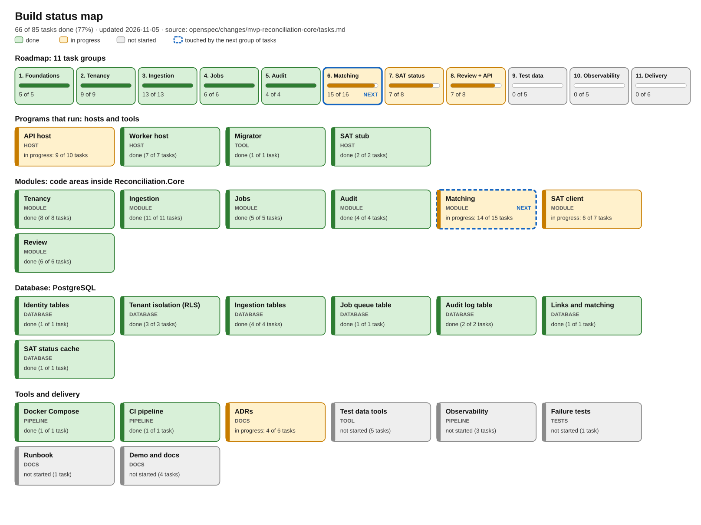
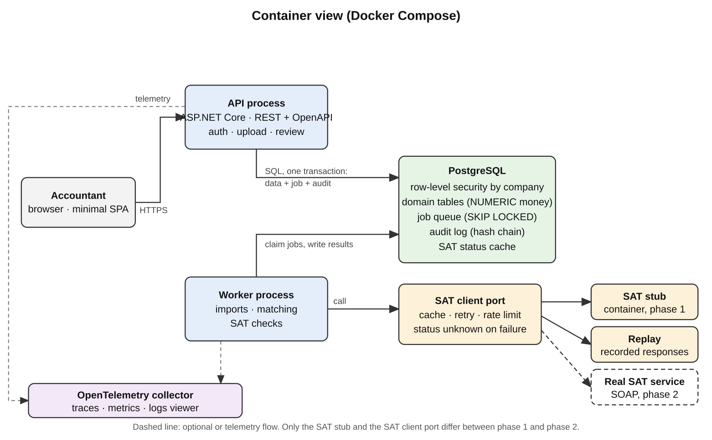
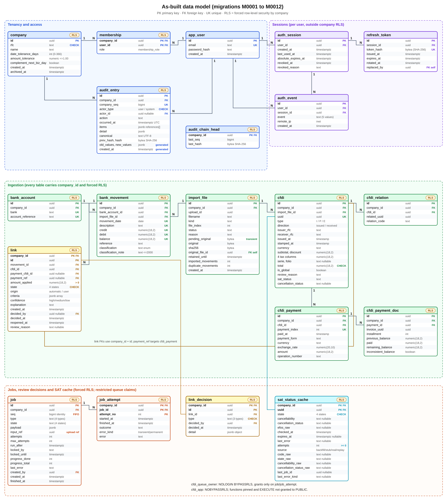
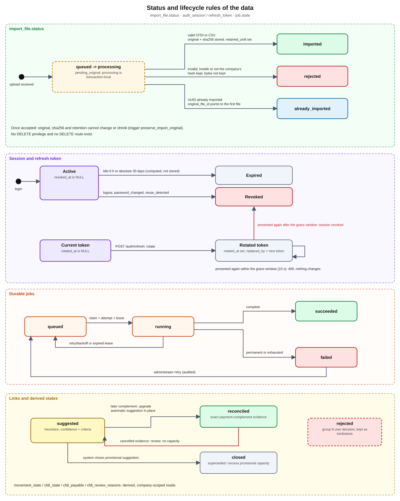
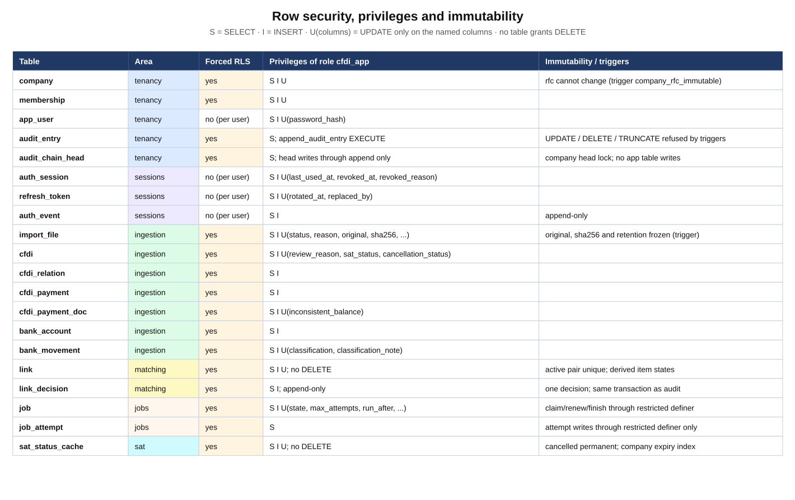

# Build log

A running record of what has been added to the project: what each piece is, how it works inside, what the names and
variables in the code mean, why it was chosen that way and which C#, PostgreSQL or tooling idea it teaches. Read it
once from start to finish, then update it with every pull request.

Versión en español: [BUILD-LOG-ES.md](BUILD-LOG-ES.md). Exported PDF/Word files live in [`exports/`](exports/).

Source of truth for the work items: `openspec/changes/mvp-reconciliation-core/tasks.md` (85 tasks in 11 groups). This
log explains them; the status map below is generated from them.

## How the documentation is organised

| Folder | What it holds | Why it is separate |
|---|---|---|
| `docs/adr/` | Architecture decision records (ADR-001 to ADR-008) | One decision = one file; amendments retain history; larger changes use a new ADR |
| `docs/build-log/` | This log in English and Spanish, and `exports/` with the generated PDF/Word files | What changes every PR; exports stay apart from the source text |
| `docs/requirements/` | BRS and SRS (English and Spanish) | Requirements documents that rarely change |
| `docs/reference/` | The reference bank CSV format and the project brief with reading links | Reference material that tests read or that is cited |
| `docs/diagrams/` | Database and role diagrams and the progress map (`progress/`) | Drawn or generated images, each with its `.svg` source |
| `openspec/` | The specification and tasks of the `mvp-reconciliation-core` change | Source of truth for scope |

Rule of thumb: before deleting or moving a file in `docs/`, search for its name with `grep -rn` (several xUnit tests
read `docs/adr/`, `docs/reference/` and `docs/build-log/`), and use `git mv` to keep history.

## 1. Status at a glance



**66 of 85 tasks complete. Review API group 8A and the real tenancy/audit decisions are implemented; UI 8.5 remains a separate 8B delivery. FX 6.11 and real SAT evidence 7.6 remain pending.**
Regenerate the image after ticking tasks: `python3 tools/progress_diagram.py` (add `--lang es` for Spanish).

### What each type means

| Type | What it is | Example here |
|---|---|---|
| **Host** | A program that keeps running and serves requests or does background work | API, worker, SAT stub |
| **Module** | An area of code inside the shared library with one business responsibility | Matching, Audit |
| **Database** | Tables, rules and security that live inside PostgreSQL | `company`, row-level security |
| **Tool** | A program that runs once to do a job and exits | Migrator, test-data generators |
| **Pipeline** | Automation that builds, tests or starts things | Docker Compose, CI |
| **Docs / Tests** | Written decisions, or code that checks the rest of the code | ADRs, xUnit tests |

## 2. Architecture

### 2.1 Overview: what is built today

```
 HTTP client (curl, browser, tests)
        |  HTTPS + header "Authorization: Bearer <JWT>" + "X-Company-Id: <uuid>"
        v
 +--------------------------+        +-----------------------------+
 | API host (ASP.NET Core)  |        | Worker host (BackgroundSvc) |
 | port 3000 (8080 outside) |        | port 3001 (internal only)   |
 +------------+-------------+        +--------------+--------------+
              |   both reference the same library                 |
              +---------------+---------------+-------------------+
                              v
              +-------------------------------+
              | Reconciliation.Core           |   Tenancy | Ingestion | Audit
              | (seven modules, no Main)      |   Matching | Review | Sat | Jobs
              +---------------+---------------+   (Review remains a placeholder)
                              | SQL via Npgsql + Dapper, CompanyScope for tenants; auth global
                              v
              +-------------------------------+        +----------------------+
              | PostgreSQL 17                 |        | Migrator (runs once) |
              | forced RLS per company        |<-------| creates tables, role |
              | application role: cfdi_app    |        | and first operator   |
              +-------------------------------+        +----------------------+

 SAT stub (8081 internal only): SOAP Consulta + local controls; worker uses short DB phases.
```

Every arrow is a boundary with a reason:

- **Two hosts, one library.** The API serves people and must answer quickly; the worker runs imports, matching and bounded
  SAT queries. They share `Reconciliation.Core`, so business rules are written once (ADR-001: modular monolith with a
  separate worker, instead of microservices).
- **Modules with boundaries.** `Tenancy` (companies, users, roles, sessions), `Ingestion` (reading CFDI and CSV), `Audit` (log),
  `Jobs` (queue/dispatch), `Matching` (pure rules and orchestration), `Sat` (SOAP/status policy), and placeholder `Review`. A module talks to another
  through explicit interfaces; matching orchestration loads the tenant ingestion/link tables while its pure engine has no SQL.
- **PostgreSQL as the final referee.** Even if the code forgets to filter by company, the database does not return
  another company's rows (section 2.3).
- **The migrator is a separate program** with a different database role: the schema owner (`cfdi`) creates and changes
  tables; the application (`cfdi_app`) can only do what it is granted.

The full design, including what does not exist yet (review UI, telemetry), is this:



The API, polling worker, PostgreSQL tenancy/ingestion/session/job tables and SAT SOAP stub exist.
The audit hash chain and matching 6A/6B also exist. Offline SAT handlers also exist. FX stretch 6.11, live SAT validation 7.6, review decisions and OpenTelemetry remain open.

### 2.2 Life of an authenticated request

Interactive diagram: [`docs/diagrams/flows/authenticated-request.html`](../diagrams/flows/authenticated-request.html).

Example: an accountant uploads an invoice with `POST /companies/{companyId}/imports/cfdi`.

1. **Login.** The client calls `POST /auth/tokens` with `{"email","password"}`. Before touching the database,
   `LoginProtection` reads the body (8 KiB maximum), normalises the email (trim and upper-case) and applies two
   fixed-window limits: 10 attempts per minute per email and 30 per minute per IP; beyond them it answers 429 with
   `Retry-After`. It then finds the user case-insensitively and performs **exactly one** PBKDF2 verification: against
   the real hash or, if the email does not exist, against a dummy hash (`DummyPasswordHash`) created once at start-up,
   so response time does not reveal which emails exist. On a match it returns a signed JWT (HMAC-SHA256) valid for 15 minutes with `sub`, `sid` and `jti` claims.
2. **Request.** The client sends the file with `Authorization: Bearer <token>` and `X-Company-Id: <uuid>`.
3. **Authentication.** ASP.NET validates signature, issuer, audience and expiry. If that fails the answer is 401.
4. **Per-company authorisation.** `CompanyRoleHandler` requires `X-Company-Id` to match the route `{companyId}`, opens a
   transaction with that context and reads the user's role from `membership`. The `accountant` policy accepts
   administrator and accountant; a `viewer` gets 403.
5. **Company context.** `CompanyScope.ExecuteAsync` opens a connection, starts a transaction and runs
   `set_config('app.company_id', <uuid>, true)`; the `true` makes it last only for that transaction. For write
   operations, in the same command batch (`NpgsqlBatch`) it takes a lock on the company row
   (`SELECT archived_at IS NOT NULL FROM company FOR UPDATE`): if the company is archived it throws
   `CompanyReadOnlyException` and the API answers 409; the lock also serialises simultaneous changes (for example two
   administrators being demoted at the same time).
6. **Enqueue.** Stream limits precede one transaction for queued originals plus job. No XML/CSV parsing runs in the request.
7. **Close.** COMMIT returns 202 with jobId/uploadId; ROLLBACK leaves no files or job. Safe ProblemDetails includes
   uploadId on enqueue failure. The worker later commits one file at a time, and GET imports/{uploadId} returns its report.

### 2.2a Session renewal

`add-session-renewal` is tracked independently from the 85 MVP tasks. It adds no company-data route and does not
change their Bearer contract. The API issues a 15-minute access JWT and a 256-bit base64url refresh credential;
only SHA-256 `token_hash` is stored. `sub` identifies the user, `sid` the family and `jti` the access token.
`SessionService` uses injected `TimeProvider` for issuance, validation, deadlines and events. `SessionOptions`
validates at startup. `CompanyRoleHandler` still reads membership live; roles stay outside tokens and sessions.

1. Login verifies the slow salted password hash and inserts a family, refresh digest and `login` event in one transaction.
2. Renewal looks up the digest, locks `auth_session` with `SELECT ... FOR UPDATE`, re-reads the token, and rotates it
   atomically with its `refresh` event. It updates `last_used_at`; the new expiry is the lesser of idle time and the original cap.
3. A replay through the inclusive grace boundary returns 409 and changes nothing. Later replay revokes the family and
   writes `reuse_detected`; other devices remain active. Clients coordinate with single-flight renewal.
4. Logout revokes the owned family. Password change verifies the current password, hashes the new one and revokes all
   of that user's sessions with `password_changed`, atomically. Auth events are append-only for `cfdi_app`.
5. Access stays stateless until expiry; no session lookup is added to company requests. Optional HttpOnly/Secure/
   SameSite=Strict cookies use Path=/auth and require an allowed Origin for renewal; default transport remains JSON.
   Login keeps its email/IP limits; refresh and logout share a named IP limit. See ADR-004.

### 2.3 Security layers (defence in depth)

| Layer | What it stops | Where it lives | How it is tested |
|---|---|---|---|
| Login attempt limit | Brute force and credential stuffing | `LoginProtection.cs` | `ReviewHardeningTests` |
| JWT authentication | Anonymous requests | `Authentication.cs`, fallback policy | `AuthenticationTests` |
| Membership and role per company | Using a company where you have no role, or an action the role cannot do | `CompanyRoleHandler.cs` | `MembershipTests`, `IsolationTests` |
| Transaction with context | Queries with no company assigned | `CompanyScope.cs` | `CompanyScopeTests` |
| Archived company is read-only | Writing to an archived company, or losing the last administrator through a race | `CompanyScope.cs` (row lock) | `ReviewHardeningTests` |
| Forced RLS in PostgreSQL | Seeing or writing another company's rows even if a `WHERE` is missing | Migrations `M0002` and `M0004` | Isolation guard over every table and route |
| Composite foreign keys | A row pointing at another company's record | `FOREIGN KEY (company_id, x_id)` | `IngestionDatabaseTests` |
| Unprivileged role | Bypassing RLS, deleting data | `cfdi_app`: no superuser, no `BYPASSRLS`, no `DELETE` | Tests that use the real role |
| Safe XML reading | XXE attacks and "bomb" files | `SafeCfdiXmlReader.cs` | `SafeXmlTests` |
| Input limits | Oversized files or CSVs; hostile file names | `IngestionOptions`, `MultipartUpload.cs` | `ReviewHardeningTests`, `IngestionHttpTests` |
| Safe downloads and errors | The browser interpreting an original; leaking internal detail | `Content-Disposition: attachment`, `nosniff`, `ProblemDetails` | `ReviewHardeningTests` |

Why several layers: each covers a different failure. A 403 does not prove the RLS policy exists, and an RLS policy does
not identify the user; both are needed, and each needs tests.

### 2.4 Life of an import

Interactive diagrams: [`import-to-reconciliation.html`](../diagrams/flows/import-to-reconciliation.html) (upload, job, reconciliation run, read) and [`matching-pipeline.html`](../diagrams/flows/matching-pipeline.html) (how a run decides).

```
 multipart -> streaming bounds and filename cleaning
   -> ONE tenant transaction: queued import_file (pending_original + sha256) + job
   -> 202 {jobId, uploadId}
 worker -> claim_next_job -> running + attempt + heartbeat
   -> safe XML / CSV validation; one bad file does not block the others
   -> per-file fenced tenant transaction: processing -> imported / rejected / already_imported + audit
   -> pending bytes cleared; accepted original immutable; progress -> succeeded
 GET jobs/{jobId} -> state/history/progress; GET imports/{uploadId} -> stable per-file report
```

An enqueue failure leaves no partial upload. A later worker failure retains committed files and queued pending input,
so a redelivery resumes without duplicate domain or audit effects. Processing is transaction-local. Accepted bytes
are verified and finalized once; progress updates touch the job row instead of repeatedly rehashing the original.

### 2.5 Data model

| Table | Why it exists | Key columns |
|---|---|---|
| `company` | Each customer (company) in the system | `rfc` (immutable, validated), `date_tolerance_days` (0–366), `amount_tolerance`, `archived_at` |
| `app_user` | People who log in | `email` (unique, case-insensitive), `password_hash` |
| `membership` | Links user, company and role | PK `(company_id, user_id)`, `role` (`administrator`, `accountant`, `viewer`) |
| `audit_entry` | Per-company immutable hash chain | `company_seq`, `occurred_at`, `actor_type`, `actor_id`, `items`, `detail`, `canonical`, `prev_hash`, `hash` |
| `audit_chain_head` | Locked append position and trusted verification tail | `company_id`, `last_seq`, `last_hash` |
| `import_file` | An uploaded file and its outcome | `upload_id`, `status`, `reason`, `original` (bytes), `pending_original`, `file_index`, `sha256`, `retained_until`, `original_file_id` |
| `cfdi` | An imported invoice | `uuid`, `type` (I/P/E), `direction`, amounts `numeric(18,2)`, `is_global`, `review_reason` |
| `cfdi_relation` | Relations between CFDIs (for example a credit note) | `related_uuid`, `relation_code` |
| `cfdi_payment`, `cfdi_payment_doc` | Payment complement and the invoices it settles | `payment_index`, `installment`, `previous_balance`, `paid`, `remaining_balance` |
| `job`, `job_attempt` | Durable queue, leases and attempts | `company_id`, type/state/input_ref, attempts, run_after, locked_until, progress, error history |
| `bank_account` | A bank account identified by a label | `bank`, `account_reference` |
| `bank_movement` | One line of the bank statement | `movement_date`, `credit`, `debit`, `balance`, `reference` |

Conventions for company tables: `id uuid` is generated by the database (job_attempt instead has a compound key); mandatory `company_id`; RLS enabled
**and** forced; composite foreign keys; money in `numeric(18,2)`, never `double` or `float`; indexes that start with
`company_id` (`M0005`) so each company query walks only its own rows.

The as-built schema (migrations M0001 to M0010), drawn from the migrations themselves:



Blue is tenancy, purple is sessions (per user, outside company RLS), orange is jobs, and green is ingestion; the orange `RLS` badge marks
tables with forced row-level security. The next two diagrams show the status rules of the data and who may do what:





The original design-time model (planned tables for the whole MVP) was retired from the working tree; git history keeps it.
Regenerate the three as-built diagrams with `python3 tools/db_diagrams.py` (add `--lang es` for Spanish).

### 2.6 Per-user authentication storage

The company/ingestion diagrams describe their tenant model. M0006 adds these global per-user tables outside company
RLS; they have no `company_id` and do not use `CompanyScope`. Existing company policies and SQL names stay unchanged.

| Table | Fields and purpose |
|---|---|
| `auth_session` | `id`, `user_id`, `created_at`, `last_used_at`, `absolute_expires_at`, `revoked_at`, `revoked_reason`: one device/family |
| `refresh_token` | `id`, `session_id`, `token_hash`, `issued_at`, `expires_at`, `rotated_at`, `replaced_by`: immutable digest/deadline and rotation link |
| `auth_event` | `id`, `user_id`, `session_id`, `event`, `remote_ip`, `created_at`: login/refresh/reuse/logout/password events, no credentials |

Indexes cover the unique digest, family and user. `cfdi_app` has SELECT/INSERT, UPDATE only on named mutable columns,
no DELETE, and no event UPDATE. `app_user` gains only UPDATE(password_hash). Down removes the new tables and that grant.
All session timestamps are explicit UTC values from TimeProvider. Authentication events remain in auth_event, separate from the company audit chain;
expired-row purging remains future work. Existing access can outlive revocation until its configured expiry.

### 2.7 Durable jobs

M0007 adds `job` and `job_attempt`, both tenant tables with forced RLS. `JobStore.EnqueueAsync` shares the caller's
CompanyScope transaction. `JobLoop` is now a polling BackgroundService with configurable concurrent lanes;
`JobDispatcher` claims due work, runs the handler under its company context and heartbeats until it finishes.

The cross-company boundary is `claim_next_job`: SECURITY DEFINER, owned by `cfdi_queue_owner` (NOLOGIN BYPASSRLS),
with privileges only on job/job_attempt. cfdi_app stays NOBYPASSRLS, cannot become that owner, and receives EXECUTE
only on pinned claim/renew/finish functions; PUBLIC cannot execute them. Renew/finish require worker, attempt and
live lease. Reaping records lease_expired and either requeues or fails exhausted work. Every time is supplied from
TimeProvider through optional SQL p_now; no HTTP route accepts or exposes p_now. See ADR-005.

Transient failures use capped exponential backoff plus jitter; invalid input fails at once. Attempts and original
input remain for an audited administrator rerun. An import's remaining files stay queued with pending_original until
successful rerun; no cleanup is implemented. Per-file lease checks and stable file ids prevent duplicate domain/audit
effects after redelivery. The four types are import_cfdi, import_statement, reconciliation_run and status_check;
reconciliation_run executes matching 6A/6B; status_check runs the three-phase cached SAT workflow (ADR-008).

## 3. Dictionary of names and variables

### 3.1 Environment variables and configuration

| Name | Example value | Read by | What it means |
|---|---|---|---|
| `ConnectionStrings__Default` | `Host=postgres;Port=5432;Username=cfdi_app;...` | API, worker, migrator | PostgreSQL connection string. The double underscore is how .NET writes `ConnectionStrings:Default` in an environment variable. API and worker use role `cfdi_app`; the migrator uses owner `cfdi` |
| `APP_DB_PASSWORD` | synthetic placeholder | Migrator and Compose | Password the migrator uses to enable login for role `cfdi_app` (`ALTER ROLE ... LOGIN PASSWORD`) |
| `Jwt__SigningKey` / `JWT_SIGNING_KEY` | at least 32 random bytes | API | Secret key used to sign and verify tokens. If missing, short or equal to the old public sample value, the API will not start. Compose **requires** `JWT_SIGNING_KEY` (there is no default any more) and passes it to the API as `Jwt__SigningKey`; generate one with `openssl rand -hex 32` |
| `OPERATOR_EMAIL`, `OPERATOR_PASSWORD` | optional; password of 12+ characters | Migrator (`up`) | If present, the platform operator is created once; an existing operator's password is never reset (it only logs that the account was not modified) |
| `Ingestion__MaxFileBytes` | 10485760 (10 MiB) | Ingestion | Maximum size of one file. A larger one rejects only that file |
| `Ingestion__MaxUploadBytes` | 20971520 (20 MiB) | Ingestion | Maximum size of the whole upload, counting multipart headers. Exceeding it rejects the entire upload (413) |
| `Ingestion__MaxFiles` | 20 | Ingestion | Maximum number of files per upload (400 if exceeded) |
| `Ingestion__MaxXmlNodes` | 100000 | Ingestion | Maximum XML nodes and attributes; stops "bomb" files |
| `Ingestion__MaxXmlDepth` | 64 | Ingestion | Maximum XML nesting depth |
| `Ingestion__MaxStatementLines` | 100000 | Ingestion | Maximum rows in a bank statement; exceeding it rejects that whole file with its reason |
| `Ingestion__MaxDescriptionLength` | 500 | Ingestion | Maximum characters of the description; bounds the size of the unique-index keys of movements |
| `Ingestion__RetentionYears` | 10 (minimum 5, maximum 100) | Ingestion | Years the original is kept; sets `retained_until` |
| `LoginRateLimit__EmailPermitLimit` | 10 | API | Login attempts per normalised email in each fixed window |
| `LoginRateLimit__IpPermitLimit` | 30 | API | Login attempts per remote IP in each fixed window |
| `LoginRateLimit__WindowSeconds` | 60 | API | Window length; exceeding a limit returns 429 with `Retry-After` |
| `RUN_BENCHMARKS` | `1` (only when measuring) | Tests | Enables the opt-in performance benchmark; without it (and in CI) it is skipped |

`IngestionOptions.Validate()` and `LoginProtection` check everything at start-up: a non-positive value, a retention
outside 5–100 or a non-positive login window stops the program from starting, instead of failing later in the middle
of an operation. The per-email limit can be abused to throttle a victim (an attacker exhausts their attempts); the
default is generous and the IP limit helps, but production needs tuning and monitoring.

### 3.1a Session dictionary and configuration

| Name | Default / meaning |
|---|---|
| `Session__AccessTokenMinutes` | 15; allowed 5–30; returned as `expiresIn` seconds |
| `Session__IdleMinutes` | 480; renewal inactivity deadline |
| `Session__AbsoluteDays` | 30; cap fixed at login, never extended |
| `Session__ReuseGraceSeconds` | 10; inclusive replay conflict window |
| `Session__RefreshCookie` | false; optional cookie instead of JSON refresh delivery |
| `Session__AllowedOrigins__0` | allowed HTTPS frontend Origin, e.g. https://app.example.invalid; required for successful cookie renewal |
| `RefreshRateLimit__IpPermitLimit` | 60 per LoginRateLimit__WindowSeconds, shared by refresh/logout per IP |
| `SessionOptions`, `TimeProvider` | validated configuration and injected clock; tests use ManualTimeProvider without sleeps |
| `accessToken`, `refreshToken`, `expiresIn` | login/renewal response; refreshToken omitted in cookie mode |
| `sid`, `token_hash`, `replaced_by` | family id; SHA-256 of the wire credential; successor token id |
| `reuse_detected` | revocation/event reason after grace; 409 inside grace changes nothing |
| `/auth/refresh`, `/auth/logout`, `/auth/password` | renew; end the owned family; change own password and end all own families |

### 3.1b Job names and configuration

| Name | Default / meaning |
|---|---|
| `Jobs__PollIntervalMilliseconds` / `JOBS_POLL_INTERVAL_MILLISECONDS` | 500; idle poll interval |
| `Jobs__Concurrency` / `JOBS_CONCURRENCY` | 2; lanes per worker process |
| `Jobs__LeaseSeconds` / `JOBS_LEASE_SECONDS` | 60; heartbeat runs every third of the lease |
| `Jobs__MaxAttempts` / `JOBS_MAX_ATTEMPTS` | 5; initial budget and extra budget for administrator rerun |
| `Jobs__BackoffBaseSeconds` / `JOBS_BACKOFF_BASE_SECONDS` | 2; exponential retry base |
| `Jobs__BackoffCapSeconds` / `JOBS_BACKOFF_CAP_SECONDS` | 300; retry delay cap including jitter |
| `JobLoop`, `JobDispatcher`, `IJobHandler` | poll, claim/heartbeat/classify, and tenant handler boundary |
| `job`, `job_attempt` | durable state/input/progress and every attempt's outcome/error history |
| `locked_by`, `locked_until`, `attempt_no` | lease ownership/deadline and stale-worker fence |
| `pending_original`, `file_index` | private queued bytes, checked by sha256; stable upload order |
| `claim_next_job`, `p_now`, `TimeProvider` | restricted global claim and injected UTC; p_now is never an HTTP field |
| `jobId`, `uploadId` | 202 receipt; progress resource and stable existing import report |

Options validate at startup. The uppercase names are Compose mappings to Jobs__*; JOBS_MAX_ATTEMPTS also configures
API enqueue. `pending_original` is never in JSON or downloads. Accepted finalization moves exactly those bytes into
original, clears pending bytes, and starts RetentionYears at acceptance. Rejected files keep only hash/reason.

### 3.2 HTTP headers, routes, fields and status codes

| Name | Where it appears | Meaning |
|---|---|---|
| `Authorization: Bearer <JWT>` | Header | The token obtained at login |
| `X-Company-Id` | Header | The company the request acts on; must equal the route `{companyId}` and the user must be a member |
| `{companyId}` | Route | The company UUID |
| `{uploadId}` / `upload_id` | Route / column | UUID that groups the files of one upload |
| `{invoiceId}` | Route | Internal UUID (`cfdi.id`) of the invoice. It is not the fiscal UUID |
| `{fileId}` | Route | UUID of an `import_file` row |
| `files` | Multipart field | One or more uploaded files; names are cleaned (no control characters, 255 maximum) |
| `bank` | Multipart field | Bank format identifier; today only `reference` |
| `accountReference` | Multipart field | A label of 1–40 ASCII letters/digits, spaces, hyphens and underscores. Never a real account number |
| `Retry-After` | Response header | Seconds to wait after a login 429 |
| `Content-Disposition: attachment`, `X-Content-Type-Options: nosniff` | Response headers | On downloads: force saving the file and forbid guessing its type |

| Code | When |
|---|---|
| 400 | Malformed body or too many files |
| 401 | No token, invalid token or wrong credentials |
| 403 | Authenticated but without the required role in that company |
| 404 | Resource does not exist **or belongs to another company** (deliberately not distinguished) |
| 405 | Method not allowed; for example there is no `DELETE` |
| 409 | Archived company: read-only; or a rotated refresh credential inside its reuse grace window |
| 413 | Login body or upload larger than the limit |
| 429 | Too many login or session renewal/logout attempts; Retry-After tells when to retry |
| 500 | Unexpected error; a safe `ProblemDetails` is returned with no internal detail |

### 3.3 Database names

| Name | Meaning |
|---|---|
| `app.company_id` | PostgreSQL session variable holding the current company. RLS policies compare it with `company_id` |
| `cfdi` (user) | Schema owner; only the migrator uses it. It can bypass RLS, which is why the application does not use it |
| `cfdi_app` (role) | The application role: `NOSUPERUSER NOBYPASSRLS`, only `SELECT/INSERT` and `UPDATE` on specific columns |
| `membership_role` | Enumerated type: `administrator`, `accountant`, `viewer` |
| `uuid` (in `cfdi`) | The fiscal identifier of the CFDI (the SAT folio). It is unique **per company** |
| `type` | `I` income, `E` expense (credit note), `P` payment (payment complement) |
| `direction` | `issued` if the company is the issuer; `received` if it is the receiver |
| `status` (in `import_file`) | `queued`, transaction-local `processing`, `imported`, `already_imported` (repeated UUID), `rejected` |
| `original_file_id` | For a duplicate, points to the file that was already accepted |
| `sha256` | 32-byte fingerprint of the file; lets you prove it did not change |
| `retained_until` | Date before which the original cannot be deleted or shortened |
| `preserve_import_original` | Trigger: only a queued/processing row may set its original (by becoming `imported`); an accepted original, its hash and its retention never change |
| `date_tolerance_days` | Days of difference allowed between bank and fiscal date when matching (default 3, maximum 366: `company_date_tolerance_max`) |
| `amount_tolerance` | Amount difference allowed when matching (default 0.01) |
| `complement_next_biz_day` | Deadline rule for payment complements; used in group 6 |
| `VersionInfo` | FluentMigrator table with the applied versions (today 1 to 8) |
| `numeric(18,2)` | Money with 18 digits and exactly 2 decimals |
| `numeric(20,10)` | Exchange rate with up to 10 decimals |

### 3.4 Frequent names in the C# code

| Name | Meaning |
|---|---|
| `actorId` | UUID of the user performing the action; comes from the `sub` claim and is stored in the audit |
| `uploadId` | UUID generated for each upload (`Guid.NewGuid()`) |
| `UploadedFile(Name, Content, Hash, Error)` | A file in memory with its SHA-256 fingerprint; `Error` carries the reason if it could not be read |
| `FileImportOutcome` | Result for one file: status, reason, ids and movement counts |
| `ImportReport(UploadId, Files)` | What the API returns: all results of one upload |
| `UploadFailedException` | Database error in the middle of an upload; carries the `UploadId` so what was already committed can be read |
| `ParsedCfdi`, `PaidInvoice` | Already-read representation of a CFDI and of each payment line (the balance flags are immutable) |
| `InconsistentBalance` | Mark on a payment line whose balance does not fit; it does not reject, it sends to review |
| `IBankStatementParser` | Contract for reading one bank's CSV; one implementation per bank |
| `CompanyScope` | Service that runs code inside a transaction with the company assigned |
| `CompanyReadOnlyException` | Thrown when writing to an archived company; the API turns it into 409 |
| `Policies`, `MembershipRoles` | Constants with the policy names (`company-member`, `administrator`, `accountant`, `platform-operator`) and the role names |
| `JwtTokenPolicy`, `PasswordPolicy` | Constants: issuer/audience (`reconciliation`), zero clock skew and minimum password length (12); access lifetime comes from `SessionOptions` |
| `CompanyHeader.Name` | The name of the `X-Company-Id` header in one place |
| `DummyPasswordHash` | Dummy hash created at start-up to equalise the work when the email does not exist |
| `LoginProtection` | Login email/IP limits plus the named per-IP policy for `/auth/refresh` and `/auth/logout` |
| `AuditLog.WriteAsync` | Transactional writer calling append_audit_entry; every current company action uses it |
| `AuditItem` | A typed string identifier (kind/id) stored in the hashed items array |
| `append_audit_entry` | Restricted SQL function: context check, head lock, next sequence and hash |
| `verify_audit_chain` | Read-only SQL cursor checking content, continuity and head |
| `AuditEndpoints` | Company-member filtered reads, keyset paging and verification |
| `DapperExtensions` | Helpers that build Dapper commands with explicit parameter aliases |
| `ImportFileStore` | Stores the original files and their metadata |

## 4. What exists today

| Piece | Type | What it is for | Where |
|---|---|---|---|
| Solution file | Build | Groups the six projects so one `dotnet build` builds everything | `Reconciliation.slnx` |
| Shared build rules | Build | Every project uses the same settings: .NET 10, null checking, warnings are errors | `Directory.Build.props`, `.editorconfig`, `global.json` |
| **Core library** | Module area | The code both hosts share: tenancy, ingestion, matching, hash-chained audit and common database/health code | `src/Reconciliation.Core` |
| **API host** | Host | The web API users will call. Serves authentication, companies, members, settings, archive, imports, matching jobs, movement reads/classification, health and OpenAPI | `src/Reconciliation.Api` |
| **Worker host** | Host | Polls jobs concurrently, renews leases, records attempts/progress and reports health | `src/Reconciliation.Worker` |
| **Migrator** | Tool | Applies or reverts database changes (`up`, `down`) and creates the first operator | `src/Reconciliation.Migrator` |
| **SAT stub** | Host | SOAP Consulta and controlled outcomes on the internal network; no live SAT required | `src/Reconciliation.SatStub` |
| **PostgreSQL 17** | Database | Stores all data with forced RLS per company | `docker-compose.yml`, migrations `M0001` to `M0011` |
| Docker Compose | Pipeline | Starts database, migrator, API, worker and stub with one command and waits for all to be healthy | `docker-compose.yml`, `Dockerfile` |
| CI pipeline | Pipeline | On every push: format, build, tests, migrations up/down/up and a full system start | `.github/workflows/ci.yml` |
| ADRs | Docs | Big decisions and the alternatives that were rejected | `docs/adr/` |
| Requirements and plan | Docs | BRS, SRS, diagrams and the OpenSpec change that defines the work | `docs/requirements/`, `docs/diagrams/`, `openspec/` |
| Tests | Tests | 374 xUnit cases: 367 passing, 4 pending scenarios and 3 opt-in benchmarks; real PostgreSQL | `tests/Reconciliation.Tests` |
| Progress map | Tool | Draws the status image from `tasks.md` | `tools/progress_diagram.py` |

## 5. Pull request log

Most recent first. Each entry answers six questions: **What it is** (the piece), **How it works** (step by step),
**Names and variables** (what each new term means), **Why this way** (decision and rejected alternative), **What you
learn** (C#, SQL or tooling idea) and **Verified** (how it was checked). Entries before PR-5 use the names the code had then; the PR-5 rename map translates them.

### PR-12: Review, summaries and API

**Purpose.** Complete group 8A (8.1, 8.2, 8.3, 8.3b, 8.3c, 8.3d, 8.4), and the real decision scenarios pending in 2.4/5.3. Task 8.5 is a separate 8B UI PR. ADR-009 records the decision resource and derived read model. The API and overview state that results have no fiscal or legal validity.

**How it works.** Accountant/administrator POST decisions to `/companies/{companyId}/links/{linkId}/decisions`. CompanyScope and FOR UPDATE locks serialize company/link/capacity writes; a stale decision returns 409 with its current state. Confirm preserves automatic origin; reject creates a user tombstone; change closes the suggestion and creates a new user reconciled link, allowing the same invoice with a different amount. Movement capacity is strict; manual invoice overpayment is allowed and flagged. A cancelled suggestion cannot be confirmed; rejecting/changing a cancellation marker is allowed. Accepting its replacement closes the obsolete marker, returns every affected link and includes typed marker references in the decision audit.

M0012 adds forced-RLS link_decision with SELECT/INSERT-only app grants and company_id-first history/read indexes. One decision row is written per action. Confirm/reject append one audit entry; change writes two audit entries (old closure/new creation), the deliberate exception required by the spec's two-actions scenario. Actor, timestamp and typed movement/CFDI/link items commit together. Notes are capped at 500 characters, stored in decision detail and omitted from audit/logs. Attaching payment coverage requires BOTH payment_cfdi_id and payment_ref, validates type P/company/status/document relation and preserves the first-claim movement rule.

Queue, summary, list and overview use set-based cfdi_state / movement_state / cfdi_payable / cfdi_review_reasons. Queue ordering is high/medium/low, then date/id, followed by invoice flags; keyset pages default to 50 and cap at 200. requiresReview distinguishes problems from informational fully credited/global reasons. Pending lists require pendingAmount > 0; uncoveredAmount also subtracts valid suggestions. Summary shows confirmed-only paid/percentage/pending, both active movements, explicit payment CFDI and received/missing/overdue complement status. Missing includes overdue unreceived complements; the overdue filter narrows by the due date. PPD confirmed payments use the 6B deadline, first-claim and weekend rules. Cash form 01 above 2,000.00 shows the exact non-blocking warning without changing state.

Overview performs one grouped query per resource and includes overdue/cancellation-in-process/EFOS/global alerts. Classified movements and zero-payable invoices remain in their derived states and count in totals; pending lists apply exclusions separately. Invoice state amounts use imported type I gross totals, movement amounts use credit plus debit. Payment and credit-note documents are not income invoice totals. The invariant tests include classified and fully credited cases.

**What I learned.** The old unconditional unique key also blocked history. Keeping a closed row and inserting a replacement for the same invoice requires active-only uniqueness: NULLS NOT DISTINCT on the original pair columns WHERE state IN ('suggested','reconciled'). ADR-007's original unique-key statement is amended by ADR-009. Engine persistence and cancellation replacement discovery use primary-key ON CONFLICT upgrades with explicit proposal/tombstone checks; user-change closures block pair re-proposal and reruns do not flap. A timestamp mapping check caught Dapper's DateTime database representation. A synthetic EFOS fixture also had to use the complete shared SAT success code, rather than its initial letter.

**Decisions.** Keep the framework's existing OpenAPI generator, with no new NuGet package. Anonymous `/openapi.json` covers every EndpointDataSource route with summary/tags/security/role notes and 401/403/404/409 responses. Existing bank, movement classification, GET/PATCH settings, XML and original-file endpoints are documented without duplicates. info.version and x-api-version are 1.0.0; no /v1 rename is introduced. A breaking contract will introduce /v2 alongside the old version during caller migration. Derived reads avoid stored-state synchronization; materialized views remain a profiling-driven option. Downgrades past M0012 require explicit manual export/cleanup if user decisions exist. Down also refuses historical duplicate pairs; both refusal cases preserve schema/data and never modify append-only audit entries. Stop API/workers before rollback.

**Measured benchmark and EXPLAIN.** RUN_REVIEW_BENCHMARKS=1 uses 20,000 invoices, 20,000 movements and 20,000 suggestions, one warmup and three actual API requests per route, in the README SDK container. Queue limit=200 samples: 532.1370 / 525.0735 / 523.2741 ms, median 525.0735 ms. Overview samples: 465.9467 / 463.6808 / 461.7593 ms, median 463.6808 ms. These local observations are not service objectives. EXPLAIN ANALYZE executes the actual endpoint SQL as cfdi_app with RLS: queue uses top-N heapsort (370 kB), company-leading link_invoice_idx and movement/CFDI key indexes; execution 529.539 ms. Invoice overview execution 388.124 ms; movement overview 91.861 ms. These are set-based joins/aggregations, including indexed join loops, not per-row function calls. The full eligible tenant is scanned/aggregated; JSON/text review predicates do not magically become indexable under non-leakproof RLS restrictions. Company_id and state btree columns remain the access foundation.

**Verification.** Local red test commits record expected failures before each slice; green commits require the full SDK-container suite and format verification. Three formerly skipped domain scenarios are real and green: Viewer cannot decide, Different roles, User confirms a link. SAT status change remains a real green API/worker/audit test. Final SDK checks: dotnet build succeeded with 0 warnings/0 errors; dotnet test --solution Reconciliation.slnx ran 607 tests, 603 passed and 4 opt-in benchmark skips; dotnet format --verify-no-changes passed. The review benchmark passed explicitly (one test, no skips). The opt-in review benchmark passed separately. Compose up --build --wait used a temporary override with dynamic localhost ports and a synthetic JWT_SIGNING_KEY supplied only through the environment. The chosen smoke imports an invoice and two movements WITHOUT a complement, runs matching to create two suggestions, reads the queue, confirms ONE, then verifies 50% paid / 5,800.00 pending, two links, additive overview totals and a consistent seven-entry audit chain. The separate worked-example integration test proves the reconciled half's payment CFDI; no extra payment-detail endpoint was added. With API/workers stopped before decisions, SDK migration up/down/up on that populated database preserved 1 CFDI, 2 movements, 2 links and all 6 audit hashes (same fingerprint). Retained-decision and duplicate-history rollback refusals have separate tests. Disposable Compose containers, volumes and network are removed with down -v before completion.

**Documentation and known gaps.** Bilingual database/progress diagrams and Word/PDF exports are regenerated through the existing tools. The architecture JSON and PR-7 flow sources were checked: no container/boundary changed and those diagrams do not show a review decision flow, so their existing flows remain accurate. No reopen endpoint, standalone manual N:M creation or UI is added; 8.5 remains pending for 8B. FX 6.11, real SAT payment evidence 7.6, UTC date semantics and holidays remain earlier limits. All data here are synthetic; commits are local only, with no push or merge.

### PR-11: SAT status check

Interactive diagram: [`sat-status-check.html`](../diagrams/flows/sat-status-check.html) (the three phases of the status check job).

**Purpose.** Complete group 7's offline status workflow (7.1, 7.2, 7.3, 7.3b, 7.3c, 7.4, 7.5) with one ISatClient port, SOAP stub/real transport, private record/replay and the SAME shared status policy. ADR-008 documents the actual contract and its uncertainties; 7.6 remains Phase 2, requiring one real anonymised payment CFDI and live SAT access. Matching does not wait for consultation. Task 5.3 remains open only for group 8 user decisions; SAT status change is now a real passing API/worker/cascade test.

**How it works.** SatContract owns every Spanish-text mapping and the exact printed expression. Total is invariant, six fractional digits and at least ten integer digits: 0000001939.270000 and 0000000000.000000. More than six significant fractional digits or negative values are refused without rounding. Unknown values retain their raw text. SOAP XML forbids DTD/external resolution and limits size/depth/nodes. Stub/real share SoapSatClient with a configured endpoint, no redirects and a 10-second total timeout. Real requires HTTPS. The local SOAP stub has forced outcomes, delays and /control/outcomes only on the internal Compose network; it is no longer a health-only placeholder.

M0011 creates sat_status_cache with forced RLS, composite company/UUID key/FK, no DELETE grant and a company-first expiry index. Current defaults to 24h, not_found to 1h, cancelled is permanent. Only existing cancelled CFDI are backfilled, source=backfill and checked_at=migration observation time, with no invented response/EFOS fields. Cached current/cancelled checks make no service call. A 601 stores error/attempts but keeps the CFDI/cache status, expires immediately, does not retry in that job, and does not automatically enqueue another. A new explicit job may recheck; last_job_id/last_error_kind prevent repeating a permanent error during the same mixed-batch retry. Transient exhaustion commits unknown/error/attempt metadata before normal job backoff. In-process and deadline-expired cancellation statuses leave a current CFDI current.

TimeProvider drives request timeout, retry delays, job budget and the small thread-safe IRequestRateGate. Default spacing is 2 requests/second, no catch-up burst. The built-in limiter was rejected because its clock cannot be injected; the same gate runs in tests and production. The fake-time Large batch benchmark schedules 1,000 simultaneous callers at exactly 0.5-second intervals: 499.5 virtual seconds from first to last permit, with no 1-second window exceeding two permits. This measures policy scheduling, not SAT latency or throughput. The limit is per process; multiple workers multiply the service quota.

StatusCheckHandler has three phases: short set-based tenant read; HTTP with NO pooled connection/transaction held; short company-locked apply transaction with set-based reread, superseded-reply checks and lease fence before commit. Heartbeats continue during HTTP. Cache UPSERT and ordinary CFDI updates use two UNNEST statements per batch when needed; add one audit per changed CFDI, one per changed nonclear EFOS value and the existing 6B cascade commands per NEW cancellation. No per-link reads or calls are added. Same-answer refreshes add no audit noise. Audit detail contains before/new status/cancellation/cancellability/EFOS/jobId/source; typed items follow ADR-006. EFOS warnings require actual code S, a present nonempty value other than 200; NULL/empty/backfill do not warn. cfdi_review_reasons exposes efos warning with requiresReview=true.

A batch contains at most 100 ids. The 60-second job budget stops new calls and cancels the pending request. Budget-only remainder gets exactly one follow-up carrying unchecked ids and generation+1, while the parent succeeds atomically with its cache/audit writes. Mixed real failures retain the original job payload and defer normal retry; cache hits skip completed ids. MaxFollowUpGenerations=20 caps the child chain and falls back to bounded job attempts. The active-parent unique index and stale-lease fence prevent duplicate children. Existing import/matching dispatcher paths stay intact. Imports enqueue one-id batches inside each retained per-file transaction, avoiding a new import transaction model; duplicate UUIDs enqueue none. POST /companies/{companyId}/cfdi/{uuid}/sat-check returns 202, accepts accountant/admin and refuses viewers, archived writes and cross-company UUIDs.

**What I learned.** A deferred retry is a durable outcome: throwing outside the company transaction would roll back the unknown status that the user needs to see. A slow network call must also release the database connection, not merely the company lock. FIFO needs a real enqueue sequence, not a random UUID tie-break. M0011 job.seq guarantees equal-timestamp order; recovery preserves run_after=LEAST(run_after,p_now), created_at and seq so the expired parent precedes its child. Only lease-expiry recovery changes; scheduled transient backoff stays unchanged. Immediate crash recovery adds no new backoff and still ends failed after Jobs:MaxAttempts. Down restores the old p_now/id behavior. The unchanged Worker killed mid-job test, equal-timestamp FIFO, parent-before-child, not-before-backoff and crash-loop bound all pass.

**Decisions and privacy.** Recording stores ONLY response raw fields plus check time under an explicit different anonymous UUID; no request, raw SOAP, RFC, total or real UUID. The privacy guard rejects echoed request identifiers. Automatic missing/unsafe recording skips with one sanitized warning per process and a counter, without changing the answer; explicit RecordAsync throws. .local/sat-recordings is ignored by git and Docker builds; Compose has writable persistent volume storage. Only an allowlisted synthetic recording is committed. Recording off ignores keys; supplied on-demand keys are administrator-only. Replay alone may use the imported anonymous UUID as fallback, allows equal keys and never resolves HTTP; missing/corrupt files become unavailable/unknown. Group 9 owns real-to-anonymised mapping. Real-mode recording warns at startup, replay+recording is rejected.

**Validation and limits.** Each slice used a red test commit with expected failures, then code with full SDK-container tests and format green. Final SDK checks: build 0 warnings/0 errors; 578 tests, 572 passed and 6 skips (three group 8 scenarios and three opt-in benchmarks); dotnet format --verify-no-changes passed. docker compose up --build --wait brought PostgreSQL/API/worker/SAT healthy. A synthetic API upload and worker produced a reconciled link; forcing cancelled initially hit the current cache, then a shortened synthetic cache expiry allowed the worker to cancel the CFDI and move the link to suggested/review with the same amount. Its ten-entry audit chain verified; another check kept permanent cancelled status. The smoke used only synthetic inputs and one explicit DB fixture to shorten the 24h cache wait, with no real SAT call. SDK M0011 up/down/up on the populated database preserved 47 audit entries with identical hash fingerprint, all 11 links totaling 45,565.00 and all 15 CFDI rows; Down restored the old function and Up reconstructed cancelled backfill. The as-built architecture now has the real worker SOAP path: 9/9 showcase checks, no errors/warnings; browser containment passed four desktop sizes and both themes were visually inspected. Database/progress diagrams and Word/PDF exports are regenerated in both languages.

Smoke cleanup: after use, run `docker compose -p bnk-matching-smoke down -v` (with the same env file) and `docker rm -f bnk-matching-sdk` to release ports 5432/8080 and remove the smoke volumes/network.

Open contract questions: padded total compatibility with real answers; exact aliases/punctuation and unknown fields; empty/absent EFOS meaning; whether the public service answers a payment CFDI with total zero. ValidacionEFOS=200 clear is an explicit assumption pending 7.6. Controls are development-only; rate is process-local; budgets/attempts bound work, not upstream availability. No live SOAP validation, distributed rate coordination or new fiscal blocking rule is claimed. FX 6.11 remains deferred. Local commits only, no push or merge.

### PR-10: Matching rest

**Purpose.** Finish matching 6B tasks 6.4, 6.12, 6.13, 6.14 and 6.15 on top of Matching core. M0010 adds cancellation metadata, company-leading indexes and set-based fiscal read functions. The pure MatchingEngine still makes bounded, exact-money proposals; item states remain derived. The documented stretch 6.11 stays open, with no partial implementation or speculative columns. ADR-007 has amendments in 6B rather than a new ADR.

**How it works.** cfdi_payable nets only issued, same-currency, non-cancelled code-01 credit-note totals and floors at zero. An invoice 11,600.00 minus a 1,160.00 note is fully reconciled by 10,440.00. Unknown SAT status counts as valid. Cancelled notes restore payable but leave valid reconciled payment links intact; this is the conservative interpretation of links “depending on” a credit note, since links do not reference notes. A different-currency note is not converted and raises a problem reason. Gross remains net payable plus ORIGINAL federal and local retention, without prorating: a known approximation because credit notes should also reduce retentions.

cfdi_review_reasons(today) returns reasons as {code, requiresReview}, aggregate requiresReview, earliest missing complement due date and overdue. Overpaid means reconciled coverage exceeds net payable, never suggested coverage. Fully credited invoices keep state pending with zero amounts and an informational fully credited reason. Global invoices are excluded from all automatic matching, including deterministic complements; the global invoice reason is informational and remains when manual links fully reconcile one. Problem reasons include overpaid, cancelled invoice/payment complement/credit note, different-currency note and complement overdue. Informational and problem reasons can coexist.

A PPD confirmed payment is due on the fifth of the next declared payment month; optional weekend adjustment moves Saturday/Sunday to Monday. Holidays are not modeled. PUE never produces this deadline. Today comes from TimeProvider as a UTC date; near Mexican local midnight this can differ by one day. Coverage requires BOTH payment_cfdi_id and payment_ref, a non-cancelled type-P complement, its payment row and an invoice-UUID document. No unlinked complement is inferred by amount/date. First-claim by link.created_at then link.id assigns each payment_ref to one MOVEMENT; that movement's A 6,000.00 + B 4,000.00 allocations can both be covered, but a second movement cannot reuse it.

ApplySatStatusChangeAsync runs in one company transaction, enforces archive/RLS guards and audits status and link changes through append_audit_entry with typed cfdi/link/movement items. Cancellation in process keeps links. A cancelled invoice or complement marks active links suggested for review, retaining amounts and user provenance while releasing their monetary capacity. Marked movements remain suggested but are held out of ordinary matching; cancelled invoices have no pending/overdue computation. Cancellation of a credit note only restores payable and reports its reason. A forced failure rolls back status, links and audit/head together.

A direct relation 04 may propose a non-cancelled, issued, non-global, same-currency, same-receiver replacement using free capacities. This is strong evidence without an invented amount/date requirement, always suggested. The old marked link coexists for human review. Deterministic date/proximity/stable-id ordering, pair rejection checks and unique keys preserve decisions and idempotency. The discovery step also runs in reconciliation_run, so a replacement imported after cancellation appears once on the next run. Only direct relations are followed; transitive replacement chains are not chased. Writes/audits are batched with no new per-link network round trips.

**What I learned.** A payment-row claim must belong to a movement, not a single link, or valid N:M allocations falsely become overdue. Informational exclusions also need an explicit requiresReview flag so “global invoice” does not become a problem queue item. Cancellation history must retain its amounts while reserving none of the live capacity. Two extra red checks caught existing heuristic suggestions that lacked a marker, and marker loss during migration replay; both now pass. M0010 Up reconstructs suggested-link markers from retained SAT status, while Down restores M0009 reads and removes the added metadata. Down loses free-text cancellation_status; it keeps CFDI, movements, link amounts/states and the audit chain. Stop API/workers during migration rollback.

**Measured benchmark.** RUN_BENCHMARKS=1, same SDK container/runtime, one warmup and three measured samples; median before -> after: 20,000 unique amounts 487.2182 -> 515.1927 ms (+5.74%); 5,000 dense equal amounts 340.2344 -> 368.6202 ms (+8.34%). Candidate comparisons remain 20,000 and 248,775. These are local observations, not CI timing assertions. Credit-note netting/global eligibility leave K=50, B<=201 and the engine comparison cap unchanged; preprocessing is indexed/set-based, cleanup O(L log L), and replacement discovery adds explicit direct relation posting hits H plus O(H log H) ordering. The guarantee stays linearithmic, never linear.

**For group 8.** Build the pending list from pendingAmount > 0 / informational fully credited exclusion, and the review queue from reason.requiresReview = true. Global invoices may still be linked manually. Attach/decision actions must set payment_cfdi_id AND payment_ref and respect the first-claim movement rule. Display both pendingAmount (confirmed-only) and uncoveredAmount (also subtracts valid suggestions); cancellation-marked suggestions count in neither. Human decisions must close the obsolete cancellation marker when accepting its replacement. The actual SAT client/job remains group 7; its SAT status change integration test stays explicitly pending, while this PR tests the domain cascade directly.

**Validation and limits.** Each scenario had a red test commit before its implementation, with full SDK suite and format green before every non-red commit. Final build has 0 warnings; 440 tests, 433 passed, 7 explicit skips (4 future domain scenarios and 3 opt-in benchmarks); format --verify-no-changes green. docker compose up --build --wait brought PostgreSQL/API/worker/SAT healthy and the migrator exited successfully. SDK M0010 up/down/up on the populated database preserved 37 audit entries with identical hash fingerprint and all 10 links totaling 45,465.00. The live synthetic API upload/worker/read smoke showed credit-note payable 10,440 with no pending amount, global invoice pending with an informational reason, and complement overdue since 2026-10-05. Its nine-entry audit chain verified. The overdue case used one synthetic user-confirmed DB fixture because the decision route belongs to group 8; documents, movements, worker execution and reads used the API. Bilingual Word/PDF exports and database/progress diagrams were regenerated and visually checked. The architecture JSON remains unchanged: all work stays inside existing PostgreSQL/Core/API/worker boundaries. FX 6.11 is deferred because TipoCambioP is stored but document-level EquivalenciaDR/exchange data is missing; exact dual-currency capacity across multi-document payments needs a separate fiscal contract. No review queue endpoint or SAT client/job is built. Local commits only; no push or merge.

### PR-9: Matching core

**Purpose.** Implement group 6A's explainable matching and movement classification, with exact amounts and preserved user decisions. MatchingEngine is pure in-memory code; reconciliation_run now executes it instead of a placeholder. M0009 adds tenant-scoped link, derived movement_state()/cfdi_state(), constrained classification notes, and nullable serie/folio for newly imported CFDI. Item states are computed, never stored. ADR-007 is the actual next decision record; task 6.8's reference to ADR-005 is stale because ADR-005 already describes the queue.

**How it works.** The worker locks its company row, loads the matching inputs with set-based SQL, and calls MatchingEngine. Stage 1 uses issued payment complements with exact payment/movement equality and a configured date window; it can allocate several document amounts to one movement. Only issued income invoices and credit movements participate. Stage 2 creates suggestions with one amount criterion plus independent date/RFC/identifier evidence. All money remains decimal/numeric. The worked invoice 11600 has its first 5800 movement reconciled by a complement and its second 5800 movement suggested from the remaining payable, with an explicit reason. The actual second description has a customer-name fragment, so residual amount alone earns low confidence; there is no name criterion.

The rubric is fixed by tests: exact net total 40, exact gross 35, exact partial remaining 30, or within-tolerance 25, in that precedence order. Exactly one amount criterion applies. Date adds 20 plus a rounded 0–10 proximity bonus; RFC adds 15; serie/folio or an eight-hex UUID fragment adds 30; reference equals operation number adds 30 when amounts equal. High is 70+, medium 45+, low 25+; lower scores create nothing. Eligibility requires amount evidence or a strong identifier. Date/RFC alone cannot invent a candidate. Identifier-only partial payments allocate the smaller remaining capacity and explain the missing amount match. Gross targets always remain suggested and say “amount equals total before retentions,” including a near-gross tolerance match.

**Decisions and names.** “Payer did not withhold” means no federal or local retention: gross target = declared total + retained_tax + local_retained_tax, consistent with D14. SQL loads the exact numeric sum (COALESCE nulls to zero) into the engine's single Retained value; persisted criterion detail, explanation and system audit list the federal/local components separately. Local-only and mixed-retention worker integration tests failed first, then passed after fixing that boundary; the pure engine already handled the summed input. Suggestions are provisional against deterministic evidence: stage 1 reserves only reconciled links and active user decisions. A later complement upgrades the same automatic suggestion in place (link.upgraded) or closes a superseded one (link.closed) and creates its deterministic replacement. The existing closed state now also represents this approved system supersession. Cleanup closes excess automatic suggestions in lowest-confidence/newest/stable-id order, never touching user or reconciled links. Its deterministic sort is O(L log L), followed by an O(L) scan; total cost is linearithmic, not linear. A user rejection blocks the movement/invoice pair across later complement changes unless explicitly reopened. Stage 2 respects all active reservations and never allocates an existing link's leftover automatically; that credit remains uncovered for manual N:M in group 8. Lost heuristic evidence does not erase suggestions, and an unchanged rerun does nothing.

MatchingResult separates creations from before/after updates. The worker persists 500-row unnest batches and calls ADR-006's append_audit_entry in the SAME tenant transaction. System detail contains jobId/source, criteria and previous values; items are typed [{kind,id}] references for movement id, CFDI UUID and link id. A forced failure after matching and audit rolls back links and the audit head together. Short independent progress transactions keep heartbeat renewal available; a final lease fence prevents a stale worker's transaction from committing. Archived companies remain readable but refuse matching/classification writes. Task 5.3 remains unticked only for future user link decisions and SAT changes in groups 7/8; Automatic link and Tolerance changed are now real passing tests.

**Spec tension.** A reference-only movement of 1,939.27 creates a suggested link covering the sample invoice's net total. pendingAmount subtracts only reconciled amounts, while uncoveredAmount also subtracts suggested amounts. It therefore has pendingAmount 1,939.27 and uncoveredAmount 0 until confirmation/complement. This follows the explicit partially-paid scenario and is a spec tension with the retention wording “no amount pending.” Both values are exposed; a later product decision can choose the display meaning without changing money calculations. Earlier CFDI have NULL serie/folio and lack that criterion; originals permit a future backfill, but duplicate UUID import never rewrites them.

**What I learned.** Capping candidates by amount alone can hide a better RFC match. Date-sorted amount buckets therefore also have a date-sorted sub-index per RFC; standalone RFC posting lists are never enumerated. Merge nearest candidates from both indexes and direct strong-identifier postings, then choose score/date/stable id. RFC normalization preserves & so A&A and AA& stay distinct and index lookup agrees with scoring. MaxCandidatesPerMovement is 50. Company amount_tolerance is at most 1.00 in the API, DB and effective engine settings, so at most 201 cent buckets per target are probed (three at 0.01). Payment lazy deletion removes exhausted candidates once because stage-1 capacity only shrinks. The bound is O((M + C + P) log n + M*(B log n + K)), plus explicit strong-posting hits and O(L log L) existing-link cleanup; it is linearithmic. CI has a dense 2,000-by-2,000 comparison-count check, five FsCheck properties with 150 cases each, and a 200-case independent brute-force best-candidate oracle with injected K=1.

**Measured benchmark.** MatchingBenchmarks runs with RUN_BENCHMARKS=1 through the README SDK container (.NET 10.0.14, X64). Inputs are prepared before timing; one warmup and three measured runs cover the pure engine. For 20,000 movements and 20,000 unique-amount invoices, samples were 526.5145 / 487.2182 / 442.3172 ms, median 487.2182 ms, 20,000 scored comparisons. For dense 5,000-by-5,000 equal amounts, samples were 361.3979 / 340.2344 / 338.8588 ms, median 340.2344 ms, 248,775 comparisons. These are local observations, not a deployment promise or a CI wall-clock threshold. Each run produced one capacity-safe suggestion per movement.

**Read and classify.** Any member can GET movements with state/classification filters and date/id keyset pages of at most 200. Accountant/administrator PATCH accepts loan, partner_contribution, tax_payment, late_invoicing, other or explicit null, plus an optional bounded note. It records movement.classification_changed with the user and movement reference in the action transaction. Classification removes a movement from the pending list and the engine while preserving its derived state; clearing reopens it. Both routes have real positive and cross-company/foreign-resource baselines in TenantIsolationChecks. No DELETE route was added.

**Validation and limits.** Slices were committed red then green, with expected failures in red commit bodies and full SDK suite/format verification before each green commit. Domain rules, concurrent run dedupe, API uploads through the worker, upgrades, rollback, changed settings, role/archive guards and classification were exercised. Final SDK checks: build 0 warnings/0 errors; 374 tests, 367 passed and 7 explicit skips (four future domain scenarios, three opt-in benchmarks); dotnet format --verify-no-changes green. docker compose up --build --wait brought PostgreSQL/API/worker/SAT healthy and the migrator exited successfully. A live synthetic API upload and actual worker produced reconciled/suggested states, progress 2/2, two system link entries and a consistent six-entry chain. SDK migration up/down/up on that populated database preserved all six audit rows and hashes; rerunning matching afterward reproduced both states and a consistent eight-entry chain. Both Word/PDF exports and bilingual database/progress diagrams were regenerated and visually checked. PR 6B retains 6.4 and 6.11–6.15: credit notes, FX, deadlines, overpaid/global flags and cancellation cascades. User decision routes and manual N:M remain group 8. The architecture JSON was inspected: containers and PostgreSQL boundaries did not change, so it stays unchanged. Matching loads one company's inputs in memory; larger deployments need profiling. Only local commits; no push or merge.

### PR-8: Audit log

**Purpose.** Give each company an append-only, tamper-evident history of current domain actions, with reads for every member role. Group 5 implements 5.1, 5.2 and 5.4; task 5.3 remains open for real links, decisions/classification and SAT changes in groups 6/7/8. The spec's auditor maps to viewer. Member removal does not exist yet; when it is added, its writes must use the same append function and tenant transaction. No access-changing removal route was added.

**How it works.** M0008 backfills existing audit_entry rows per company in created_at/id order. AuditLog.WriteAsync calls append_audit_entry in the same CompanyScope transaction as imports, company creation/settings/archive, member added/changed and job retry. audit_chain_head stores last_seq/last_hash; a FOR UPDATE lock serializes one company's writers, while other companies progress independently. Every new company_seq is gapless across committed entries. A rollback after the action and audit leaves neither an entry nor an advanced head. Imports record accepted, duplicate and rejected files; typed movement references include overlapping statements' existing movements. Worker-driven imports retain the initiating user actor and include job/worker provenance.

Items are an array of typed references, for example [{"kind":"cfdi","id":"synthetic-uuid"},{"kind":"movement","id":"synthetic-id"}]. IDs are strings; multiple movements are multiple elements. The canonical JSON array includes company, sequence, UTC microseconds, actor type/id, action, items and detail. The SHA-256 input is exact stored canonical UTF-8 text followed by 32 binary prev_hash bytes. Verification hashes those stored bytes and compares the parsed canonical fields with the columns, so an edited column with unchanged canonical is detected and PostgreSQL JSON spelling changes do not invalidate old rows. ADR-006 documents the full format and independently computed fixed vector.

The audit-only cfdi_audit_owner is NOLOGIN and NOBYPASSRLS; it owns the SECURITY DEFINER append function and has privileges only on audit tables. EXECUTE is revoked from PUBLIC, search_path begins with pg_catalog and ends with pg_temp, and app.company_id must match the requested company. cfdi_app has SELECT through FORCE RLS and no INSERT/UPDATE/DELETE/TRUNCATE. Mutation triggers reject even the table owner. old_values/new_values/created_at are generated from hashed detail/occurred_at. Down retains full actor/items/detail in legacy new_values._audit_v8 metadata for a later Up, including system actors with nullable actor_id.

verify_audit_chain is STABLE and SECURITY INVOKER under caller RLS, walking one company in sequence order and checking content, hash, previous hash, gaps and the tail against its head. Reads use GET /companies/{companyId}/audit-entries (from/to, actor, action, item, optional itemKind, afterSeq, limit 1–200) and GET /companies/{companyId}/audit/verification. Paging returns nextAfterSeq and reads at most limit+1 entries. Archived companies remain readable. The routes check live membership and matching X-Company-Id inside the tenant transaction; unknown and inaccessible companies get the same empty 404. TenantIsolationChecks exercises both routes and both audit tables automatically.

**What I learned.** A trigger's own audit insert rolls back when the trigger raises. AuditLog.RecordModificationRefusedAsync is therefore an internal guarded seam that records audit.modification_refused in a separate transaction after a refused mutation rolls back. No HTTP endpoint can modify audit rows: this is defense plus a tested seam for future catchers, not autonomous recording of every direct SQL attempt. Authentication/session events remain in auth_event; the earlier plan to fold them into this log is superseded.

**Decisions and performance.** Claude review selected typed references over a duplicated values array or a second expression index. A real EXPLAIN as cfdi_app then showed that non-LEAKPROOF jsonb containment cannot use the proposed GIN(items jsonb_path_ops) index under FORCE RLS, even after ANALYZE. We removed that unused index instead of adding write cost. The useful (company_id, company_seq) and (company_id, occurred_at, id) indexes remain. Item reads narrow by company index and then filter: O(n) in that company's entries. The CI plan check uses more than 20,000 entries across three companies and asserts a company index and no sequential scan. No built-in was marked LEAKPROOF and no RLS policy was weakened. An owner-only transactional GIN demonstration proves the index is usable without RLS; the demo index is rolled back. A future audited read-only SECURITY DEFINER search capability or partitioning is the escape hatch, not part of this PR.

The opt-in AuditBenchmarks command uses RUN_AUDIT_BENCHMARKS=1 in the README SDK container. It measures actual item-filter HTTP requests for one company at 20,000 and 100,000 entries, one warmup and three timed requests, plus full verification. Local PostgreSQL 17 on this machine: median item lookup 9.77 ms / 38.33 ms; full verification 244.94 ms / 1,166.16 ms at 20,000 / 100,000 entries respectively. Lookup samples were 14.00/9.77/9.31 ms and 38.33/38.42/37.10 ms. These observations are not capacity guarantees.

**Validation and limits.** The final SDK-container build completed with 0 warnings and 0 errors. The full suite passed 275 tests with 8 explicit skips (283 total); dotnet format --verify-no-changes passed. docker compose up --build --wait completed with PostgreSQL/API/worker/SAT healthy and the migrator exited successfully. A disposable PostgreSQL at local port 55439 demonstrated migration up/down/up with three legacy audit rows, plus a new system entry: all four verified after reapply. In the real HTTP demo, altering action at seq 2 while leaving canonical untouched returned {consistent:false, entries:1, firstInconsistentSeq:2, reason:canonical_mismatch}; restoring the action returned {consistent:true, entries:4}. No user data was used. The tests include fixed-vector hashing, 24 concurrent connections, independently locked companies, privileged tampering with unchanged canonical, deleted middle/tail, separately committed refusal attempts, transactional rollback, every current call site, paging/filters, archived viewers and automatic isolation guards. The three new skips are User confirms a link, Automatic link and SAT status change, with pending group 6/7/8 reasons; three earlier tenancy skips and two opt-in benchmarks remain. Full-chain verification is O(n), streaming in PostgreSQL without loading the log into application memory. Appending is O(1) in chain length, plus payload size. A superuser can rewrite the entire chain and head; external head anchoring is future work. Explicit Down/Up rebuilds hashes and is not a tamper-preserving archive. Local commits only; no push or merge.

### PR-7: Jobs

**What it is:** group 4 (4.1–4.6): durable PostgreSQL jobs, tenant-scoped handlers, attempt history, retry/backoff,
heartbeat/recovery, asynchronous imports and one active reconciliation run per company. The six tasks are green;
32 of 85 MVP tasks are complete. Sessions remain their independent change. ADR-005 is the queue ADR: ADR-004 was
already occupied, so task 4.5's wording is stale; no spec or design was edited.

**How it works:** each slice has a red test commit with expected failure in its body, then a green feat/fix commit
with the full suite and format check. Tests use real PostgreSQL/Testcontainers and injected TimeProvider, including
controlled timers instead of sleeps. Transactional enqueue stores all queued files and the job atomically. A
SECURITY DEFINER claim takes FOR UPDATE SKIP LOCKED, records an attempt and leases the row. JobLoop polls concurrently;
JobDispatcher executes within CompanyScope, renews ownership and classifies actual exceptions, including wrapped
import timeouts. Reaper/renew/finish and each per-file write fence by attempt/worker/live lease. Finished file ids are
reused so a crash after a file commits produces no second invoice, movement or import audit entry.

**Names and variables:** job holds type/state/payload/input_ref/attempts/max_attempts/run_after/locked_by/locked_until,
progress_done/progress_total, last_error and actor/timestamps. job_attempt records started/finished time, outcome,
error_kind and safe reason. pending_original and file_index are private queued bytes/order; accepted bytes move into
immutable original with hash/retention verification, rejection clears pending bytes. See dictionary 3.1b and ADR-005.

**Why this way:** PostgreSQL avoids a database/queue dual write. The volume budget is **100 jobs/minute** sustained,
backlog 10,000; it is a conservative review threshold, not a measured capacity claim. Redis and RabbitMQ/SQS need an
outbox; the ADR records that migration path. The user-delegated decisions and conservative details are:

| Decision | Result |
|---|---|
| Separate pending_original | CHECK permits bytes only in queued/processing and verifies their hash; acceptance moves the same bytes in one UPDATE, rejection clears them; queued bytes/hash cannot be substituted |
| Failed input retention | Remaining files stay queued with bytes until a successful administrator rerun; no cleanup/delete policy in this MVP (D15) |
| Dedicated definer owner | cfdi_queue_owner is NOLOGIN BYPASSRLS with rights only on job/job_attempt; cfdi_app remains NOBYPASSRLS; functions pin search_path and revoke PUBLIC execution |
| Optional SQL p_now | Worker supplies injected UTC from TimeProvider; HTTP neither accepts nor exposes it |
| Processing and order | Processing is transaction-local so rollback preserves queued input; file_index preserves ordering after atomic multi-file enqueue |
| Retry classification and bounds | Timeouts/deadlocks/serialization/connection errors retry with capped jitter; unknown failures fail conservatively with safe text; administrator rerun retains history and adds a fresh bounded budget |
| Migration Down | Refuses to discard queued/processing input; otherwise restores the M0005 retention rule and removes M0007 objects/role/grants |
| Future handlers | reconciliation_run/status_check explicitly succeed with “not implemented until group 6/7” resultNote; no matching or SAT capability is claimed |

**Before / after:**

| Before | After |
|---|---|
| Upload returns 200 after parsing/persistence | 202 {jobId, uploadId} after streaming checks and atomic enqueue; worker parses |
| Database failure can leave earlier files without a job | Enqueue rolls back all files/job; later per-file worker commits are resumable |
| Worker only reports health | Concurrent polling, heartbeat, attempt history and expired-lease recovery; health remains |
| Metadata-only importing placeholder inside importer | Durable queued pending bytes, transaction-local processing, one immutable accepted original |
| No queue ADR | ADR-005 compares Redis/broker/SQS and states the volume limit and outbox migration path |

**What I learned:** SKIP LOCKED prevents duplicate claims but is not sufficient for stale workers: completion and
individual domain transactions need fencing as well. A row lock held during one file protects that commit; replay
then skips its stable file id and audit entry. Consistent hashes alone do not prove an upload is unchanged: tests
caught queued bytes being replaced together with their hash, so the trigger also preserves identity. A wrapper around
a timeout must retain its transient classification. Recovery also changes test fixtures: a deliberately unfinished
job becomes claimable at its lease boundary, so an ordering test must finish work it is not testing for recovery.

**Verified:** 227 cases: 223 pass, four existing skips (group 8 Viewer cannot decide/Different roles, group 6 Tolerance
changed, opt-in ingestion benchmark). Build has zero warnings/errors; dotnet format --verify-no-changes is clean.
All dotnet commands run through the README SDK container, no host SDK or new NuGet dependency. Compose is healthy
with the worker actually claiming imports. CLI migrations up/down/up pass on a disposable database through version 7,
including forced RLS and grant rollback. Both status maps and as-built database diagrams are regenerated, as are the
Word/PDF exports. Commits remain local; nothing is pushed.

**Manual kill demonstration (performed, not a CI sleep test):** use synthetic input and a temporary synthetic-only
advisory-lock trigger to hold the worker inside a CFDI insert. Start the worker with a six-second lease and one lane,
observe the job running, then execute:

```bash
# JWT_SIGNING_KEY is already set in the caller's environment; no credentials are printed.
docker compose kill worker
# Release the synthetic test gate, then restart the worker.
docker compose up -d worker
```

A bounded state poll observed two attempts: lease_expired, succeeded; progress 1/1; **one CFDI, one file, one import
audit entry**. SHA-256 matched the retained original and pending_original was NULL. The temporary trigger/lock were
removed, the synthetic company was archived, and default worker configuration was restored healthy. No real fiscal
data or plaintext credentials were written to the log. Lease recovery and real import idempotency are also automated
with a fake clock; this controlled process kill supplements those tests.

### PR-6: Session renewal

**What it is:** the independent `add-session-renewal` change: short access, rotating refresh families, bounded
renewal, logout, password change, append-only authentication events and optional browser cookie transport.

**How it works:** red tests were committed before each new behavior and followed by feature commits. Real
PostgreSQL/Testcontainers, the real M0006 migrator and an injected fake clock verify storage, grants, races and
expiry. Rotation locks the family, re-reads the credential and uses a second conditional-update guard. Every event
shares its state-change transaction. Live membership remains in CompanyRoleHandler; no ORM, new NuGet package or
company RLS policy is added for sessions. Existing Bearer routes and existing SQL/JSON names stay intact.

**Names and variables:** SessionOptions holds the six session settings; TimeProvider supplies UTC time;
auth_session is the family; refresh_token stores only token_hash; auth_event records user/session/event/IP/time.
The JWT sid links access to its family, while jti distinguishes access tokens issued at the same instant. A grace
409 differs from a revoked/unknown/expired 401. Cookie refresh requires an allowed Origin, and its secret never
appears in JSON. See the architecture and dictionary above and ADR-004.

**Why this way:** a rotating 256-bit opaque secret needs only a fast SHA-256 digest. The row lock makes concurrent
outcomes explicit; sixteen requests produce one winner and fifteen conflicts. The grace window tolerates tabs but
can hide an immediate replay, so clients use single-flight. Stateless access retains the documented revocation
latency (15 minutes by default). Optional refresh cookies preserve Bearer clients; server-side cookie sessions
were rejected, and OIDC remains the production recommendation. IP budgets affect shared NATs. Chained auditing,
expired-row purging, MFA/SSO/recovery and a UI remain outside this change's scope.

**What I learned:** a token lookup performed before a lock can be stale after waiting; read it again under the
family lock. Password verification/session creation and password changes serialize on a user row without blocking
foreign-key reads. A real denied event INSERT proves rollback instead of merely asserting transaction syntax.
Already-green concurrency, expiry, legacy-Bearer and live-role regressions were committed as verification-only
changes with user approval; no artificial failures or production changes were introduced. Test-host mutations
prove the auth guard rejects an unregistered route and a refresh endpoint that ignores credentials.

**Verified:** 190 cases: 186 pass and 4 skip (the existing three group 6/8 scenarios and the opt-in ingestion
benchmark). Build has zero warnings/errors; format verification passes. Migrations up/down/up run against a
disposable database; cfdi_app cannot delete sessions/tokens or alter events and can update only password_hash on
app_user. Compose is healthy. The README curl flow and live rotation/grace/password/logout checks pass without
logging credentials. Word/PDF exports are regenerated and rendered for inspection. No MVP task/spec/design was
edited; supplied session design/spec artifacts remain unchanged. Commits are local; nothing is pushed.

### PR-5: Domain naming and de-duplication

**What it is:** a clean-up with no behaviour change. The code is rewritten in the project's vocabulary (company, CFDI,
upload, file) and repetition is removed, preserving routes, JSON fields, SQL table and column names, report statuses and
migration versions.
**How it was done:** five refactor blocks, each verified with the full suite before moving on:
- **B1:** locals and parameters get domain names.
- **B2:** named constants for policies, roles and money/password/JWT/upload limits; statuses and kinds are mapped
  explicitly to the strings that already exist in the database.
- **B3:** shared code: one audit write, Dapper commands, claims, transaction results, upload validation and error
  mapping, and test helpers.
- **B4:** CFDI reading/validation was split from persistence, and a payment's balance flags became immutable.
- **B5:** types and files renamed, with the README, ADR-003 and both logs updated together.

**Names and variables new or changed:**

| Old name | New name | Why |
|---|---|---|
| `TenantContext` | `CompanyScope` | The transaction scope belongs to one company |
| `CompanyManagement` | `CompanyAdminEndpoints` | Company administration routes |
| `ImportStorage` | `ImportFileStore` | Stores retained upload files |
| `CompanyAuthorization` | `CompanyRoleHandler` | Authorises the role in the requested company |
| `PlatformAuthorization` | `PlatformOperatorHandler` | Authorises the platform operator |
| `IngestionServices` | `IngestionServiceCollectionExtensions` | Describes the dependency-injection registrations |
| `SafeCfdiXml` | `SafeCfdiXmlReader` | Reads XML with safety limits |
| `PaymentDocument` | `PaidInvoice` | One invoice paid by a complement |
| `InvoiceResponse` | `CfdiResponse` | Uses the CFDI domain term |
| `ExistingInvoice` | `StoredCfdi` | The stored result that enables idempotency |
| `FileImportResult` | `FileImportOutcome` | The outcome of one uploaded file |
| `LoginRequest` | `TokenRequest` | Token endpoint input |
| `LoginUser` | `LoginAccount` | The account used to log in |
| `M0003CompanyManagement` | `M0003OperatorAndAudit` | Describes operator and audit; version 3 is unchanged |
| `M0004Ingestion` | `M0004IngestionTables` | Describes the ingestion tables; version 4 is unchanged |

Route parameters `{id}` became `{companyId}`. The PR-1 to PR-3 entries of this log keep the names the code had at the
time; use the table above to translate them. The new constants (`Policies`, `MembershipRoles`, `JwtTokenPolicy`,
`PasswordPolicy`, `CompanyHeader`) are in section 3.4.

**Why this way:** the name `TenantContext` spoke about architecture ("tenant"), not about the business; `CompanyScope`
says what happens: a transaction scoped to one company. Deliberate decisions **not** to change: type visibility (kept as
it was), the seven planned modules (they stay as the design's module map, with a "planned" comment) and the XML fiscal
terms, which stay as the SAT uses them.

| Review finding | Fix or decision |
|---|---|
| Generic names in locals and parameters | Domain names; explicit Dapper aliases; `cancellationToken` and `transactionCancellationToken` |
| Repeated policy, status and limit literals | Shared constants; enums mapped to the database strings, which do not change |
| Repeated SQL, audit, upload and test plumbing | `DapperExtensions`, one `AuditLog.WriteAsync`, one upload handler, transaction results, claims and fixture helpers |
| Long reading and persistence methods | Named stages, `CfdiInsertRow` and immutable `PaidInvoice` |
| Ambiguous type names | Table above; code, README, ADR-003 and logs updated together |
| Narrow visibility / delete empty modules / translate XML terms | Intentionally skipped (see above) |

**What you learn:** renaming a local variable can change an inferred anonymous-object property that Dapper uses as a SQL
parameter, which is why explicit aliases are written. Renaming a C# type does not change its JSON members. Transaction
callbacks use `transactionCancellationToken` and endpoint methods use `cancellationToken`; the parameters of an
`override` keep the base signature's name so the analysers stay quiet. A temporary Roslyn tool helped with the renames
and was left outside the repository.
**Verified:** 126 cases: 122 pass and 4 skipped (three future scenarios and the opt-in benchmark); format clean after
every refactor commit. The progress map keeps the same completed tasks: none was ticked for clean-up.

### PR-4: Hardening and performance

**What it is:** fixing the findings of a security, correctness and performance review without changing the public data
contracts.
**How it was done:** red tests first (`ReviewHardeningTests`, `PerformanceRegressionTests`) and a baseline measurement
with an opt-in benchmark (`RUN_BENCHMARKS=1`) on real PostgreSQL 17: one warm-up plus three samples, same SDK container
and same machine. The baseline was committed **before** the production code changed. Then the fixes were applied.
Normal runs and CI skip the benchmark.

| Workload | Median before (ms) | Median after (ms) | Improvement |
|---|---|---|---|
| 50,000 statement lines | 13423.6802 | 4089.7699 | ≈ 3.28× |
| Payment with 300 related documents | 65.4256 | 17.5534 | ≈ 3.73× |

Samples before: 13423.6802 / 13529.5307 / 13336.1982 and 65.4256 / 66.9515 / 63.3336. Samples after: 4230.7872 /
4089.7699 / 4083.4153 and 17.5399 / 17.5534 / 17.9515. These are local elapsed timings, not production latency
guarantees, and they already include the new security checks and the indexes.

**How each fix works:**

| Finding | Fix or decision |
|---|---|
| Hostile file names; partial uploads that cannot be discovered | Control characters and NUL are stripped, invalid Unicode is replaced and the name is capped at 255; if the database fails mid-upload, the error returns the `uploadId` of what was already committed |
| XML attribute amplification | Attributes count toward the node budget; the XML is parsed **once** through a bounded reader |
| Writes to an archived company; last-administrator race | A lock on the company row guards every write; an archived company answers 409; two simultaneous demotions leave at least one administrator |
| Different work for unknown emails | One dummy hash created at start-up; exactly one PBKDF2 verification per well-formed attempt |
| Login abuse | Two chained fixed windows: normalised email (10/min) and IP (30/min), configurable; 429 with `Retry-After` |
| Public default JWT key | Compose requires `JWT_SIGNING_KEY` and start-up rejects the old public value; CI supplies a synthetic one explicitly |
| Downloads that can be interpreted and buffered | `attachment` + `nosniff`; bytes are streamed (`SequentialAccess`, `Results.Stream`) while the company transaction stays open |
| Unbounded CSV and index keys that are too large | `MaxStatementLines` = 100000 and `MaxDescriptionLength` = 500; the whole file is rejected with its reason |
| Unlimited date tolerance; existing operator | Cap of 366 in the API and in `M0005`; start-up logs that an existing account was not modified |
| Error leakage; OpenAPI | `AddProblemDetails` + `UseExceptionHandler` give safe errors in every environment; OpenAPI stays anonymous per the spec (the suggestion to require authentication in production was dropped) |
| Row-by-row writes | 5000-row `unnest` chunks for movements; one batch of relations, payments and documents; duplicates within and across chunks keep their counts |
| Re-hashing the original | A transient metadata-only `importing` row is finalised once with the bytes, hash validation and counters; no `importing` row is ever committed; a failure rolls back all rows |
| Weak NULL-to-bytes guard | `M0005` allows fixing the original only on the `importing` → `imported` transition; a committed rejected or duplicate original cannot change |
| Extra round trips for UUID, RFC and context | `INSERT ... ON CONFLICT ... RETURNING` with a `SELECT` fallback for duplicates; the (immutable) RFC is cached for 5 minutes; `NpgsqlBatch` folds context, lock and check together |
| Company lookups without an index | `M0005` adds company-first indexes on files, payments and documents; `membership` already had its `(company_id, user_id)` primary-key index |
| Memory copies | Capacity hints, buffer plus explicit length, bytea bound as memory, one XML parse, CSV read with `StreamReader` and no full decoded string |
| `UNIQUE` on `company.rfc` | **Not** added: the same RFC may identify several workspaces |
| Column grants on `app_user` / `SECURITY DEFINER` | Deferred to the group 5 audit hardening |
| Role cache | Skipped: reading membership on every request makes a revocation take effect immediately |

**Names and variables new:** `Ingestion__MaxStatementLines`, `Ingestion__MaxDescriptionLength`,
`LoginRateLimit__EmailPermitLimit`, `LoginRateLimit__IpPermitLimit`, `LoginRateLimit__WindowSeconds` and
`RUN_BENCHMARKS` (section 3.1); the `importing` status, the `company_date_tolerance_max` cap and the
`preserve_import_original` trigger (section 3.3); `DummyPasswordHash`, `CompanyReadOnlyException`,
`UploadFailedException` and `LoginProtection` (section 3.4); status codes 409, 413 and 429 (section 3.2); and
`M0005HardeningAndIndexes` (version 5).

**Why this way:** most of the saving comes from sending fewer commands and not repeating work; PostgreSQL's per-row cost
for constraints and indexes remains. Reading membership on every request was preferred over caching roles, even at the
cost of one more query.

**What you learn:** fewer client/server round trips do not remove PostgreSQL's per-row work (constraints and indexes), so
time is still proportional to rows. A pending row is private inside its transaction, so fixing a blob once avoids
re-hashing a 10 MiB original on every update, with no new table and no deferred foreign keys. A streaming download holds
a connection until the body finishes. The per-email limit can be abused to throttle a victim; the generous default and the
IP limit reduce the abuse but do not eliminate it, and production needs monitoring and tuning.
**Verified (PR-4 and PR-5):** `dotnet build` with 0 warnings and 0 errors; `dotnet test --solution Reconciliation.slnx`
passed 122 of 126 cases with four explicit skips; format verification clean. With `RUN_BENCHMARKS=1`, 123 passed and
only the three future scenarios skipped. The post-refactor benchmark gave medians of 3983.3587 ms (50k lines) and
17.3551 ms (Pagos300), with samples 4143.5624 / 3983.3587 / 3926.9649 and 17.7486 / 17.3551 / 17.2354.
`docker compose up --build --wait` completed with PostgreSQL, API, worker and SAT stub healthy and the migrator
finished. Migrations up/down/up passed on a disposable database, preserving a synthetic original; `VersionInfo` stays at
versions 1–5, the composite primary-key index of `membership` exists and all ten company tables have enabled and forced
RLS. Both progress-map commands ran: 26/85 tasks, no new tasks. "Viewer cannot decide" and "Different roles" (group 8) and
"Tolerance changed" (group 6) remain pending. The red commits record their expected failures before the fixes.
Everything stays local; nothing was pushed. No open questions remain from this review.

### PR-3: Domain model and ingestion (3.1–3.8, including 3.4b–3.4f)

**What it is:** the way data enters the system. It turns synthetic CFDI (XML) and reference bank CSV statements into
company-isolated records with exact amounts and the original file preserved.
**How it was built:** each implementation follows its red-tests commit. Persistence uses real PostgreSQL through
Testcontainers and the real migrator; the parsers are also tested directly with invalid and hostile inputs.
**Verified:** build with no warnings/errors, `dotnet test --solution Reconciliation.slnx` with 101 passing and 3
skipped, format check, Compose built and healthy, migrations up/down/up on a disposable database and both maps
regenerated. Nothing was pushed.

#### Model, exact money and RLS (3.2, 3.8)
- **What it is:** migration `M0004IngestionTables` and the seven new tables: `import_file`, `cfdi`, `cfdi_relation`,
  `cfdi_payment`, `cfdi_payment_doc`, `bank_account` and `bank_movement` (see section 2.5).
- **How it works:** all carry `company_id`, enabled and forced RLS and a `tenant_isolation` policy. Foreign keys are
  composite, for example `(company_id, cfdi_id)`, so a row of company A cannot point at company B's invoice even by
  mistake. The fiscal UUID is unique per company (`UNIQUE(company_id, uuid)`). A bank movement's identity is the
  combination account + date + description + credit + debit + balance, and `INSERT ... ON CONFLICT DO NOTHING` turns a
  repeat into a "duplicate" instead of an error.
- **Names and variables:** `numeric(18,2)` for money, `numeric(20,10)` for exchange rates; `CHECK(total = subtotal -
  discount + transferred_tax - retained_tax + local_transferred_tax - local_retained_tax)` forces the header total to
  match its parts.
- **Why this way:** a `CHECK` constraint protects even against a C# code bug; PostgreSQL is the last barrier. `double`
  was rejected: it cannot represent 0.10 exactly. With C# `decimal` and PostgreSQL `numeric`, 0.10 + 0.20 is exactly
  0.30.
- **What you learn:** composite foreign keys as an isolation technique; `GRANT UPDATE(column)` to give permission on
  specific columns only; `ON CONFLICT` for idempotent operations.

#### Safe XML and declared fiscal values (3.3, 3.4, 3.4b–3.4e)
- **What it is:** `SafeCfdiXmlReader` (safe reading) and `CfdiParser` (interpreting CFDI 4.0 and payment complement 2.0).
- **How it works:** first a bounded pass counts nodes and depth (`MaxXmlNodes`, `MaxXmlDepth`) with
  `DtdProcessing.Prohibit` and `XmlResolver = null`, which prevents declaring external entities (XXE) and expanding
  entities (billion laughs). Only if it passes is the document loaded. Then the parser validates:
  - Header arithmetic includes discounts, transferred taxes and federal and local withholdings, **without recomputing
    rates**: declared values are verified, tax rules are not redone.
  - The synthetic sample imports with total 1,939.27. Line-item amounts with six decimals are accepted without
    recomputing or storing them separately. Header, payments and balances with more than two declared decimals are
    rejected, including extra zeros; the MVP treats other currencies as two decimals.
  - Old payment complement versions are rejected.
  - Each payment line checks `previous balance - paid = remaining balance` and continuity between consecutive
    instalments present in the upload. An inconsistency is stored with `inconsistent_balance = true` and a
    `review_reason`, **without rejecting** the complement. Missing instalments are not inferred and the paid invoice is
    not required to have been imported.
  - Relation codes (even unknown ones), the global-invoice/generic-RFC indicator and issue and stamp dates are stored.
    Ingestion keeps relations; it does not apply them to outstanding amounts (that is group 6).
- **Names and variables:** `InvoiceUuid`, `Installment`, `PreviousBalance`, `Paid`, `RemainingBalance` are the fields of
  each payment line; `ReviewReason` explains why an invoice needs review.
- **Why this way:** rejected files or files unrelated to the company do not affect valid lines. Rejecting more than two
  declared decimals avoids silently rounding a fiscal amount.
- **What you learn:** verifying declared values is different from recomputing tax rules. Local dates carry no time zone
  and allow up to six fractional digits; more precision is rejected so it is not changed when stored in PostgreSQL.
  `LINQ to XML` (`XDocument`) and `XmlReaderSettings` are the safe way to read XML in .NET.

#### Reports, originals and limits (3.4f, 3.5)
- **What it is:** `CfdiImporter`, `ImportFileStore` and `MultipartUpload`: they store each file with its outcome and read
  the upload with limits.
- **How it works:** each file has one `import_file` row, grouped by `upload_id`, with no batch table. Status, reason and
  SHA-256 are stored; a rejected file keeps its hash, not its bytes. A repeated UUID points to the original
  (`original_file_id`) and does not replace it. A transactional lock (`pg_advisory_xact_lock`) per company/UUID
  serialises concurrent duplicates, backed by the unique constraint. A trigger prevents changing originals/hashes or
  shortening retention; there is no `DELETE` privilege and no DELETE route. `RetentionYears` defaults to 10, is
  validated at start-up (minimum 5, conservative maximum 100) and sets `retained_until`.
- **Limits and decisions:** `MaxFileBytes` = 10 MiB, `MaxUploadBytes` = 20 MiB, `MaxFiles` = 20, `MaxXmlNodes` = 100000 and
  `MaxXmlDepth` = 64, configurable under `Ingestion`. Aggregate size or too many files reject the whole upload before
  anything is persisted (413/400). A file that is too large or invalid/hostile XML rejects only that file. Bytes are
  counted while the multipart body is read, even without `Content-Length`. The bytes of an oversize file are discarded
  while its hash is computed; the accepted buffer stays within the aggregate maximum. Reads and SQL receive
  cancellation.
- **Why this way:** a hash plus a clear rejection is preferred over storing junk. An advisory lock is simpler and
  cheaper than retrying after a duplicate error.
- **What you learn:** each file needs its own transaction so an invalid one does not roll back the rest; the full hash
  can be kept without storing the rejected content; `CancellationToken` lets work stop if the client disconnects. Full
  audit chaining remains in group 5.

#### Reference bank statements (3.1, 3.6, 3.7)
- **What it is:** `ReferenceBankStatementParser` and `BankStatementImporter`, plus the document
  `docs/reference/bank-csv-reference-format.md`.
- **How it works:** the exact header is `fecha,concepto,abono,cargo,saldo`; UTF-8, `yyyy-MM-dd` dates, amounts with a
  decimal point and two decimals. An invalid line rejects the whole file with its line number and creates no account
  or partial movements. An unknown bank reports `reference`. `bank=reference` and `accountReference` create or reuse the
  account per company/bank/label; there is no account CRUD.
- **Names and variables:** `accountReference` allows 1–40 ASCII letters/digits, spaces, hyphens and underscores; it is a
  label, never a full real number (suggestion: the last four digits). `RASTREO:<key>` or `REF:<number>` inside
  `concepto` fill `reference`; RASTREO takes precedence; with no token the reference is null. `ImportedMovements` and
  `DuplicateMovements` count new and repeated rows.
- **Why this way:** overlapping uploads of the same period do not duplicate movements; equal rows with a different
  balance are kept because they are different movements. As a conservative decision, a file with no movements is
  rejected and each line must have exactly one positive credit or debit. The original statement is also stored.
- **What you learn:** reusing the platform CSV reader avoids quoting and comma bugs; an interface
  (`IBankStatementParser`) lets real banks be added without touching the importer.

#### API and closing the tenancy scenarios
- **What it is:** `IngestionEndpoints`: two import `POST` routes and four `GET` query routes.
- **How it works:** every route validates membership and `X-Company-Id`. `POST /companies/{companyId}/imports/cfdi` and
  `/imports/bank-statement` require accountant or administrator. `GET /companies/{companyId}/imports/{uploadId}`,
  `/cfdi/{invoiceId}`, `/cfdi/{invoiceId}/xml`, `/imports/files/{fileId}/original` and `/banks` accept any member,
  including viewer. Files use the multipart field `files`.
- **Tests:** the isolation guard discovers routes, prepares successful cases, tries company B's ids under a valid
  company A context and compares all of B's tables before and after. "Cross-company attempt in the test suite" now
  checks 404 with a real invoice of B; "Delete attempt" checks 405 and an intact invoice/original. Tasks 2.6 and 2.9 are
  completed.
- **What you learn:** a 404 only proves isolation after checking that the owner can in fact read the resource.

**Still skipped:** "Viewer cannot decide" and "Different roles" wait for real group 8 links; "Tolerance changed" waits
for a group 6 run. Task 2.4 remains unticked. Imports are synchronous until the group 4 jobs.

### PR-2: Tenancy and access (group 2; six tasks complete, three pending)

**What it is:** isolating each company from PostgreSQL, authenticating the user and letting administrators manage
access and settings. Identifiers and test credentials are synthetic.
**How it was built:** each slice had its red-tests commit first and then the implementation commit. Testcontainers runs
the real migrator against PostgreSQL 17; the application connects as `cfdi_app`, with no superuser and no `BYPASSRLS`.
**Verified:** `dotnet build` with no warnings or errors, `dotnet test --solution Reconciliation.slnx` with 40 passing
and 5 explicitly skipped cases, `dotnet format --verify-no-changes`, Compose healthy after building and migrations
up/down/up on a separate disposable database. Reverting to zero and re-applying everything also worked.

#### Transactions and forced RLS (2.1, 2.2)
- **What it is:** `CompanyScope` and migration `M0002TenantIsolation`.
- **How it works:** `CompanyScope.ExecuteAsync(companyId, action)` opens a connection and transaction, runs
  `set_config('app.company_id', ..., true)` and hands that connection to the action. In PostgreSQL, `company`,
  `membership` and `audit_entry` have `ENABLE` and `FORCE ROW LEVEL SECURITY` with a policy comparing `company_id` with
  `current_setting('app.company_id', true)`. With no context the variable is empty, `nullif(..., '')` yields NULL and no
  row matches: no rows are visible, and the attempt is logged. API and worker use the restricted role; the migrator
  uses the owner.
- **Names and variables:** `app.company_id` is the session variable; `USING` filters what can be read or modified and
  `WITH CHECK` filters what can be inserted; `FORCE` makes even the table owner obey the policy.
- **Why this way:** it was compared with a schema per company and a database per company (ADR-003): RLS keeps one schema
  and simple migrations, in exchange for requiring discipline in setting the context, which `CompanyScope` centralises.
- **What you learn:** `SET LOCAL` (or `set_config(..., true)`) ends with the transaction and avoids carrying context over
  when pooled connections are reused. RLS and the authenticated membership check solve different parts; both are needed.

#### Credentials and roles per company (2.3; 2.4 pending)
- **What it is:** `Authentication.cs`, `CompanyRoleHandler.cs`, `CompanyEndpoints.cs`.
- **How it works:** see the cycle in section 2.2. Identity's `PasswordHasher` produces PBKDF2 hashes with a random salt.
  If the email does not exist, login still does a slow verification against a synthetic hash so response time does not
  reveal which emails exist. The fallback policy requires authentication; only health, OpenAPI and login are anonymous.
  The policies are `company-member` (all three roles), `accountant` (administrator and accountant) and `administrator`;
  they query PostgreSQL on every request.
- **Names and variables:** `sub` is the claim with the user id; `MapInboundClaims = false` stops .NET renaming claims;
  a `ClockSkew` of 30 s tolerates small clock differences; `ValidAlgorithms` pins HMAC-SHA256 so a token cannot declare a
  weak algorithm.
- **Why this way:** not storing the role in the token avoids stale permissions after a change. Cost: one query per
  request; accepted for simplicity.
- **What you learn:** `AuthorizationHandler<TRequirement>` and named policies; `WebApplicationFactory` lets you test a
  policy without publishing fake domain endpoints.

#### Creation, settings and archive (2.7, 2.8; 2.9 completed in PR-3)
- **What it is:** `CompanyAdminEndpoints`, `PlatformOperatorHandler`, `OperatorBootstrap` and migration `M0003`.
- **How it works:** the migrator optionally creates an operator from `OPERATOR_EMAIL` / `OPERATOR_PASSWORD`. Only that
  operator can create a company and its first administrator (`POST /companies`). The RFC is validated with a regular
  expression and a trigger (`company_rfc_immutable`) prevents changing it. A new account requires a 12-character
  password; an existing one keeps its password and gets the same response shape. Settings changes (`DateToleranceDays`,
  `AmountTolerance`, `ComplementNextBizDay`) store old and new values plus the actor in `audit_entry`, in the same
  transaction. Archiving (`POST /companies/{companyId}/archive`) keeps the rows.
- **Why this way:** denying INSERT on the audit table proves the settings change rolls back; the action and its audit must
  share a transaction. The first Compose start found that the migrator needed the ASP.NET runtime image to use
  `PasswordHasher`; it was fixed.
- **Demo shortcut:** sending the password at creation simplifies this demo; production would use invitation or reset links
  and secret management. `.env.example` contains placeholders only.
- **What you learn:** `JsonUnmappedMemberHandling.Disallow` rejects unknown fields; PostgreSQL *triggers* enforce rules no
  code path can bypass.

#### Isolation tests and ADR (2.5, 2.6)
- **What it is:** `TenantIsolationChecks`, `IsolationTests` and `docs/adr/ADR-003-tenant-isolation-rls.md`.
- **How it works:** `information_schema` discovers tables with `company_id`; RLS enabled and forced and at least one
  policy are required. `EndpointDataSource` discovers routes; each protected route must have a success case, an
  anonymous rejection and a cross-company (or non-operator) rejection. B's rows are compared before and after.
  Deliberately removing `membership_isolation` produced four failures, including the policy guard; restoring it brought
  the suite back to green.
- **Why this way:** a new table or route without an isolation test fails the build, instead of relying on someone
  remembering.
- **What you learn:** removing a policy causes deny-by-default; a 403 alone does not prove the policy exists, which is why
  the PostgreSQL structure is also verified.

**Pending from this PR:** task 2.4 remains unticked. Two skipped tests keep their exact names: "Viewer cannot decide" and
"Different roles" wait for real group 8 links; "Tolerance changed" waits for a group 6 run. Settings persistence and audit
are tested now; the behaviour of the future run is not claimed. No task is marked complete because of a skipped test.

### PR-1: Foundations (tasks 1.1 to 1.5), commit `a10c3ab`

**What it is:** a project that builds, starts and verifies itself automatically before any business logic exists.
**Verified:** clean build, 4 of 4 tests, clean format check, all four services healthy in Docker, migration up/down/up on a
real database and GitHub Actions run `41122200072` succeeded.

#### Solution and shared build configuration (task 1.1)
- **What it is:** `Reconciliation.slnx`, `Directory.Build.props`, `.editorconfig`, `global.json`.
- **How it works:** `Directory.Build.props` applies automatically to every `.csproj` below it, so one place defines how
  every project is built. `TreatWarningsAsErrors` together with `AnalysisLevel` makes the compiler's code analysers block
  sloppy code. `global.json` pins the SDK and the test runner.
- **Names and variables:** `Nullable` turns on null checking; `TreatWarningsAsErrors` turns warnings into errors;
  `AnalysisLevel` chooses which quality rules apply.
- **What you learn:** a *solution* (`.slnx`) groups *projects*; a *project* (`.csproj`) builds one assembly (a `.dll` or a
  program). Two analysers already taught something: renaming namespace `Shared` to `Common` (a reserved word in VB) and
  using `[LoggerMessage]` instead of string logging (faster and checked at compile time).

#### Core library: modules and common code (task 1.1)
- **What it is:** `src/Reconciliation.Core`, with seven folders matching the design: Ingestion, Matching, Review, Audit,
  Tenancy, Sat, Jobs.
- **How it works:** the API and the worker reference it, so logic is written once. Each module has a small marker class
  implementing `IModule` (`Common/IModule.cs`). The design rule is that modules talk through interfaces and never through
  another module's tables.
- **What you learn:** an `interface` is a contract with no code; a *class library* is code with no `Main`, reused by
  programs.

#### Health check and database access (task 1.2)
- **What it is:** `IDatabaseHealth`, `NpgsqlDatabaseHealth`, `HealthEndpoint`, `AddReconciliationDatabase`.
- **How it works:** `NpgsqlDatabaseHealth` runs `SELECT 1`. `MapHealth()` publishes `GET /health` and answers 200 with
  `{"status":"ok","database":"up"}` or 503. Docker, CI and later a load balancer use it to know whether the program is
  alive and reaches the database. `AddReconciliationDatabase` reads `ConnectionStrings:Default` and fails with a clear
  message if it is missing.
- **Names and variables:** `NpgsqlDataSource` is the shared connection pool; `ConnectionStringName = "Default"`.
- **What you learn:**
  - *Dependency injection:* `AddReconciliationDatabase` registers services once; ASP.NET hands them to whoever asks in a
    constructor. Tests swap the real check for a fake.
  - *Extension methods* (`this IServiceCollection services`) add methods to a type you do not own.
  - *Primary constructors* (`class NpgsqlDatabaseHealth(NpgsqlDataSource dataSource)`) and *records*
    (`record HealthResponse(...)`) remove boilerplate.
  - `await using`, `async`/`await` and `CancellationToken` for non-blocking database calls.
  - A *minimal API* route is simply `app.MapGet("/health", ...)`.

#### API host (task 1.2)
- **What it is:** `src/Reconciliation.Api/Program.cs`, the users' entry point.
- **How it works:** a few lines of *top-level statements*: build, register services, enable authentication and
  authorisation, map endpoints, run. `public partial class Program;` lets tests start the whole app in memory.
- **What you learn:** `WebApplication.CreateBuilder` / `Build` / `Run` is the standard ASP.NET Core lifecycle.

#### Worker host (task 1.2)
- **What it is:** `JobLoop`, a `BackgroundService`, for long work that must not block web requests. It can also be
  started several times to process jobs in parallel.
- **How it works:** the host calls `ExecuteAsync` at start-up and cancels the token on shutdown. Today the loop only logs
  and waits; group 4 replaces it with the real job queue.
- **What you learn:** hosted services; `partial` methods with the `[LoggerMessage]` *source generator* (the compiler
  writes the logging code for you).

#### Database migrations (task 1.5)
- **What it is:** `Reconciliation.Migrator` and `M0001CompanyUserMembership`.
- **How it works:** each migration has `Up()` (create) and `Down()` (undo). The tool runs `up` or `down` through
  FluentMigrator, which records applied versions in a `VersionInfo` table. It returns exit code 0 on success and non-zero
  on failure so scripts and CI can react.
- **Schema notes:** the RFC is validated with a `CHECK`; money-like settings use `numeric(18,2)`, never floating point;
  `membership` links a user to a company with a role.
- **Why this way:** database changes are versioned code, so every environment gets the same schema and any change can be
  undone.
- **What you learn:** *raw string literals* (`"""..."""`) hold multi-line SQL; a migration must never be edited once
  shared; add another one.

#### SAT stub (task 1.2, placeholder)
- **What it is:** a stand-in for the real SAT service so the status lookup can be built and tested offline.
- **How it works:** an empty ASP.NET app with `/health` and a 501 for everything else. Task 7.2 turns it into a real
  simulation.

#### Docker image and Compose (task 1.2)
- **What it is:** a multi-target `Dockerfile` (`api`, `worker`, `migrator`, `sat-stub`) and `docker-compose.yml`.
- **How it works:** Compose starts PostgreSQL, waits until it is healthy, runs the migrator once, then starts the rest.
  Containers run as a non-root user. One command (`docker compose up --build --wait`) gives anyone the complete system,
  identical on every machine.
- **Names and variables:** ports are published only on `127.0.0.1` (API 8080, stub 8081, database 5432); the worker
  exposes its health on 3001 only inside the Compose network.
- **What you learn:** *multi-stage builds* (large SDK image to build, small runtime image to run); `depends_on` with
  `service_healthy` and `service_completed_successfully` describe start-up order.

#### Tests (tasks 1.1 / 1.2)
- **What it is:** `tests/Reconciliation.Tests`, using xUnit.
- **How it works:** `[Fact]` and `[Theory]` methods; `WebApplicationFactory<Program>` runs the real API in memory with a
  fake database check (`HealthEndpointTests.cs`); Testcontainers starts a real PostgreSQL for the tenancy and ingestion
  tests.
- **What you learn:** a *fixture* (`IClassFixture`) shares costly set-up between tests; fakes keep tests fast and real
  databases catch SQL mistakes.

#### CI and ADRs (tasks 1.3, 1.4)
- **What it is:** `.github/workflows/ci.yml` and `docs/adr/ADR-001`, `ADR-002`.
- **How it works:** on every push CI runs `dotnet format --verify-no-changes`, `dotnet build`, `dotnet test`, migrations
  up/down/up and `docker compose up --build --wait`. The ADRs explain *why* the structure and stack were chosen (modular
  monolith with a worker; C# and PostgreSQL) and which alternatives were rejected.
- **What you learn:** a pipeline is just the commands you would run by hand, written down. Reading ADR-002 shows the
  trade-offs between TypeScript, Java, Go, PHP, Ruby and Elixir that led to C#.

**Findings to remember from this PR**
- A FluentMigrator dependency had a known vulnerability. Because warnings are errors, the build stopped, and the fix was
  to pin a patched version (`System.Security.Cryptography.Pkcs` 10.0.14) instead of silencing the warning.
- The first scaffold was TypeScript. It was dropped when the stack changed to C#; nothing depended on it.

## 6. Next work: group 8 review decisions

Offline SAT group 7 is implemented, including the real API/worker cancellation scenario. Phase 2 task 7.6 needs live
SAT evidence from one real anonymised payment CFDI. Matching FX stretch 6.11 still needs its document-level exchange
contract. User decisions, review queue and manual N:M remain group 8; 5.3 and 2.4 await those actions. The default suite
keeps three future group 8 scenarios and three opt-in benchmarks skipped.

## 7. The rest of the road

| Group | Adds | Main types |
|---|---|---|
| 3. Ingestion | Safe reading of CFDI XML and bank CSV, with idempotent import and document and balance checks | Module, Database |
| 4. Jobs | PostgreSQL job queue: workers claim jobs without clashing, retries, recovery after crashes | Module, Host, Database |
| 5. Audit | Append-only, hash-chained log of every action, with a verification function | Module, Database |
| 6. Matching | The rule pipeline that links movements to invoices, with reasons, credit notes, cancellations and deadlines | Module |
| 7. SAT status | The SAT client with stub, cache, retries and replay, and later the real service | Module, Host |
| 8. Review + API | Review queue, decisions, summaries, OpenAPI document and a minimal UI | Module, API |
| 9. Test data | Anonymiser, statement generator, edge cases, demo seed and leak scan | Tool |
| 10. Observability | Structured logs, traces and metrics, fault-injection tests, operations guide | Pipeline, Docs |
| 11. Delivery | Cloud design ADR, architecture views, README walkthrough, recorded walkthrough | Docs |

## 8. How to keep this log current

1. Finish a pull request and tick its tasks in `tasks.md` (`- [x]`).
2. Run `python3 tools/progress_diagram.py` and `python3 tools/progress_diagram.py --lang es`, and commit the new
   `docs/diagrams/progress/status-map*` files.
3. Add a "PR-n" entry in section 5 with the same shape: What it is, How it works, Names and variables, Why this way, What
   you learn and Verified. If the PR introduces new environment variables, headers, columns or types, add them to
   section 3.
4. Update section 2 (architecture) if a flow, module or table changed.
5. Move "Next work" (section 6) to the following group.
6. Regenerate the exports in `exports/` (Word and PDF) from this file; never edit them by hand. Command: `npm install --prefix /tmp/mdtools docx` once, then `NODE_PATH=/tmp/mdtools/node_modules node tools/md_to_docx.js <log>.md exports/<log>.docx` and `soffice --headless --convert-to pdf --outdir exports exports/<log>.docx`.
7. The pull request template (`.github/pull_request_template.md`) asks for this same information, so the description can
   be pasted into the log.

## 9. Short glossary

- **Host:** a program that keeps running (web server, background worker).
- **Dependency injection (DI):** the framework creates the objects your class needs and passes them in; they are easy to
  replace with fakes in tests.
- **Migration:** a versioned database change with `Up` and `Down`.
- **Row-level security (RLS):** a PostgreSQL feature that filters rows by policy, enforced by the database itself.
- **JWT (JSON Web Token):** a signed credential the client presents on every request; the server checks the signature
  without looking up a stored session.
- **Claim:** a piece of data inside the token (here, `sub` with the user id).
- **PBKDF2:** a slow, salted password-hashing algorithm; slow on purpose to hinder brute-force attacks.
- **XXE:** an attack where XML makes the server read external files or URLs; avoided by prohibiting DTDs and resolvers.
- **Multipart:** the HTTP format for sending files and fields together in one request.
- **Idempotent:** doing the same thing twice gives the same result as doing it once (uploading the same file twice
  creates one record).
- **Transaction:** a set of changes that is committed whole or not applied at all; `COMMIT` / `ROLLBACK`.
- **Testcontainers:** a library that starts a real database in Docker during tests.
- **ADR:** architecture decision record; a short note on one decision and the alternatives rejected.
- **Healthy:** the container's health check passed, so services that depend on it may start.
